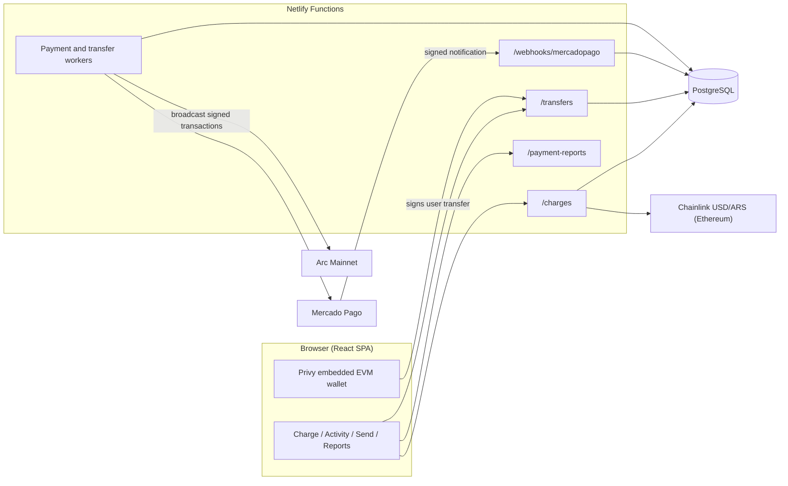

# MidatoPay × Arc: QR and voice payments

**Argentine merchants get paid in pesos through a Mercado Pago QR code and receive the proceeds in USDC on Arc.**

The customer pays in ARS with a Mercado Pago QR code. MidatoPay verifies the payment server-side, and a treasury sends the equivalent amount in USDC, net of a 0.5% fee, to the merchant's Arc wallet. Every settlement carries an on-chain memo (Arc Memo contract) with the charge reference, the ARS amount and the exchange rate.

The merchant logs in with email or phone, and the app creates an embedded EVM wallet for them. From there they can charge and send USDC by typing or speaking, for example "cobrar 5000 pesos" ("charge 5000 pesos") or "enviar 1 dólar a katy" ("send 1 dollar to katy"). Every operation settles on Arc and can be verified on the Arc explorer.

- Repository: `github.com/MidatoPay/arc`
- Network: **Arc Mainnet** (chain ID `5042`)
- Settlement asset: USDC, Arc's native gas token, moved through its ERC-20 interface (`0x3600000000000000000000000000000000000000`, 6 decimals)
- Payment provider: Mercado Pago (Orders API, dynamic QR)
- Explorer: https://explorer.arc.io

---

## Table of contents

1. [Problem and product](#1-problem-and-product)
2. [Architecture](#2-architecture)
3. [Charge and settlement flow](#3-charge-and-settlement-flow)
4. [Fees and gas](#4-fees-and-gas)
5. [Arc and USDC](#5-arc-and-usdc)
6. [Installation and configuration](#6-installation-and-configuration)
7. [Commercial traction](#7-commercial-traction)
8. [Repository map](#8-repository-map)
9. [Further documentation](#9-further-documentation)

---

## 1. Problem and product

Small and mid-sized Argentine merchants are mostly paid in pesos, and many of them get paid by QR. Their problem is less about *how* they get paid and more about *what they can do with the money afterwards*. Pesos lose value between the sale and the moment the merchant uses that money, and paying a supplier in dollars is slow or simply not possible.

MidatoPay changes nothing at the counter. It changes what the merchant ends up holding:

| Actor | Experience |
|---|---|
| Customer | Scans a Mercado Pago dynamic QR code and pays in ARS, with no crypto wallet and no new app. |
| Merchant | Logs in with email or phone (Privy) and gets an Arc wallet automatically. Types or says the amount ("cobrar 5000 pesos"), shows the QR code, and sees "Payment received" followed by the USDC credit. |
| Platform | Verifies the payment with Mercado Pago, settles USDC from a prefunded treasury and records the fee. |

The app also includes:

- **Activity:** history with an Arc explorer link for every settlement.
- **Send:** USDC transfers to contacts or addresses (the sender pays Arc gas in USDC).
- **Voice charges.**
- **Contacts.**
- **Business profile** (see below).
- **Operations and commissions reports** for administrators (see below).
- **Languages:** English, Spanish and Chinese.

### Business name

- Each user can save or clear their business name under **Profile → Business name**.
- The name appears in Activity and in the QR header. If it is empty, the Privy user name is used instead.
- The `merchant_profiles` table links both names to the authenticated Privy DID (`db/migrations/20261016_merchant_profiles.sql`, included in `npm run db:migrate:payments`).
- The authenticated `/merchant-profile` endpoint returns the profile with GET and updates only `businessName` with PATCH.

### Administrator access

Users listed in `PAYMENTS_ADMIN_USER_IDS` open **More → Operations and commissions**. There they see the history of every merchant, with filters, totals and CSV export.

`GET /treasury` requires a valid Privy access token. Signed-in merchants receive the configuration and destination address needed by the app; only users in `PAYMENTS_ADMIN_USER_IDS` receive the treasury balance. Responses use `Cache-Control: private, no-store`. Charge creation and settlement read treasury liquidity directly on the server.

### RPC traffic and read caches

- `GET /quote` serves a validated Chainlink display quote, cached at the Netlify CDN for up to 60 seconds and bounded by the feed's remaining freshness. Errors and fallbacks are never cached. Charge creation still obtains and validates its own strict quote.
- `GET /balance` authenticates with Privy and selects the session's saved primary wallet server-side. It returns the USDC that can be moved through the ERC-20 interface (native balance truncated to 6 decimals). Snapshots stay private (`no-store`) and are shared internally for 10 seconds.
- The UI refreshes balances on entry, on return to a visible tab, and after operations, with a two-minute visible-tab fallback.
- Both RPC proxies require a current Privy token, bound bodies to 64 KiB and batches to 10, and allow only the methods the app needs. The Arc proxy (`/rpc`) allows read methods only: `eth_call` is limited to the USDC and Memo contracts, `eth_getBlockByNumber` only without full transactions, and writes or log scans are rejected. The Ethereum proxy (`/eth-rpc`) is restricted to the configured Chainlink contract and selectors. Each warm instance also limits authenticated users to 120 RPC operations per minute.

---

## 2. Architecture

- **Application:** a Vite + React SPA served by Netlify.
- **Backend:** Netlify Functions.
- **State:** PostgreSQL.
- **Settlement:** EIP-1559 transactions on Arc that call `Memo.memo(USDC, transfer(to, amount), keccak256(reference), memo)`. There is no custom contract; `ethers` v6 builds, signs and verifies transactions.



| Layer | Main files |
|---|---|
| Network and chain primitives | `src/network.js`, `src/chain.js`, `src/arc.js` |
| Frontend | `src/App.jsx`, `src/MercadoPagoCharge.jsx`, `src/transfers.js`, `src/scanTarget.js` |
| Charges and Mercado Pago | `netlify/functions/charges.js`, `lib/paymentService.js`, `lib/mercadopago.js`, `lib/merchantPos.js` |
| Webhook and payment worker | `netlify/functions/mercadopago-webhook.js`, `lib/paymentWorker.js` |
| Treasury | `lib/treasuryPayout.js` |
| User transfers | `netlify/functions/transfers.js`, `lib/transferChain.js`, `lib/transferService.js`, `lib/transferWorker.js` |
| Arc RPC | `lib/arcRpc.js`, `lib/rpcProxy.js`, `lib/reconcile.js` |
| Reports | `netlify/functions/payment-reports.js`, `lib/paymentReporting.js` |
| Data | `db/schema.sql`, `db/migrations/*.sql` |

---

## 3. Charge and settlement flow

1. **The merchant creates the charge.** They enter the amount in ARS. The server verifies their session and wallet, reads the ARS/USD rate from Chainlink, computes the fee and the USDC to deliver, and reserves that liquidity in the treasury.
2. **The QR code is generated.** MidatoPay creates a dynamic QR order in Mercado Pago, on the merchant's own point of sale. The rate stays locked for 15 minutes (see [Quote freshness](#quote-freshness)).
3. **The customer pays** in pesos by scanning the QR code.
4. **MidatoPay verifies the payment** with Mercado Pago, through the signed webhook and an order lookup. A payment only counts as paid if the amount, seller, point of sale and currency match exactly.
5. **The treasury settles in USDC.** The worker assigns the next treasury nonce under a database lock, signs the transaction and saves it before broadcasting. It sends the USDC to the merchant's Arc wallet and pays the gas, so the merchant needs nothing extra. The memo carries the charge reference, the ARS amount and the rate.
6. **Delivery is confirmed.** Arc finality is deterministic: a successful receipt is final. The charge becomes "delivered" and the fee is recorded exactly once. A reverted receipt, or a nonce consumed by another transaction, sends the charge to manual review instead of paying twice.

The merchant follows the progress on screen: QR code, "Payment received" and "USDC credited".

### Quote freshness

Every charge requires a current quote from the Chainlink USD/ARS feed:

- `CHAINLINK_MAX_AGE_SECONDS` sets the maximum accepted quote age. It is required and its value is **90000 seconds (25 hours)**: the feed's published heartbeat (86400 s) plus one hour of margin.
- If the latest round is older, the charge is rejected with `quote_stale`: no QR code is created and no liquidity is reserved.
- If the variable is missing or is not a positive integer, no charges are created.

---

## 4. Fees and gas

MidatoPay charges a **fixed 0.5% fee** on the peso amount of each charge.

- **Who pays it:** the merchant. It is deducted before converting to USDC.
- **The customer** pays exactly the QR amount, with no surcharge.
- **Settlement gas:** the treasury pays it in USDC. It keeps a 0.05 USDC gas reserve that is never counted as payout liquidity.
- **User transfers:** the sender pays Arc gas in USDC from the same balance. The recipient receives exactly the amount entered; an amount is sendable only if `amount + maximum gas` fits after in-flight transfers. The approval sheet shows the estimated fee.

**Example** (verified in `test/payments.test.js`):

| Item | Value |
|---|---|
| Customer pays | ARS 10,000.00 |
| Fee (0.5%) | ARS 50.00 |
| Amount converted | ARS 9,950.00 |
| Rate | 1,650 ARS per USD |
| Merchant receives | 6.030303 USDC |

---

## 5. Arc and USDC

### 5.1 Why Arc

- **USDC is the gas token.** Balances, payouts and fees are all in USDC; there is no second token to fund.
- **Deterministic finality.** A receipt is final, so delivery is recorded without probabilistic confirmations.
- **EVM tooling.** Standard EIP-1559 transactions, `ethers` and EVM wallets.
- **Embedded wallets.** Privy creates the EVM wallet at login, with no seed phrases.
- **On-chain traceability.** Every settlement links the Mercado Pago reference, the ARS amount and the exchange rate to a public transaction through the Memo contract.

### 5.2 Network constants (`src/network.js`)

| Item | Value |
|---|---|
| Chain ID | `5042` |
| Public RPC | `https://rpc.mainnet.arc.io` |
| Explorer | `https://explorer.arc.io` |
| USDC (ERC-20 interface, 6 decimals) | `0x3600000000000000000000000000000000000000` |
| Native USDC decimals | 18 |
| Memo contract | `0x5294E9927c3306DcBaDb03fe70b92e01cCede505` |
| Minimum fee per gas | 20 gwei |

### 5.3 Stack and tools

- `ethers` v6 for transactions, ABI encoding and receipts
- `viem` (only `defineChain` for the Privy chain object)
- Privy (`@privy-io/react-auth`, `@privy-io/server-auth`) with EVM embedded wallets
- PostgreSQL for charges, transfers, contacts and history
- Arc explorer links

Privy's SDK ships its own multi-chain code (including Solana screens and packages) inside `@privy-io/react-auth`; MidatoPay does not use or configure it.

### 5.4 How to verify a settlement

1. Open a delivered charge in **Activity** and follow its explorer link.
2. Confirm:
   - the USDC transfer from the treasury to the merchant's wallet;
   - the Memo event with `MIDATO|v1|inv:mp_…|kind:charge_mercadopago|…`;
   - a successful receipt (`status = 1`).
3. Compare the memo's `inv` with the Mercado Pago order reference, and its `amt` and `fx` fields with the charge.

---

## 6. Installation and configuration

Requirements:

- Node.js 22
- npm
- a Privy app with EVM embedded wallets
- PostgreSQL
- a Mercado Pago seller account

### 6.1 Quick start (frontend only)

```bash
npm install
cp .env.example .env   # fill in the keys (see the table below)
npm run dev            # http://localhost:5173
```

### 6.2 Full environment (frontend + Functions + charges)

```bash
npm ci
cp .env.example .env
npm run payments:env          # adds missing payment variables
npm run db:migrate:payments   # applies the migrations to the configured database
npm run payments:check        # read-only configuration check
npm run dev:full              # Vite + Functions at http://localhost:8888
npm test                      # unit and integration tests (PGlite, mocked RPC)
```

Use `.env.production.example` as the checklist for the Netlify **Production** context. Never commit a completed file.

### 6.3 Environment variables

| Variable | Purpose |
|---|---|
| `VITE_PRIVY_APP_ID`, `PRIVY_APP_SECRET` | Privy app |
| `VITE_ARC_NETWORK` | `mainnet` (the only supported value) |
| `ARC_RPC` | Arc RPC for Functions (server-side; may include a provider API key) |
| `VITE_ARC_RPC` | Public Arc RPC used by the Privy wallet in the browser (empty = `https://rpc.mainnet.arc.io`) |
| `TREASURY_SECRET_KEY` | Treasury EVM private key, `0x` + 64 hex (server-side only) |
| `MP_ENVIRONMENT`, `MP_ACCESS_TOKEN`, `MP_USER_ID`, `MP_STORE_ID`, `MP_WEBHOOK_SECRET` | Mercado Pago |
| `ETH_RPC_URL`, `VITE_ETH_RPC` | Chainlink USD/ARS quote on Ethereum Mainnet |
| `CHAINLINK_MAX_AGE_SECONDS` | Maximum quote age: `90000` (25 h) |
| `CONVERSION_FEE_BPS` | `50` |
| `PAYMENTS_BASE_URL`, `INTERNAL_WORKER_SECRET` | Payment worker |
| `PAYMENTS_ENABLED` | Enables charges |
| `PAYMENTS_ADMIN_USER_IDS` | Administrators |
| `TRANSFERS_ENABLED`, `TRANSFERS_ALLOWED_USER_IDS` | User USDC transfers and production pilot |
| `AIVEN_PG_URL`, `AIVEN_PG_CA_CERT` | PostgreSQL |
| `ANTHROPIC_API_KEY` | Voice parsing (optional) |

### 6.4 Configure Privy

1. Go to https://dashboard.privy.io and create an app.
2. Under **Login methods**, enable Email and SMS.
3. Under **Embedded wallets**, enable automatic creation of **Ethereum (EVM)** wallets.
4. Under **Domains**, add `http://localhost:5173`, `http://localhost:8888` and the deployment domain.
5. Copy the App ID into `VITE_PRIVY_APP_ID`.

The production go-live guide is in `docs/MERCADOPAGO_PRODUCCION.md`.

USDC sends through manual entry, QR and voice use the user's primary Privy wallet (index 0). The server prepares the exact transaction, the embedded wallet signs it without a pop-up after the in-app approval sheet, and the server verifies and stores it before the worker broadcasts it. General access defaults to disabled; `TRANSFERS_ALLOWED_USER_IDS` enables selected Privy users for a production pilot. See the [transfer operations guide](docs/USDC_TRANSFERS.md).

---

## 7. Commercial traction

The `business-lois/` folder contains two letters of intent: one from a distribution channel and one from a merchant.

**Deenex Technologies S.A.S.** (16 May 2026, `business-lois/Carta_Intencion_Deenex_MidatoPay.pdf`). Deenex is an omnichannel platform for food-service chains in Argentina. In the letter, Deenex intends to:

- offer MidatoPay to its whole network, which currently has **500 active locations** and is projected to reach 2,000 by December 2026;
- support MidatoPay with a pilot, training and merchant onboarding.

**Supermercado Soler** (26 November 2025, `business-lois/Carta_Intencion_Wang_Midatopay.pdf`), signed by its owner. In the letter, the supermarket:

- states its formal interest in MidatoPay as a tool to protect the value of its daily cash against inflation and devaluation, by converting peso revenue into digital dollars (stablecoins);
- highlights MidatoPay's model of **pooled volume purchasing with other supermarkets**, which could offer better conversion rates and operational benefits;
- asks for a product demo and wants to evaluate a pilot in its operations.

---

## 8. Repository map

```
src/                     React SPA and shared Arc primitives
netlify/functions/       HTTP and scheduled Functions
netlify/functions/lib/   Payment core, workers, Mercado Pago client, treasury, Arc RPC
db/                      Schema and migrations
scripts/                 Environment setup, checks and migrations
test/                    Tests
docs/                    Operations and integration guides
business-lois/           Letters of intent (Deenex, Supermercado Soler)
```

---

## 9. Further documentation

- [`datosadicionales.md`](datosadicionales.md): why MidatoPay fits Arc, covering its capabilities, commercial proposition and adoption potential.
- [`docs/MERCADOPAGO_PRODUCCION.md`](docs/MERCADOPAGO_PRODUCCION.md): operations guide for Mercado Pago → USDC (Spanish).
- [`docs/USDC_TRANSFERS.md`](docs/USDC_TRANSFERS.md): primary wallet, USDC sends, production pilot and recovery (Spanish).
- [`docs/arc-migration/`](docs/arc-migration/): migration plan, target architecture and Arc research.
- [`ARC-RULES.md`](ARC-RULES.md): Arc engineering rules.
