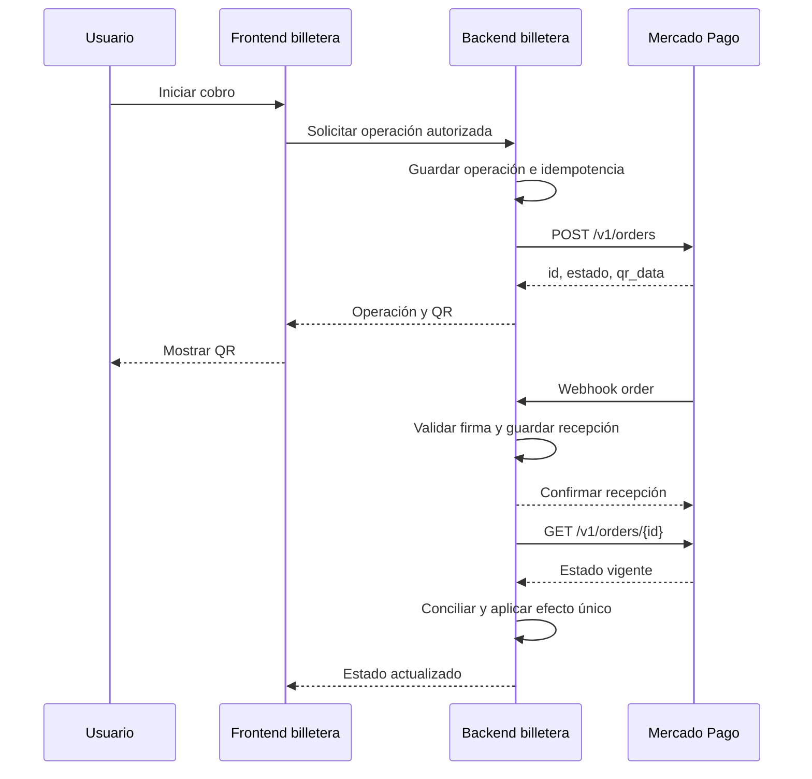

# Contexto para Codex: cobros con QR de Mercado Pago en producción

Fecha: 2026-10-13. País de esta integración: Argentina; moneda: ARS.
Proyecto de referencia: `C:\midatopay\code\mercadopagoTest`.
Destino: otro proyecto del usuario que ya muestra QR para cobros y funciona como prueba de una billetera virtual.

## 1. Pedido que debe ejecutar Codex en el proyecto destino

Adaptar la acción existente **Iniciar cobro / Cobrar** para que cree una orden QR dinámica en la cuenta productiva de Mercado Pago y muestre el QR devuelto por esa API. Vincular la orden a la operación interna y actualizarla cuando el proveedor confirme el pago.

Primero inspeccionar el repositorio destino, sus instrucciones, backend, autenticación, persistencia, componente QR y flujo de cobros. Implementar dentro de sus patrones existentes. La tecnología de ese proyecto no se conoce en esta sesión; no asumir que también usa Node.js.

Este archivo es contexto de implementación. Los IDs, rutas locales y nombres de comandos del laboratorio sirven como referencia; verificar su aplicabilidad al destino. Mantener la autorización y el cálculo del monto en el backend. Preparar y probar el código sin generar ni pagar cobros reales como parte de una prueba automatizada.

Resultado esperado:

- El usuario inicia un cobro y recibe un QR dinámico de Mercado Pago para esa operación.
- El QR contiene la trama `type_response.qr_data`, sin reemplazarla por un QR genérico de la billetera, un JSON interno, una dirección de wallet o una URL de Checkout.
- La pantalla identifica la operación y muestra su estado.
- Un Webhook válido dispara la conciliación con la API.
- La operación se acredita una sola vez, según el modelo de negocio de la aplicación y después de confirmar el pago.
- Los errores de configuración se muestran con una indicación útil.

## 2. Lo que se hizo y lo que está comprobado

Se creó un laboratorio desde una carpeta vacía. Usa Node.js, servidor HTTP propio, API REST de Mercado Pago mediante fetch y la dependencia `qrcode@1.5.4` para producir SVG. El runtime observado fue Node.js 24.19.0 en Windows/PowerShell.

Se implementaron órdenes, consulta de estado, firma del Webhook, historial local y scripts de sucursal/caja. La última ejecución de pruebas de esta sesión pasó **19 pruebas automatizadas**, usando proveedor simulado.

### Recursos observados en los archivos locales al preparar este documento

| Recurso | Prueba | Producción |
|---|---|---|
| ID interno de sucursal | `82057713` | `88627668` |
| ID externo de caja | `PRUEBAPOS001` | `PRODPOS001` |
| ID interno de caja | `139423599` | No se documentó en esta sesión |
| Archivo de sucursal | `scripts/store.json` | `scripts/store.production.json` |
| Archivo de caja | `scripts/pos.json` | `scripts/pos.production.json` |

Estos IDs no son contraseñas, pero pertenecen a cuentas concretas. Solo reutilizar los productivos si la billetera cobrará en la misma cuenta vendedora. No crear nuevas sucursales por cada cobro.

Al inspeccionar el laboratorio al cierre:

- `MP_EXTERNAL_POS_ID` estaba configurado como `PRODPOS001`.
- El User ID configurado coincidía con el vendedor de la última orden registrada.
- Había un valor configurado para el secreto del Webhook; no se validó su correspondencia con la aplicación.
- Se habían creado órdenes con la caja productiva y se había recibido `type_response.qr_data`.
- Última orden registrada: `ORD01M4VNZ2TTZMHVT2MPS4K5MQKK`, monto `15.00`, estado `created / created`.
- No había eventos `webhook` ni órdenes `processed / accredited` en el historial local.

**La creación de QR está comprobada; un pago productivo acreditado y la recepción real del Webhook todavía no quedaron comprobados.** Estos datos son una lectura del historial local, no una nueva consulta en vivo.

## 3. Cuenta que recibe el dinero y significado de las credenciales

| Variable o dato | Función |
|---|---|
| `MP_ACCESS_TOKEN` | Credencial privada del servidor para operar en la cuenta vendedora |
| `MP_USER_ID` | User ID/collector ID del vendedor al crear su sucursal |
| `MP_EXTERNAL_POS_ID` | `external_id` elegido para la caja, usado en las órdenes |
| `MP_WEBHOOK_SECRET` | Clave de firma generada en la configuración de Webhooks |
| Public Key | Credencial pública usada en otros flujos desde el frontend; no se requiere en este flujo REST del servidor |
| Client ID / Client Secret | Credenciales de aplicación para OAuth; no sustituyen directamente al Access Token del vendedor |
| `APP_PASSWORD` | Protección HTTP Basic del laboratorio; no es una credencial de Mercado Pago |

El token, el vendedor, la sucursal y la caja deben corresponder entre sí. Un token productivo no accede automáticamente a la caja del vendedor de prueba. El prefijo `APP_USR` tampoco permite determinar por sí solo el ambiente.

Para el destino, almacenar secretos en su configuración privada del backend. No incluirlos en variables públicas, JavaScript del navegador, logs, Git ni este documento. Reiniciar o desplegar de nuevo el proceso que carga la configuración cuando se cambie.

Si los usuarios de la billetera cobrarán en cuentas Mercado Pago distintas, se necesita un diseño por vendedor y autorización OAuth. No asignar a todos un único token suponiendo que cobrará cada usuario. El dinero se recibe en la cuenta Mercado Pago identificada por el token; la acreditación del saldo interno de la billetera requiere su propia regla de negocio.

[Credenciales oficiales](https://www.mercadopago.com.ar/developers/es/docs/your-integrations/credentials).

### Ejemplo de configuración privada para el destino

```dotenv
MP_ACCESS_TOKEN=COMPLETAR_EN_EL_SERVIDOR
MP_USER_ID=USER_ID_DEL_VENDEDOR_REAL
MP_EXTERNAL_POS_ID=PRODPOS001
MP_WEBHOOK_SECRET=SECRETO_DEL_WEBHOOK_DE_LA_APP_PRODUCTIVA
```

Los valores son marcadores, no credenciales válidas. `PRODPOS001` solo corresponde si se utiliza la cuenta del laboratorio.

Separar las configuraciones y los registros de prueba/producción en el destino. El laboratorio separa archivos de setup, pero utiliza un solo `.env` activo y un historial compartido: no copiar esa limitación a la billetera.

## 4. Preparación de sucursal y caja

La cuenta vendedora necesita una sucursal y una caja atendida. Para prepararlas se usan:

```text
POST https://api.mercadopago.com/users/{MP_USER_ID}/stores
POST https://api.mercadopago.com/v2/pos
GET  https://api.mercadopago.com/v2/pos?external_id=PRODPOS001&limit=30
```

La sucursal incluye nombre, identificador externo y ubicación real. Latitud/longitud son números JSON. La caja debe vincularse a la sucursal del mismo vendedor:

```json
{
  "name": "Caja principal",
  "store_id": "ID_DE_SUCURSAL_REAL",
  "external_id": "PRODPOS001",
  "config": {
    "qr": {
      "operating_mode": "pdv"
    }
  }
}
```

`store_id` e ID interno de caja son distintos de `external_id`. En la orden se envía el último como `config.qr.external_pos_id`.

El setup del laboratorio busca primero la caja por ID externo, comprueba la sucursal y la reutiliza. Si un POST devuelve `409 pos_already_exists`, vuelve a buscarla para cubrir una creación concurrente. No oculta otros errores.

[Crear sucursal y caja](https://www.mercadopago.com.ar/developers/es/docs/qr-code/create-store-and-pos).
[Buscar cajas del vendedor autenticado](https://www.mercadopago.com.ar/developers/es/reference/in-person-payments/qr-code/pos/search-pos/get).

### Consulta del titular del token

Se agregó `scripts/account.js`: lee el token de `.env`, consulta:

```text
GET https://api.mercadolibre.com/users/me
Authorization: Bearer <MP_ACCESS_TOKEN>
```

Valida el `id` devuelto y actualiza `MP_USER_ID` sin cambiar otras variables. Si falla, no escribe. Solo imprime el identificador, no el perfil completo.

No deducir ni guardar el vendedor a partir de fragmentos del token. La consulta autenticada o Datos de integración son las referencias a verificar.

[Ejemplo oficial de consulta autenticada](https://www.mercadopago.com.ar/developers/es/docs/split-payments/additional-content/your-integrations/credentials).

### Comandos existentes en el laboratorio

Ejecutar desde su carpeta, uno por uno, y continuar solo después del éxito:

```powershell
npm run account:sync
npm run setup:store:production
npm run setup:pos:production
npm start
```

El comando de sucursal realiza una creación y guarda su ID en el archivo de caja del perfil seleccionado. No repetirlo si la sucursal ya existe. La caja sí tiene búsqueda/reutilización.

Los nombres `:production` seleccionan archivos de configuración; el ambiente efectivo depende de las credenciales cargadas. El destino debe verificar esa coherencia.

## 5. Crear el QR al iniciar un cobro

Decisión de esta sesión: usar **Orders API, type qr, modo dynamic**, para obtener un QR único por operación.

```text
POST https://api.mercadopago.com/v1/orders
Authorization: Bearer <ACCESS_TOKEN_PRODUCTIVO>
Content-Type: application/json
X-Idempotency-Key: <CLAVE_PERSISTIDA_PARA_ESTE_COBRO>
```

Ejemplo construido para el proyecto:

```json
{
  "type": "qr",
  "total_amount": "15.00",
  "description": "Cobro de la billetera",
  "external_reference": "cobro_01_abc123",
  "expiration_time": "PT15M",
  "config": {
    "qr": {
      "external_pos_id": "PRODPOS001",
      "mode": "dynamic"
    }
  },
  "transactions": {
    "payments": [
      { "amount": "15.00" }
    ]
  }
}
```

El ejemplo es un contrato ilustrativo; el servidor debe obtener el monto y el vendedor de una operación autorizada. Guardar la operación interna antes de contactar al proveedor.

Capturar como mínimo:

```text
response.id
response.external_reference
response.status
response.status_detail
response.transactions.payments[0].id
response.type_response.qr_data
```

El QR se codifica **exactamente** con `response.type_response.qr_data`. El laboratorio usa:

```javascript
await QRCode.toString(qrData, { type: 'svg', margin: 4, width: 320 });
```

Puede mantenerse el componente QR del destino si admite esa cadena y conserva una imagen legible.

[Referencia de creación de orders QR](https://www.mercadopago.com.ar/developers/es/reference/in-person-payments/qr-code/orders/create-order/post).
[Procesamiento de pagos QR](https://www.mercadopago.com.ar/developers/es/docs/qr-code/payment-processing).

### Validación y reintentos a adoptar

- Utilizar importes positivos, representados como strings decimales consistentes. El laboratorio limita a dos decimales; el destino debe calcular en centavos o con una librería decimal, no con aritmética binaria para el saldo.
- Mantener `total_amount` y el importe de la transacción coherentes.
- Descripción de hasta 150 caracteres y referencia única de hasta 64; no enviar datos personales en esos campos.
- La referencia admite letras, números, guion y guion bajo.
- Persistir la clave de idempotencia junto a la operación. Reutilizar clave y body para el mismo cobro tras un timeout.
- Una nueva operación, cambio de monto o cambio de cuenta/ambiente requiere una nueva intención y una nueva clave.
- Si no vuelve una trama QR, registrar el fallo de creación y no mostrar como cobrable un QR inventado.
- Conservar la trama obtenida al crear: las consultas posteriores pueden no incluirla.
- Mostrar vencimiento y permitir generar una nueva intención una vez vencida, conservando trazabilidad de la anterior.

Las reglas de persistencia y de saldo son propuestas de adaptación a la billetera, no funcionalidades ya implementadas en el laboratorio.

### Diferencias con ejemplos antiguos

No iniciar esta integración nueva con las rutas legacy `/instore/.../qrs`. La sesión adoptó `POST /v1/orders`. En este flujo, las notificaciones se configuran en el panel: no se envía `notification_url` en el body de la orden. El QR dinámico se encuentra en `type_response.qr_data`.

[Guía oficial de migración](https://www.mercadopago.com.ar/developers/es/docs/qr-code/resources/migrate-dynamic-qr-model-to-orders).

## 6. Flujo de la billetera y persistencia propuesta



Para producción se propone un registro durable de recepción y un worker. El laboratorio consulta la API y escribe el historial antes de responder al Webhook; no implementa esa cola.

Campos propuestos para integrar en las entidades existentes:

```text
internal_operation_id
authenticated_user_id
seller_or_merchant_id
environment
amount_minor_units
currency
external_reference
idempotency_key
mercadopago_order_id
mercadopago_transaction_id
qr_data
provider_status
provider_status_detail
created_at
expires_at
last_reconciled_at
ledger_effect_id
```

No es un esquema obligatorio. Adaptar al modelo del destino y sus restricciones únicas. No permitir que el cliente elija arbitrariamente la cuenta que recibe el cobro o consulte órdenes ajenas.

La pantalla puede leer el estado del backend mediante polling moderado, SSE o el mecanismo existente. No entregar el Access Token al frontend para consultar Mercado Pago.

## 7. Webhook y conciliación

Ruta elegida en el laboratorio:

```text
POST /webhooks/mercadopago
```

En la aplicación productiva de la cuenta real configurar una URL HTTPS alcanzable y el evento **Order (Mercado Pago)**. Guardar el secreto generado en `MP_WEBHOOK_SECRET`. Es independiente del Access Token y del Client Secret.

La configuración de Webhooks de prueba QR tiene una particularidad: la documentación indica ingresar como Seller Test User y configurar Modo productivo en esa cuenta de prueba. Eso no convierte sus órdenes en órdenes de la cuenta real.

Los eventos contemplados incluyen procesamiento, cancelación, expiración y reembolso. Una notificación es una señal para conciliar; no basta su texto para acreditar saldo.

[Notificaciones de Orders QR](https://www.mercadopago.com.ar/developers/es/docs/qr-code/notifications).

### Verificación implementada en el laboratorio

1. Tomar `data.id` del query de la URL, `x-request-id` y `x-signature`.
2. Extraer `ts` y `v1`; validar su formato.
3. Convertir el ID usado en el cálculo a minúsculas.
4. Construir el manifest:

```text
id:<data.id_en_minusculas>;request-id:<x-request-id>;ts:<ts>;
```

5. Calcular HMAC-SHA256 con el secreto y comparar en tiempo constante.
6. Comprobar `type=order` y que el ID del body coincida con el de la URL.
7. Consultar la orden autenticada; comparar ID, referencia y monto con la operación guardada.

El código exige todos esos campos y rechaza firma inválida o secreto ausente con 401. Verificar el contrato actual del proveedor o usar su validador oficial al portarlo. No convertir un 401 en una aceptación indiscriminada si llegan eventos con otro formato.

Se observó una discrepancia documental: una nota del SDK oficial menciona QR sin firma, mientras la documentación específica de **Orders QR** describe firma. No se comprobó ese caso con una notificación real. Investigar los headers recibidos y el tipo de integración; no asumir que el flujo legacy coincide con Orders QR.

### Adaptaciones necesarias para la billetera

- Registrar durablemente los eventos válidos antes de confirmar su recepción.
- Deduplicar recepción y efectos contables por identificadores estables, no solo por `x-request-id`.
- Consultar el estado vigente para manejar eventos repetidos o fuera de orden.
- Verificar también cuenta vendedora, moneda y transacción esperada.
- Aplicar el cambio de operación y el movimiento de saldo en una transacción de base de datos con unicidad.
- No aplicar un segundo crédito ante el mismo pago ni ante una consulta manual.
- Tratar las devoluciones según las reglas del ledger del destino; no ignorarlas ni generar débitos repetidos.
- Si hay un timeout de creación, resolver la misma intención con su idempotencia; no descartarla y crear otra a ciegas.
- Si un evento llega antes de registrar la respuesta de creación, conservarlo para reintentar conciliación.

El laboratorio ignora eventos de órdenes que no están en su Map y responde 200. Esa simplificación no resuelve la carrera anterior y no debe copiarse como política de producción.

## 8. Consulta de estado y significado del resultado

```text
GET https://api.mercadopago.com/v1/orders/{order_id}
Authorization: Bearer <ACCESS_TOKEN_DEL_VENDEDOR_CORRECTO>
```

[Referencia de consulta](https://www.mercadopago.com.ar/developers/es/reference/in-person-payments/qr-code/orders/get-order/get).

En el laboratorio, el estado visual “Pago acreditado” requiere `status=processed` y `status_detail=accredited`, obtenidos mediante la API. El destino debe contrastar también los datos de la transacción y el importe confirmado antes de aplicar su efecto de saldo.

| Situación | Tratamiento de implementación |
|---|---|
| `created` / `ready_to_process` | QR generado o pendiente; no acreditar |
| `processed` / `accredited` | Conciliar identidad e importe; aplicar un único efecto autorizado |
| `expired` | Mostrar vencimiento; no acreditar |
| `canceled` | Mostrar cancelación; no acreditar |
| `refunded` | Conciliar devolución y su efecto según el ledger |

La documentación de migración aclara que los intentos rechazados pueden no exponerse en Orders QR y la orden puede permanecer `created`. Por tanto, ese estado **no demuestra que no hubo un error al escanear o intentar pagar**.

[Modelo de estados de Orders frente a legacy](https://www.mercadopago.com.ar/developers/es/docs/qr-code/resources/migrate-dynamic-qr-model-to-orders).

## 9. Errores encontrados y aprendizajes

| Error o síntoma | Evidencia y respuesta de esta sesión |
|---|---|
| `409 pos_already_exists` | La caja ya había sido creada. Se agregó búsqueda y reutilización; recuperar también la carrera GET/POST |
| `pos_not_found` para `PRUEBAPOS001` | Apareció al cambiar al token productivo manteniendo la caja de prueba. Se prepararon recursos separados con `PRODPOS001` |
| `403 forbidden` al crear sucursal | Se comprobó que MP_USER_ID seguía siendo el vendedor de prueba. Se agregó account:sync; otros problemas de permisos pueden requerir revisión de cuenta |
| “Algo salió mal” al escanear en la app | La orden se creó, el CRC de la trama era correcto y no estaba vencida durante la consulta. Se explicó el uso del comprador de prueba. No se estableció una causa definitiva de ese mensaje |
| Falta de notificaciones | Inicialmente faltaba MP_WEBHOOK_SECRET. Después apareció configurado, pero el historial inspeccionado no registró Webhooks |
| Assertion de Node/libuv en Windows | Aparecía después de excepciones sin manejar. Se agregaron catch y process.exitCode en CLI; no se probó la causa nativa ni una corrección definitiva de libuv |

Cuando la app falla al escanear, revisar cuenta comprador/vendedor, ambiente, país, vigencia y trama. Un QR íntegro no prueba que la cuenta pueda pagarlo.

Para pruebas, el comprador inicia sesión en la app móvil con el usuario/contraseña de **Cuentas de prueba → Comprador** del panel; si pide verificación por correo usa el código de seis dígitos mostrado en esa cuenta. En producción se usan cuentas reales y dinero real.

[Uso de cuentas de prueba](https://www.mercadopago.com.ar/developers/es/docs/qr-code/resources/test-accounts).
[Prueba de compra QR](https://www.mercadopago.com.ar/developers/es/docs/qr-code/test-integration/test-purchase).

### Diagnóstico útil en el destino

Guardar de forma privada el status HTTP, códigos del proveedor, ID de orden, referencia y fecha. No registrar tokens, contraseñas o perfil personal completo. Mostrar al usuario una explicación accionable, no siempre “reintentá”: cambiar la cuenta/caja o corregir permisos no se soluciona repitiendo el mismo request.

Ante 403, primero verificar el titular y permisos; no crear una cadena de retries automáticos. En 409 de creación de caja comprobar el código específico antes de reutilizar. No confundir conflictos de idempotencia de cobros con una caja duplicada.

## 10. Túnel HTTPS utilizado en desarrollo

El usuario abrió el puerto 3000 con VS Code y compartió:

```text
https://j14rmr62-3000.brs.devtunnels.ms/
https://j14rmr62-3000.brs.devtunnels.ms/webhooks/mercadopago
```

Se indicó **Puertos → 3000 → Visibilidad del puerto → Público** para permitir la solicitud del proveedor. Mantener servidor y túnel activos.

La accesibilidad externa no pudo verificarse desde las herramientas de esta sesión por restricciones de red. No asumir que esa URL sigue activa ni copiarla como URL final del otro proyecto. Configurar el receptor del backend destino; el QR no depende de incluir esta URL.

El laboratorio protege su pantalla/API con Basic Auth; el Webhook usa firma y no requiere esa contraseña. En el destino usar su autenticación existente.

[Port forwarding de VS Code](https://code.visualstudio.com/docs/debugtest/port-forwarding).

## 11. Código de referencia disponible

Si la siguiente sesión tiene acceso a esta máquina, puede leer:

```text
C:\midatopay\code\mercadopagoTest\src\core.js
C:\midatopay\code\mercadopagoTest\src\server.js
C:\midatopay\code\mercadopagoTest\scripts\account.js
C:\midatopay\code\mercadopagoTest\scripts\setup.js
C:\midatopay\code\mercadopagoTest\public\app.js
C:\midatopay\code\mercadopagoTest\test\account.test.js
C:\midatopay\code\mercadopagoTest\test\core.test.js
C:\midatopay\code\mercadopagoTest\test\http.test.js
C:\midatopay\code\mercadopagoTest\test\setup.test.js
```

| Ruta del laboratorio | Responsabilidad |
|---|---|
| POST /api/orders | Crear orden con clave de idempotencia y referencia |
| GET /api/orders | Listado local |
| GET /api/orders/{id} | Consultar proveedor y guardar estado |
| GET /api/orders/{id}/qr | Convertir la trama en SVG |
| GET /api/events | Últimos 100 eventos |
| GET /api/config | Presencia de configuración, sin secretos |
| POST /webhooks/mercadopago | Validación y conciliación |

El laboratorio guarda snapshots en `data/events.jsonl` y reconstruye el Map al iniciar. Su panel lee datos locales cada tres segundos; el botón de consulta llama a Mercado Pago. No hay base de datos, cola, ledger, multiusuario ni múltiples procesos. El frontend conserva el intento solo en memoria y podría perder su idempotencia al recargar.

Adoptar el contrato y los aprendizajes; reemplazar esas simplificaciones por los mecanismos del proyecto destino.

La instalación de dependencias tuvo restricciones de red; se preparó qrcode desde una instalación local y se generó package-lock. Eso es un detalle del entorno del laboratorio, no una dependencia funcional del nuevo proyecto.

## 12. Verificación que debe completar la siguiente sesión

### Pruebas automatizadas propuestas para el destino

1. Iniciar un cobro autorizado crea una sola intención y usa el vendedor productivo configurado.
2. Monto inválido o acceso a una operación ajena se rechaza antes de llamar al proveedor.
3. Se renderiza la trama QR exacta devuelta, vinculada a esa intención.
4. Un retry tras timeout conserva referencia, clave y body.
5. Un cambio de monto/cuenta produce una intención nueva.
6. Firma inválida no actualiza operación ni saldo.
7. Webhook válido consulta la orden y verifica sus datos.
8. Eventos repetidos o fuera de orden no producen un doble movimiento.
9. Un evento adelantado a la respuesta de creación no se pierde.
10. Expiración/cancelación no acreditan; reembolso se concilia según el ledger.
11. Los errores pos_not_found, 403 y 409 se diagnostican sin exponer secretos.
12. La recarga del frontend y el reinicio del backend preservan la relación cobro/orden.
13. Los registros de prueba y producción no se mezclan en consultas o acreditaciones.

### Verificaciones reales pendientes

Comprobar la cuenta y caja productiva con consultas autenticadas, la ruta HTTPS del destino y el secreto de su aplicación. Verificar que una notificación auténtica pueda recibirse y conciliarse.

La aceptación funcional final requiere un pago productivo confirmado, usando el procedimiento que el usuario autorice para la billetera. Este archivo no acredita que esa compra haya ocurrido ni autoriza a Codex a pagar automáticamente con una cuenta real.

### Criterio de finalización

La acción de cobro muestra el QR dinámico de la orden productiva correcta; la operación interna queda trazable; un pago confirmado se refleja una sola vez en la aplicación; quedan comprobados los fallos y reintentos relevantes. Si faltan credenciales, acceso HTTPS o datos del vendedor, informar el dato concreto pendiente después de completar el código y su verificación simulada.
