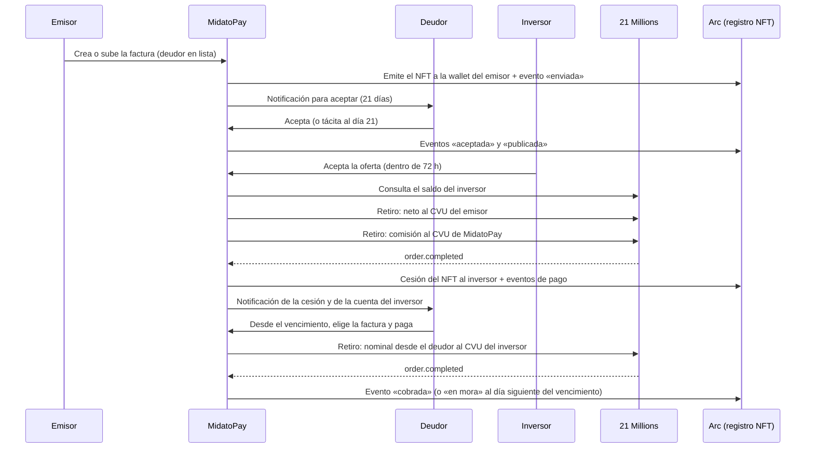
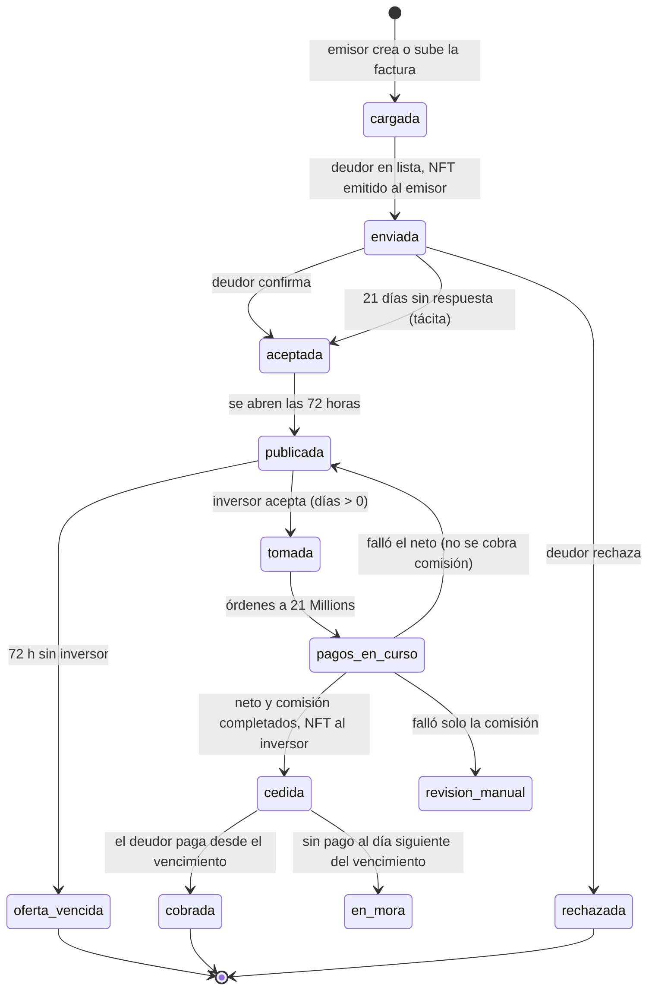

# Piloto de cesión de facturas a un inversor: decisiones

Fecha: 11/11/2026. Branch: `factoring`. Estado: decisiones del piloto; plan en revisión (`PLAN_PILOTO_CESION.md`).

Este documento reemplaza el modelo de pools de liquidez de `FACTORING_HANDOFF.md` (secciones 5.4 a 5.6, 8.7, 9 y decisiones FD-08 a FD-13) y de `EJEMPLO_FINANCIERO.md` (secciones 4.2 y 6). El resto del handoff (QR fiscal, ARCA, marco legal, convenciones del repo) sigue vigente.

Marcas: **[V]** verificado en una fuente oficial o primaria; **[S]** fuente secundaria o a confirmar; **[P]** propuesta. Nada de este documento es asesoramiento legal.

## 1. Decisiones

| Tema | Decisión |
|---|---|
| Pools de liquidez | Descartados por motivos regulatorios. Sin tramos, first loss ni fondeo previo |
| Modelo | Una factura se cede a un único inversor, sin fracciones. Emisor e inversor negocian. Al deudor se le notifica la cesión |
| Facturas | Se crean con un formulario (marcadas «SIMULADA») o se sube el archivo y se lee el QR fiscal. La constatación en ARCA (WSCDC) es configurable. Montos mínimos para la prueba |
| Deudores | Lista curada con CUIT reales que va a pasar el usuario. Se guardan como datos del servidor, fuera del repo. Los deudores tienen cuenta en MidatoPay |
| Aceptación del deudor | Expresa, o tácita a los 21 días desde la emisión. Puede confirmar antes y puede rechazar |
| Publicación | Cuando el deudor acepta, de forma expresa o tácita. Desde ahí el inversor tiene 72 horas para tomarla. Si nadie la toma, la oferta vence |
| Inversores | Usuarios de MidatoPay habilitados por una lista del servidor, con KYC marcado como aprobado a mano y cuenta de 21 Millions (CVU) registrada en MidatoPay. Esa es la cuenta de la cesión: ahí paga el deudor |
| Precio | Tasa de descuento de 35% TNA vencida, base 365, desde la acreditación hasta el vencimiento de la factura. La acreditación ocurre en el momento en que el inversor acepta |
| Plazo mínimo | Ninguno. Se bloquea solo si al aceptar quedan 0 días o menos hasta el vencimiento |
| Comisión de MidatoPay | 2,5% del descuento, a cargo del inversor. El emisor paga exactamente el 35% TNA. Se cobra en el instante de la acreditación |
| Pagos | Dinero real, en pesos, fuera de la cadena. Al aceptar, MidatoPay ordena automáticamente dos transferencias desde la cuenta de 21 Millions del inversor: el neto al CVU del emisor y la comisión al CVU de MidatoPay. Desde la fecha de vencimiento, el deudor elige en la app la factura que paga y se transfiere el nominal desde su cuenta al CVU del inversor. Si no paga, la factura pasa a mora al día siguiente del vencimiento |
| NFT | Un ERC-721 real por factura en Arc Mainnet. Funciona como registro público de los contratos, las emisiones y lo que debería suceder. Se emite a la wallet del emisor cuando la factura se envía al deudor. Solo la clave de cesión de MidatoPay puede transferirlo, y lo pasa automáticamente al inversor cuando se completa el pago al emisor. El emisor no firma nada: acepta esa condición en el contrato marco |
| Datos on-chain | Hashes de documentos (contrato marco, anexo de cesión, factura, términos), estados, fechas y montos visibles (nominal, descuento, comisión, vencimiento). Ningún dato personal: sin CUIT ni nombres |
| Eventos on-chain | Todo el ciclo: enviada, aceptada (expresa o tácita), rechazada, publicada, oferta vencida, tomada, pagos confirmados, cedida, cobrada, en mora. Unas 7 u 8 transacciones por factura, con gas en USDC pagado por MidatoPay |
| Herramientas del contrato | Foundry con el ERC-721 de OpenZeppelin |

## 2. Cálculo

Fórmulas, con `N` el nominal de la factura y `días` el plazo desde la acreditación hasta el vencimiento:

- `x = 0,35 × días / 365`
- Descuento: `D = N − N / (1 + x)`. Es el costo del emisor.
- Acreditación al emisor: `N − D`.
- Comisión de MidatoPay: `0,025 × D`, pagada por el inversor al acreditar.
- Desembolso del inversor: `N − D + 0,025 × D`. Cobra `N` al vencimiento.
- Ganancia del inversor: `0,975 × D`.
- TNA del inversor: `ganancia / desembolso × 365 / días`.

### 2.1 Factura de ARS 100

| Concepto | 30 días | 60 días | 90 días |
|---|---|---|---|
| Descuento total | 2,7963 | 5,4404 | 7,9445 |
| Acreditación al emisor | 97,2037 | 94,5596 | 92,0555 |
| Comisión MidatoPay | 0,0699 | 0,1360 | 0,1986 |
| Desembolso del inversor | 97,2736 | 94,6956 | 92,2541 |
| Ganancia del inversor | 2,7264 | 5,3044 | 7,7459 |
| TNA del inversor | 34,10% | 34,08% | 34,05% |

### 2.2 Factura de ARS 17.000.000

| Concepto | 30 días | 60 días | 90 días |
|---|---|---|---|
| Descuento total | 475.366,18 | 924.870,47 | 1.350.567,47 |
| Acreditación al emisor | 16.524.633,82 | 16.075.129,53 | 15.649.432,53 |
| Comisión MidatoPay | 11.884,15 | 23.121,76 | 33.764,19 |
| Desembolso del inversor | 16.536.517,97 | 16.098.251,29 | 15.683.196,72 |
| Ganancia del inversor | 463.482,03 | 901.748,71 | 1.316.803,28 |
| TNA del inversor | 34,10% | 34,08% | 34,05% |

Comprobación a 30 días: 16.524.633,82 de acreditación + 11.884,15 de comisión + 463.482,03 de ganancia = 17.000.000. Todas las columnas de las dos tablas suman el nominal.

### 2.3 Lectura

- El inversor gana en cualquier plazo mayor a cero, alrededor de 34,1% TNA. La comisión equivale a unos 0,9 puntos anuales.
- La comisión de MidatoPay es chica. En ARS 17 millones son unos USD 7,7 a 30 días, USD 15 a 60 días y USD 21,9 a 90 días, a ARS 1.545 por USD. Con un costo operativo supuesto de USD 10 por factura, la de 30 días no lo cubre.
- ARS 17 millones supera el mínimo de FCE de ARS 5.549.862 **[S]**. Si el emisor es MiPyME y el deudor una empresa grande, esa factura sería FCE (sección 4.2).

### 2.4 Alternativa descartada

Comisión del 2,5% del nominal, dentro del 35%. Con esa opción el inversor pierde plata por debajo de unos 26,7 días: sobre ARS 100.000, a 10 días gana −1.550; a 30 días, 3,6% TNA; a 90 días, 23,4% TNA. Se descartó porque el inversor siempre tiene que ganar.

## 3. Flujo y estados

### 3.1 Secuencia

### 3.2 Estados

Cuando el neto falla y la factura vuelve a «publicada», conserva el tiempo que le quede de sus 72 horas **[P]**.

### 3.3 Reglas de pagos [P]

- Cada orden a 21 Millions se guarda con su `Idempotency-Key` antes de llamar a la API.
- Primero se ordena el neto. Si falla de forma definitiva, se cancela la toma y no se cobra comisión.
- Después se ordena la comisión. Se reintenta con la misma clave; si sigue fallando, pasa a revisión manual.
- Una orden en `PROCESSING` no se reintenta: se espera el evento.
- La cesión del NFT va después del pago completo.
- Los demás eventos on-chain salen por una cola, para no bloquear el flujo de dinero.

## 4. Investigación

### 4.1 API de 21 Millions

Partner API v1.2.0, contrato público consultado el 11/11/2026 **[V]** sobre el contrato publicado:

- MidatoPay, como partner, opera en nombre de sus clientes con una clave de máquina (`nx_live_` o `nx_test_`). Es la única credencial que mueve dinero.
- Hay retiro en pesos del saldo hacia un CVU, CBU o alias (`PartnerBankWithdrawalRequest`, hasta 2 decimales; hoy sin comisión del proveedor). No se vio una transferencia interna entre clientes: el pago se hace como retiro al CVU de la otra parte.
- Los retiros exigen `Idempotency-Key`, que vale por cliente y no vence. Reintentar con la misma clave no ejecuta dos veces. En `PROCESSING` el saldo ya se debitó. Un 502 deja la orden `FAILED` y devuelve lo debitado.
- Hay saldos por moneda, un feed de depósitos con comprobante (`coelsa_id` y contraparte), un feed de eventos (`order.completed`, `order.failed`, `deposit.credited`) y webhooks firmados. El límite es de 120 pedidos por minuto.
- En el ambiente de pruebas los ingresos en pesos no se pueden simular, el KYC es real y los límites diarios pueden ser más bajos. El piloto usa dinero real.
- Las redes cripto de 21 Millions son Ethereum, Polygon y Tron, no Arc. No afecta, porque el dinero no pasa por la cadena.
- El laboratorio existente está en el branch `21millon` (`examples/21m-kyc`, con `api-environment.mjs`). Propuesta **[P]**: un cliente de servidor nuevo en `factoring`, sin hacer merge de ese branch.

### 4.2 Ley 27.440

Texto oficial en argentina.gob.ar **[V]**:

- **Arts. 4 a 6:** el plazo de aceptación es de 15 días corridos, con aceptación tácita. La Res. SEPyME 219/2025 lo llevó a 21 días entre el 01/11/2025 y el 31/10/2026. Ese período terminó y no se verificó si hubo prórroga. El plazo del piloto queda configurable, con 21 días por defecto.
- **Art. 9:** la aceptación es incondicional e irrevocable. Ni el emisor ni los adquirentes sucesivos garantizan el pago, así que en una FCE no hay recurso contra el emisor.
- **Art. 13:** fuera de un mercado autorizado por la CNV, solo pueden comprar FCE las entidades financieras y los proveedores no financieros de crédito, que son personas jurídicas. Una persona humana no entra en esa excepción.
- **Art. 18:** una FCE no se puede transferir en los 3 días hábiles bancarios anteriores a su vencimiento.
- La Res. 219/2025 también excluía del régimen FCE, hasta el 31/10/2026, los comprobantes de una MiPyME a una empresa grande cedidos por el art. 1618 del CCyC antes de su aceptación. Esa exclusión también venció.
- **Consecuencia [P]:** cada factura se marca como FCE o común. Para una FCE, el inversor tiene que ser una entidad financiera o un proveedor no financiero de crédito, y se bloquea la cesión en los últimos 3 días hábiles. Para una factura común, la aceptación del deudor es una regla de producto. Una factura simulada no tiene valor legal: el piloto valida el flujo y los pagos, no la cesión.

### 4.3 CNV, RG 1150

Comunicado oficial **[V]**: amplía el régimen de tokenización a los valores negociables emitidos con autorización automática y prorroga el sandbox hasta el 31/12/2027. Se menciona como contexto: el NFT del piloto es un registro, no un valor negociable ofrecido a inversores.

### 4.4 Arc

`docs/arc-migration/ARC_MAINNET_RESEARCH.md` **[V]**: EVM con baseline Osaka, compatible con Solidity y Foundry, finalidad determinística y gas en USDC con piso de 20 gwei. El patrón de firma del lado del servidor ya existe en `netlify/functions/lib/paymentWorker.js` (`settlePayout`: nonce bajo advisory lock, transacción persistida antes del envío, reenvío de bytes idénticos y revisión manual). Se reusa con una clave propia del registro, separada de `TREASURY_SECRET_KEY`.

## 5. Riesgos

- El inversor autoriza un débito inmediato al aceptar. Tiene que figurar en sus términos.
- MidatoPay ordena movimientos entre clientes bajo el modelo «PSPCP como Servicio». Hay que confirmarlo con 21 Millions y con legales.
- MidatoPay recibe solo la comisión, nunca el total de la operación, para no custodiar fondos de terceros.
- Los deudores de la lista curada tienen que aceptar participar del piloto, porque se les notifican cesiones de facturas simuladas.
- Los montos quedan públicos en Arc. Las wallets son seudónimas pero vinculables.
- `ARC-RULES.md` hoy prohíbe contratos propios. Hace falta un cambio explícito y aprobado para este contrato.
- El despliegue del contrato es irreversible y paga gas real.
- Los límites diarios de 21 Millions pueden bloquear montos.

## 6. Supuestos a confirmar

- La comisión va a un CVU de MidatoPay, configurable.
- El deudor paga el total; no hay pagos parciales.
- Los usuarios no pueden transferir el NFT; solo la clave de cesión de MidatoPay.
- Al cobrarse, el NFT queda en la wallet del inversor como registro, sin quemarse.
- Si la oferta vence o el deudor no paga, el NFT queda con su titular en ese momento.
- El plazo de 21 días y las 72 horas son configurables.

## 7. Decisiones abiertas

| ID | Tema |
|---|---|
| MD-01 | Prórroga de la Res. SEPyME 219/2025 (plazo de 21 días y exclusión del régimen FCE) |
| MD-02 | Tipo de inversor admitido para FCE |
| MD-03 | Proveedor de KYC y KYB para el piloto |
| MD-04 | Contenido exacto de la metadata y de los eventos del contrato |
| MD-05 | Costo operativo real por factura |
| MD-06 | Validación con 21 Millions de las transferencias entre clientes del partner |

## 8. Fuentes

- [21 Millions: Partner API (contrato OpenAPI)](https://api.21millions.com/partner-api.json)
- [Ley 27.440, texto oficial](https://www.argentina.gob.ar/normativa/nacional/ley-27440-310084/texto)
- [Res. SEPyME 219/2025](https://www.argentina.gob.ar/normativa/nacional/norma-419339)
- [CNV: comunicado de la RG 1150](https://www.argentina.gob.ar/node/504466)
- [Arc: diferencias de EVM](https://docs.arc.io/arc/references/evm-differences)
- `docs/arc-migration/ARC_MAINNET_RESEARCH.md`
- [Contadores en Red: monto mínimo de FCE desde abril de 2026](https://contadoresenred.com/factura-de-credito-electronica-mipyme-monto-minimo-a-partir-de-abril-2026/) **[S]**

El contenido de las fuentes se resumió y parafraseó para este documento.
