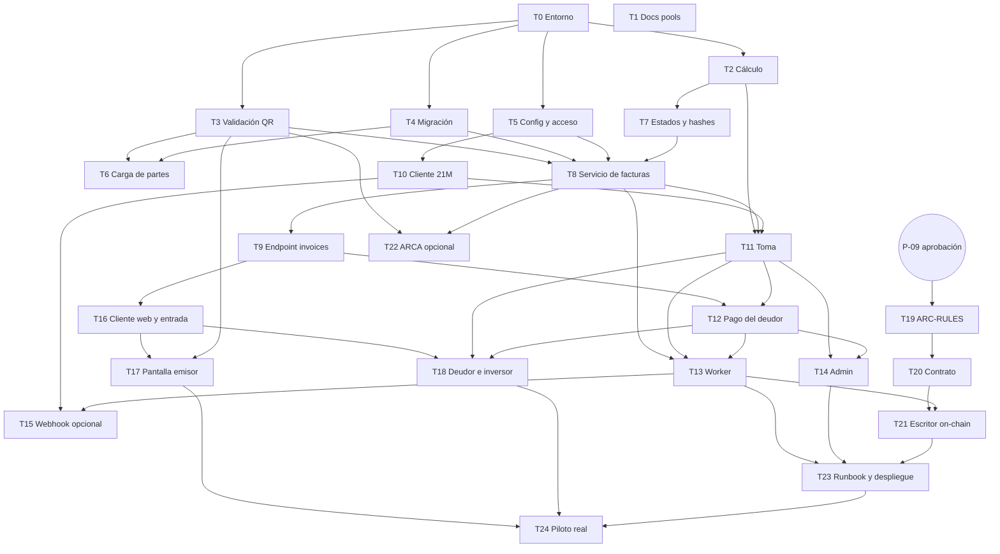

# Plan de implementación: piloto de cesión de facturas a un inversor

Fecha: 24/11/2026. Branch: `factoring` (base `3b41d3b`). Estado: plan para ejecutar tarea por tarea; nada de esto está implementado.

Fuentes de este plan: `DECISIONES_MOCK_CESION.md` (decisiones vigentes), `PLAN_PILOTO_CESION.md` (borrador de 18 tareas que este documento detalla y corrige), `FACTORING_HANDOFF.md` (secciones 3.2, 3.3, 8.1 y 8.3; las de pools están descartadas), `ARC-RULES.md`, `CLAUDE.md`, `README.md`, los `.env` de ejemplo, `docs/arc-migration/ARC_MAINNET_RESEARCH.md`, el código citado en cada tarea, el branch `21millon` (leído con `git show`) y el contrato público de 21 Millions (`https://api.21millions.com/partner-api.json`, v1.2.0, leído el 24/11/2026).

Marcas: **[V]** verificado en una fuente oficial o en el código; **[S]** fuente secundaria o a confirmar; **[P]** propuesta de este plan. Nada de este documento es asesoramiento legal.

## 0. Cómo usar este plan

- Las tareas van de T0 a T24. Cada una deja el repo compilando y con los tests en verde (salvo las fallas previas anotadas en 1.5). Cada tarea se entrega por separado: un commit local por tarea, sin push.
- Antes de cada tarea, revisar la tabla de decisiones (sección 2). Si una decisión que bloquea la tarea sigue abierta, se usa la recomendación indicada y se lo dice en el commit, o se para y se pregunta si la decisión es de las marcadas como «bloqueante dura».
- Convenciones del repo que aplican a todas las tareas (handoff 8.1, **[V]** en el código):
  - Endpoint v1: `export function createXHandler(adapters={})` y `export const handler=createXHandler()`, como `netlify/functions/merchant-profile.js`.
  - Dentro del handler: primero `authenticatePayment(event)` (`lib/paymentRuntime.js`, línea 31), después método (405), JSON (`invalid_json`, 400) y campos sin claves extra.
  - Errores con `PaymentError(code,status)` (`lib/paymentCore.js`) y respuestas con `json()` y `errorResponse()` (`lib/paymentRuntime.js`, líneas 66 y 69). Toda query filtra por el usuario autenticado; el cliente nunca manda su `user_id`.
  - Montos en centavos `BIGINT`, nunca `Number` para dinero. Conversión de texto con el criterio de `decimalUnits` y `unitsDecimal` (`lib/paymentCore.js`).
  - Tests con `node:test`, PGlite, adapters inyectados y sin red. La migración se aplica dos veces para probar que es idempotente.
  - Secretos solo server-side, nunca con prefijo `VITE_`. Los nombres de secretos nuevos llevan `SECRET` para que `scripts/public-env-policy.js` los rechace si alguien les pone `VITE_`.
  - No se aplican migraciones, no se hace push ni deploy, no se despliega el contrato y no se crea ninguna orden real sin pedido explícito del usuario.

## 1. Resumen, alcance y prerrequisitos

### 1.1 Resumen

Un emisor carga una factura (formulario «SIMULADA» o QR fiscal) contra un deudor de la lista curada y la envía. MidatoPay emite un NFT ERC-721 a la wallet del emisor como registro público. El deudor acepta de forma expresa, o la aceptación es tácita a los 21 días desde la emisión, y la factura se publica por 72 horas. Un inversor habilitado la toma: MidatoPay calcula los montos (35% TNA base 365 desde la acreditación hasta el vencimiento, comisión de 2,5% del descuento a cargo del inversor) y ordena a 21 Millions dos retiros en pesos desde la cuenta del inversor: el neto al CVU del emisor y la comisión al CVU de MidatoPay. Con los dos completados, la factura queda cedida y la clave de cesión pasa el NFT al inversor. Desde el vencimiento, el deudor elige la factura y paga el nominal al CVU del inversor; sin pago, la factura pasa a mora al día siguiente. Cada cambio de estado se escribe en el contrato desde una cola, sin bloquear el dinero.

### 1.2 Alcance

| Bloque | Incluye |
|---|---|
| Cálculo | Módulo puro compartido cliente/servidor, centavos con `BigInt`, redondeo definido, días corridos en hora argentina, días hábiles para FCE |
| Facturas | Alta por formulario o por QR (cámara o imagen), validación compartida, deudores de una lista del servidor, unicidad global de la factura |
| Estados | Máquina de estados completa con reloj inyectado: tácita, publicación, oferta vencida, toma, pagos, cesión, cobro, mora, revisión manual |
| Dinero | Cliente de servidor de la Partner API de 21 Millions (saldos, límites, retiro bancario con `Idempotency-Key`, consulta de órdenes, webhook firmado opcional) y un simulador sin dinero |
| Registro on-chain | Contrato Foundry + OpenZeppelin, cola de eventos en Postgres y un escritor con el patrón de `settlePayout` |
| UI | Pantallas del emisor, del deudor y del inversor, entrada desde Perfil, textos `en` y `es` |
| Operación | Carga de partes fuera del repo, endpoint de revisión manual, runbook y guion del piloto |

### 1.3 Fuera de alcance

- Pools, tramos, fondeo previo y cualquier custodia (descartados en `DECISIONES_MOCK_CESION.md`).
- Pagos parciales del deudor (supuesto 6 de las decisiones).
- Movimiento de USDC por la cesión: el dinero es en pesos, fuera de la cadena. El NFT no mueve fondos.
- Lectura de PDF (requiere `pdfjs-dist`, FD-06 del handoff). El piloto lee el QR por cámara o desde una imagen JPG/PNG con `jsQR`, que ya es dependencia. Ver decisión D-10.
- Guardado del archivo de la factura (requiere almacenamiento de blobs, FD-03). Ver D-10.
- Notificaciones push o por email. Los avisos al deudor y a las partes son dentro de la app (D-18).
- Pantalla de administración. La revisión manual se opera por API (D-19).
- Constatación en ARCA (WSCDC): queda como tarea opcional T22, apagada por defecto.
- Alta de clientes y KYC en 21 Millions desde la app: las cuentas de las partes se crean fuera (laboratorio del branch `21millon` o portal de 21 Millions).

### 1.4 Prerrequisitos

| ID | Prerrequisito | Quién | Bloquea | Estado al 24/11/2026 |
|---|---|---|---|---|
| P-01 | Foundry (`forge`, `cast`). En Windows: `foundryup` desde Git Bash o WSL, o los binarios de GitHub Releases **[S]** | Usuario | T20 | **No instalado**: `forge --version` devuelve «no se reconoce como nombre de un cmdlet» |
| P-02 | `npm ci` para alinear `node_modules` con el lockfile | Usuario o coder con OK | T0 y todos los tests de UI | Falta `react-test-renderer` en `node_modules` (está en `devDependencies`); por eso falla `test/charge-received.test.js` |
| P-03 | Sacar del `.env` local las variables `VITE_TREASURY_PRIVATE_KEY` y `VITE_ANTHROPIC_API_KEY` y rotarlas si alguna vez llegaron a un build | Usuario | `npm run build` en T16 a T18 | `npm run build` falla hoy con «Variables privadas con prefijo público VITE_: VITE_TREASURY_PRIVATE_KEY» (`vite.config.js` + `scripts/public-env-policy.js`) |
| P-04 | CUIT reales de los deudores del piloto, razón social, Privy ID de cada uno, `customer_id` de 21 Millions y constancia de que aceptan participar. Todo en un archivo fuera del repo | Usuario | Carga de datos de T6 y T24 (no el código) | Pendiente |
| P-05 | Credenciales de máquina de 21 Millions: `nx_test_…` (staging) y `nx_live_…` (producción). Vencen a los 90 días salvo otro plazo **[V]** | Usuario | Modo `live` de T11 a T13 y T24 | Pendiente |
| P-06 | CVU de MidatoPay para la comisión | Usuario | T24 (configuración) | Pendiente |
| P-07 | Cuentas de 21 Millions de las partes: inversor y deudor con `customer_id`, rail ARS aprobado y saldo; emisor con CVU de destino | Usuario | T24 | Pendiente |
| P-08 | Clave nueva del registro on-chain (EOA dedicada, nunca `TREASURY_SECRET_KEY`), dirección de administración del contrato (fría, fuera del servidor) y unos 1 USDC de gas en la EOA | Usuario | Despliegue en T23 y T24 | Pendiente |
| P-09 | Cambio de `ARC-RULES.md` aprobado (texto propuesto en 8.6) | Usuario | T19 y todo lo que sigue en la fase 6 | Pendiente. `ARC-RULES.md` dice hoy «Contracts: none of our own» |
| P-10 | Documentos legales: contrato marco (su SHA-256 va a `FACTORING_FRAMEWORK_SHA256`), plantilla del anexo de cesión, términos del inversor con el débito inmediato, consentimiento de los deudores | Usuario y legales | Envío real (T24); el código usa una plantilla de prueba | Pendiente |
| P-11 | Confirmación escrita de 21 Millions de que el partner puede ordenar retiros entre clientes así (MD-06) | Usuario | T24 | Pendiente |
| P-12 | Si se usa el webhook (T15): configurarlo desde el portal de 21 Millions; solo lo puede hacer una persona con sesión **[V]** | Usuario | T15 en producción | Opcional |

### 1.5 Estado verificado del repo

Comprobado el 24/11/2026 en este equipo (Windows, Node v24.19.0; `CLAUDE.md` pide Node 22):

| Comando | Resultado |
|---|---|
| `npm test` | 185 tests, 182 pasan, 3 fallan: `test/charge-received.test.js` (falta `react-test-renderer`, P-02) y dos de `test/redirect-credentials.test.js` («cross-host redirects strip credentials supplied as an array…» y «custom sensitive headers with regex metacharacters…», 400 en vez de 200 en `follow-redirects`). Son previas a este trabajo |
| `npm run functions:check` | Pasa: «Packaged 21 Functions; protected endpoints reject unauthenticated requests.» |
| `npm run build` | Falla por el `.env` local (P-03), no por el código |
| `forge --version` | No instalado (P-01) |

Criterio de todas las tareas: ningún test nuevo falla y la cantidad de fallas previas no sube.

## 2. Decisiones que hay que tomar antes de ciertas tareas

«Bloqueante dura» significa que la tarea no se empieza sin respuesta. En las demás, el coder sigue con la recomendación y la deja escrita.

### 2.1 Decisiones abiertas del documento de decisiones

| ID | Tema | Bloquea | Tipo | Recomendación |
|---|---|---|---|---|
| MD-01 | Prórroga de la Res. SEPyME 219/2025 (plazo de 21 días) | T24 | Dura para T24 | El código deja el plazo en `FACTORING_ACCEPTANCE_DAYS`, 21 por defecto, como pidió el usuario. Confirmarlo con legales antes del piloto real |
| MD-02 | Tipo de inversor admitido para FCE | T5, T11 | Blanda | Para FCE, solo `entidad_financiera` y `proveedor_no_financiero_credito` (Ley 27.440, art. 13 **[V]**). El piloto usa facturas simuladas comunes de monto mínimo, que no son FCE |
| MD-03 | Proveedor de KYC y KYB | T6 | Blanda | En el piloto, KYC aprobado a mano (`kyc_status='approved'`) con la fuente anotada (`kyc_source`, por ejemplo `21millions`), porque el KYC de 21 Millions es real **[V]** |
| MD-04 | Metadata y eventos del contrato | T20 | Dura para T20 | Adoptar la interfaz de la sección 8: datos en eventos y en una vista `invoice(tokenId)`, `tokenURI` vacío, sin datos personales |
| MD-05 | Costo operativo real por factura | T24 (decisión económica) | Blanda | No cambia código. Con montos mínimos la comisión no cubre costos (sección 2.3 de las decisiones) |
| MD-06 | Validación de 21 Millions de los retiros entre clientes del partner | T24 | Dura para T24 | Pedir la confirmación por escrito antes de cargar `nx_live_` |

### 2.2 Supuestos del documento de decisiones (sección 6)

| ID | Supuesto | Bloquea | Recomendación |
|---|---|---|---|
| S-1 | La comisión va a un CVU de MidatoPay configurable | T5 | Sí: `FACTORING_FEE_CVU` |
| S-2 | El deudor paga el total, sin parciales | T12 | Sí: el monto del pago es siempre el nominal y el cliente no lo manda |
| S-3 | Solo la clave de cesión transfiere el NFT | T20 | Sí: transferencias y aprobaciones de usuarios revierten |
| S-4 | Al cobrarse, el NFT queda en la wallet del inversor, sin quemarse | T20 | Sí: el contrato no tiene `burn` |
| S-5 | Con oferta vencida o sin pago, el NFT queda con su titular | T20, T21 | Sí: esos eventos solo cambian el estado |
| S-6 | 21 días y 72 horas configurables | T5 | Sí: `FACTORING_ACCEPTANCE_DAYS` y `FACTORING_OFFER_HOURS` |

### 2.3 Decisiones nuevas que surgen de este plan [P]

Son casos que las decisiones no resuelven. La recomendación es la lectura que mantiene lo ya decidido.

| ID | Tema | Bloquea | Recomendación y motivo |
|---|---|---|---|
| D-01 | Redondeo | T2 | Acreditación al emisor y comisión redondeadas al centavo, mitad hacia arriba; la ganancia del inversor es la diferencia, así la suma da el nominal exacto. Con esa regla, ARS 17.000.000 da los mismos centavos que la tabla 2.2 de las decisiones (sección 6) |
| D-02 | Calendario | T2 | Días corridos entre la fecha argentina de la aceptación del inversor y el vencimiento, con UTC−3 fijo (Argentina no usa horario de verano desde 2009 **[S]**) |
| D-03 | 72 horas tras un neto fallido | T8, T11 | Plazo fijo desde la publicación (`expires_at` no se mueve). «Conserva el tiempo que le quede» se cumple sin pausar el reloj; si venció mientras se pagaba, vence en la siguiente corrida del worker |
| D-04 | Momento de «cedida» | T8, T11 | La factura pasa a `cedida` cuando el neto y la comisión están `COMPLETED`, y en esa misma transacción se encola la cesión del NFT. El dinero ya es final; la cadena no bloquea al deudor ni al inversor (regla 3.3 de las decisiones: la cola no bloquea el dinero). La UI muestra «registro on-chain pendiente» hasta que la cesión confirma. Alternativa: esperar el NFT para pasar a `cedida` |
| D-05 | Pago tardío | T7, T12 | `en_mora → cobrada` permitido. El diagrama no marca `en_mora` como final, así que el deudor puede pagar después |
| D-06 | Neto con resultado incierto | T11 | Si el neto queda incierto (timeout sostenido, respuesta que no coincide, conflicto de clave) la factura va a `revision_manual`, no a `publicada`, porque no se puede probar que la plata no se movió |
| D-07 | Auto-toma | T11 | El inversor no puede ser el emisor ni el deudor de la misma factura (`self_take_not_allowed`) |
| D-08 | Tope del piloto | T5 | `FACTORING_MAX_NOMINAL_CENTS` obligatorio en modo `live`. Recomendado para la primera orden: ARS 10.000 (sección 11.3) |
| D-09 | Mínimos de 21 Millions | T11 | Antes de mover dinero se consulta `/limits`. Si el neto o la comisión quedan debajo de `min_amount`, o el desembolso supera `available` o `max_amount`, la toma se rechaza con 422 y no se crea nada. Si la comisión da 0 centavos no se crea esa orden |
| D-10 | Archivo de la factura | T3, T17 | No se guarda el archivo. El cliente decodifica el QR y manda el texto; el servidor lo vuelve a parsear. Sin PDF en el piloto |
| D-11 | Tácita para facturas viejas | T8 | Se respeta «21 días desde la emisión»: una factura enviada con más de 21 días de emitida se acepta tácitamente en la siguiente corrida, sin ventana para el deudor. La UI del emisor lo advierte antes de enviar. Si se quiere una ventana mínima, es una regla nueva a decidir |
| D-12 | Feriados bancarios | T2 | Lista versionada en `src/arBankHolidays.js` para 2026 y 2027, cargada desde la fuente oficial y aprobada por el usuario. Solo afecta FCE (art. 18) |
| D-13 | Claves del registro | T20, T21 | Una sola EOA de servidor con `REGISTRAR_ROLE` y `CESSION_ROLE` (una sola secuencia de nonces, orden estricto) y `DEFAULT_ADMIN_ROLE` en otra dirección fría, que puede revocar y rotar |
| D-14 | Invocación del contrato | T19, T21 | Llamada directa al contrato, sin Memo (sección 8.2) |
| D-15 | Dependencias de Solidity | T20 | `@openzeppelin/contracts` y `forge-std` como `devDependencies` exactas de npm, con remappings de Foundry, en vez de submódulos git. Requiere OK para instalar dependencias |
| D-16 | Cuándo se habilita el NFT | T5 | `FACTORING_NFT_ENABLED=true` solo con pagos `live` contra 21 Millions `production`. Así el registro público de Mainnet no recibe pagos simulados ni de staging |
| D-17 | Seguimiento de órdenes | T13, T15 | Fuente de verdad: `GET /customers/{id}/orders/{order_id}` por cada orden abierta (ARQ-06 del branch `21millon`). El webhook solo acelera. El feed de eventos no se usa en el piloto |
| D-18 | Avisos | T16 a T18 | Solo dentro de la app |
| D-19 | Administración | T14 | Solo API (curl con token de un admin) |
| D-20 | Destino de la comisión y del neto | T11 | Solo CVU de 22 dígitos (no alias ni CBU) para que el destino sea exacto y comparable con la orden |

## 3. Fases, tareas y dependencias

### 3.1 Grafo



### 3.2 Tabla de tareas

| Tarea | Fase | Depende de | Esfuerzo | Entregable |
|---|---|---|---|---|
| T0 | 0 Preparación | P-02, P-03 | S | Base de tests y build reproducible |
| T1 | 0 Preparación | ninguna | S | Docs sin pools (resto del borrador Task 2) |
| T2 | 1 Núcleo puro | T0 | S | `src/invoiceCession.js`, `src/arBankHolidays.js` |
| T3 | 1 Núcleo puro | T0 | M | `src/invoiceQr.js` |
| T4 | 2 Datos | T0 | M | Migración sin aplicar + inspección |
| T5 | 2 Datos | T0 | S | `factoringConfig.js`, `factoringAccess.js`, variables documentadas |
| T6 | 2 Datos | T3, T4 | S | `scripts/factoring-parties.js` |
| T7 | 3 Dominio | T2 | M | `lib/factoringStates.js`, `lib/factoringHashes.js` |
| T8 | 3 Dominio | T3, T4, T5, T7 | L | `lib/factoringService.js` |
| T9 | 3 Dominio | T8 | M | `netlify/functions/invoices.js` |
| T10 | 4 Dinero | T5 | M | `lib/twentyOneMillions.js` |
| T11 | 4 Dinero | T2, T8, T10 | L | `lib/factoringTakes.js`, `invoice-offers.js` |
| T12 | 4 Dinero | T9, T11 | M | `lib/factoringPayments.js`, ruta de pago |
| T13 | 4 Dinero | T8, T11, T12 | M | Worker programado |
| T14 | 4 Dinero | T11, T12 | M | `factoring-admin.js` |
| T15 | 4 Dinero (opcional) | T10, T13 | S | `twentyone-webhook.js` |
| T16 | 5 UI | T9 | M | `src/factoring.js`, entrada en Perfil, i18n base |
| T17 | 5 UI | T16, T3 | L | `src/InvoicesScreen.jsx` |
| T18 | 5 UI | T16, T11, T12 | L | `src/DebtorInvoicesScreen.jsx`, `src/InvestorOffersScreen.jsx` |
| T19 | 6 On-chain | P-09 | S | `ARC-RULES.md` aplicado tras aprobación |
| T20 | 6 On-chain | T19, P-01, D-15 | M | `contracts/` con tests de forge y ABI |
| T21 | 6 On-chain | T20, T13 | L | `lib/factoringRegistry.js` y fase on-chain del worker |
| T22 | 7 Opcional | T3, T8 | L | Constatación WSCDC detrás de un flag |
| T23 | 8 Piloto | T13, T14, T21 | M | Runbook, chequeo de configuración, script de despliegue |
| T24 | 8 Piloto | todo lo anterior y P-04 a P-11 | M | Una factura real de monto mínimo, de punta a punta |

Independencias: T1 no depende de nada ni bloquea nada. T2, T3, T4 y T5 son independientes entre sí. T10 solo necesita T5. T19 y T20 se pueden adelantar en cuanto haya aprobación, en paralelo con la fase 4, porque solo comparten la tabla de la cola. La ejecución es secuencial igual: todas las tareas comparten el mismo worktree.

### 3.3 Cambios respecto del borrador `PLAN_PILOTO_CESION.md`

| Borrador | Este plan | Motivo |
|---|---|---|
| Task 1 (decisiones) | Hecha | Ya está en `DECISIONES_MOCK_CESION.md` |
| Task 2 (descartar pools) | T1, con alcance reducido | Los avisos de descarte ya están en `FACTORING_HANDOFF.md` (línea 5) y `EJEMPLO_FINANCIERO.md` (línea 5). Falta la sección 6.3, la RG 1150 a [V] y las imágenes. No bloquea nada |
| Task 3 (cálculo) | T2 | Se fija la regla de redondeo (D-01), el calendario (D-02) y los valores en centavos que tienen que dar los tests |
| Task 4 (carga) | T3 | Se agrega: solo PES, tipos de comprobante cerrados, receptor con CUIT de la lista y CUIT del emisor igual al registrado (handoff 4.2) |
| Task 5 (migración) | T4 | La cola on-chain y la auditoría entran desde el principio, así el dominio encola eventos aunque el contrato todavía no exista. La inspección va en una función nueva, para no poner en rojo el chequeo de pagos de producción (sección 4.3) |
| Task 6 (estados) | T7 (pura) + T8 (con base) | La tabla de transiciones pura se prueba sin base; el servicio aplica locks, auditoría y cola |
| Task 7 (acceso) | T5, antes de los estados | El servicio necesita plazos y tasas validados. Se agregan el modo de pagos (`disabled`, `simulated`, `live`), el tope del piloto y la regla D-16 |
| Sin tarea | T6 (carga de partes) | El borrador decía «deudores cargados fuera del repo» sin mecanismo. Los inversores y emisores también necesitan `customer_id` y CVU |
| Task 8 (endpoints) | T9 | Se suman `GET /invoices/access` y `GET /invoices/debtors`, y el proxy de `vite.config.js`, que el borrador no mencionaba |
| Task 9 (cliente 21M) | T10 | Se suma el mapeo completo de códigos y el simulador explícito |
| Task 10 (toma) | T11 | La toma se hace en el worker (202 + seguimiento), no dentro del pedido, porque 21 Millions puede tardar más que una Function síncrona |
| Task 11 (pago) | T12 | Igual, más pago tardío (D-05) |
| Task 12 (worker) | T13 | Se agrega un lock global del worker y el salto cuando el factoring está apagado |
| Sin tarea | T14 (admin) | El borrador manda casos a revisión manual pero no tenía cómo resolverlos |
| Sin tarea | T15 (webhook) | Opcional, solo acelera el seguimiento |
| Tasks 13 y 14 (UI) | T16, T17, T18 | Se separa el cableado común (acceso, Perfil, i18n) de las pantallas |
| Task 15 (contrato + ARC-RULES) | T19 + T20 | La aprobación de la regla va antes que el código del contrato, porque la regla vigente prohíbe contratos propios |
| Task 16 (worker on-chain) | T21 | Igual; agrega verificación de los logs del registro y la reemisión segura desde admin |
| Task 17 (ARCA) | T22 | Sin cambios |
| Task 18 (piloto) | T23 + T24 | Se separa lo que se puede preparar (runbook, scripts) de los pasos irreversibles |

### 3.4 Tareas

Formato de cada tarea: objetivo, archivos, interfaces, reglas, tests, verificación, aceptación, riesgos. «Verificación estándar» significa: el test nuevo con `node --test test/<archivo>.test.js`, después `npm test` sin fallas nuevas; si toca Functions, `npm run functions:check`; si toca `src/` con JSX, `npm run build`.

#### Fase 0: preparación

- [ ] **T0. Entorno de verificación reproducible.** Esfuerzo S.
  - Objetivo: que `npm test` y `npm run build` reflejen el código y no el equipo.
  - Pasos: con OK del usuario, `npm ci` (P-02). El usuario saca `VITE_TREASURY_PRIVATE_KEY` y `VITE_ANTHROPIC_API_KEY` del `.env` (P-03); el coder no edita `.env`.
  - Archivos: ninguno del repo.
  - Verificación: `npm test` (esperado: 2 fallas previas de `redirect-credentials`, ninguna de `charge-received`), `npm run build` (pasa), `npm run functions:check` (pasa).
  - Aceptación: los tres comandos dan ese resultado y se anota en el commit de T2.
  - Riesgo: si el usuario no limpia el `.env`, ninguna tarea de UI puede verificar el build. En ese caso se informa y se sigue con los tests.

- [ ] **T1. Terminar de descartar los pools en los documentos.** Esfuerzo S. Independiente.
  - Objetivo: el resto de la Task 2 del borrador.
  - Archivos a modificar: `docs/factoring/FACTORING_HANDOFF.md` (sección 6.3, desde la línea 320: sumar Ley 27.440 arts. 4 a 6, 9, 13 y 18 como **[V]**, copiando de `DECISIONES_MOCK_CESION.md` 4.2; sección 6.4: RG 1150 a **[V]**), `docs/factoring/EJEMPLO_FINANCIERO.md` (secciones 4.2 y 6). Regenerar `FLUJO_FACTORING_MIDATOPAY.svg/.jpg` y `EJEMPLO_FINANCIERO.svg/.jpg` sin pools solo si el usuario lo pide, porque es trabajo gráfico.
  - Tests: revisión de consistencia. Las cifras del ejemplo coinciden con la sección 6 de este plan.
  - Aceptación: ninguna sección vigente describe pools como camino del piloto.

#### Fase 1: núcleo puro

- [ ] **T2. Cálculo de la cesión y calendario.** Esfuerzo S. Depende de T0.
  - Objetivo: un módulo puro, sin dependencias ni red, que usen el servidor y la UI.
  - Archivos a crear: `src/invoiceCession.js`, `src/arBankHolidays.js`, `test/invoice-cession.test.js`.
  - Interfaces:
    ```js
    // src/invoiceCession.js
    export const ART_OFFSET_MINUTES = -180;
    export function argentinaDate(nowMs)                    // 'YYYY-MM-DD' en UTC−3
    export function addDays(isoDate, days)                   // 'YYYY-MM-DD'
    export function daysBetween(fromIso, toIso)              // entero, puede ser ≤ 0
    export function isBankBusinessDay(isoDate, holidays)     // lunes a viernes y no feriado
    export function fceTransferBlocked(todayIso, dueOnIso, holidays) // art. 18: true dentro de los 3 días hábiles previos
    export function cessionQuote({ nominalCents, days, rateBps, feeBps })
      // → { days, rateBps, feeBps, nominalCents, discountCents, advanceCents, feeCents,
      //     investorOutlayCents, investorGainCents, investorTnaBps }  todos BigInt salvo días y bps
      // lanza PaymentError('invoice_due_too_soon',422) si days <= 0
    export function centsToArs(cents) / arsToCents(text)    // texto con 2 decimales; reutiliza el criterio de decimalUnits
    // src/arBankHolidays.js
    export const AR_BANK_HOLIDAYS = new Set([ /* 'YYYY-MM-DD' 2026 y 2027, D-12 */ ]);
    ```
    `PaymentError` vive en `netlify/functions/lib/paymentCore.js` y el módulo de `src/` no puede importar código de Functions. El módulo lanza `Error` con `code` y `status` (`Object.assign(new Error(code),{code,status})`) y el servidor lo traduce a `PaymentError` en `factoringService`.
  - Reglas: la especificación completa está en la sección 6. `rateBps` y `feeBps` son enteros recibidos por parámetro (los valores salen de la configuración, T5).
  - Tests (`test/invoice-cession.test.js`):
    - ARS 100 y ARS 17.000.000 a 30, 60 y 90 días dan exactamente los centavos de la tabla 6.3 y la TNA en puntos básicos.
    - Para cada caso, `advance + fee + gain === nominal` y `discount === nominal − advance`.
    - 0 días y días negativos lanzan `invoice_due_too_soon`.
    - 1 día en ARS 100 da comisión 0.
    - Redondeo mitad hacia arriba en un caso armado con resto exacto de medio centavo.
    - `argentinaDate` en los bordes: `2026-11-25T02:59:59Z` es `2026-11-24` y `2026-11-25T03:00:00Z` es `2026-11-25`.
    - `fceTransferBlocked` con un fin de semana y un feriado inyectado en el medio.
    - Ninguna función usa `Number` para dinero: un nominal de `9007199254740993` centavos no pierde precisión.
  - Verificación: `node --test test/invoice-cession.test.js`; `npm test`.
  - Aceptación: todos los valores de la sección 6.3 pasan.
  - Riesgo: la lista de feriados queda incompleta (D-12). Mitigación: solo afecta FCE, que el piloto no usa.

- [ ] **T3. Validación de facturas y lectura del QR fiscal.** Esfuerzo M. Depende de T0.
  - Objetivo: un validador único para formulario y QR, usado por el navegador (vista previa) y el servidor (verdad).
  - Archivos a crear: `src/invoiceQr.js`, `test/invoice-qr.test.js`.
  - Interfaces:
    ```js
    export const QR_HOSTS = ['www.afip.gob.ar','afip.gob.ar','serviciosweb.afip.gob.ar','www.arca.gob.ar','arca.gob.ar']; // FD-17, [S]
    export const INVOICE_TYPES = new Map([[1,'A'],[6,'B'],[11,'C'],[201,'FCE A'],[206,'FCE B'],[211,'FCE C']]); // [S]
    export function isValidCuit(text)                         // 11 dígitos, pesos 5,4,3,2,7,6,5,4,3,2 (handoff 3.2)
    export function parseFiscalQr(urlText)                    // → payload normalizado o error 'invalid_qr'
    export function validateInvoiceInput(input, { todayIso })  // formulario o QR → objeto canónico o error con code
    export function isFceType(cbteTipo)
    ```
  - Reglas:
    - QR: URL `https:` con host de `QR_HOSTS`, path que empieza con `/fe/qr`, parámetro `p` en Base64 o Base64 URL-safe, JSON con `ver === 1`, campos de la tabla 3.2 del handoff. `importe` a centavos sin flotantes (si el JSON trae número, se usa su representación de texto y se rechaza con más de 2 decimales).
    - `moneda` distinta de `PES` o `ctz` distinto de 1: `unsupported_currency` (los pagos son en pesos).
    - `tipoCmp` fuera de `INVOICE_TYPES`: `unsupported_invoice_type`. Notas de crédito y débito quedan fuera.
    - `tipoDocRec` tiene que ser 80 (CUIT) y `nroDocRec` un CUIT válido: `receiver_cuit_required`.
    - `fecha` no futura; `due_on` (que el QR no trae y se carga a mano) posterior a la emisión y a hoy: `invalid_due_date`.
    - Formulario: `debtorId` (UUID), `cbteTipo`, `ptoVta`, `cbteNro`, `issuedOn`, `dueOn`, `nominal` (texto `^\d{1,12}(\.\d{1,2})?$`). Sin claves extra. Queda `simulated=true`.
    - `is_fce` sale de `isFceType(cbteTipo)`; el cliente no lo elige.
    - El CUIT del emisor no viene del formulario: lo pone el servidor desde la parte registrada (T8).
  - Tests: QR válido con host `www.afip.gob.ar` y con `serviciosweb.afip.gob.ar`; Base64 URL-safe y con padding faltante; host fuera de lista; `http:`; path distinto; JSON roto; `ver` 2; CUIT con dígito verificador inválido (incluido el caso «da 10»); `moneda: 'DOL'`; tipo 3 (nota de crédito); importe con 3 decimales; fecha futura; vencimiento anterior a la emisión; formulario con clave extra; nominal `0`; detección de FCE con 201.
  - Verificación: `node --test test/invoice-qr.test.js`; `npm test`.
  - Aceptación: el mismo input da el mismo resultado en el test y en el servidor (el servidor importa este módulo, como `merchant-profile.js` importa `src/merchantIdentity.js`).
  - Riesgo: hosts y nombres de campos son **[S]** (FD-17). Mitigación: probar con QRs reales antes de T24; las facturas simuladas no dependen del QR.

#### Fase 2: datos y configuración

- [ ] **T4. Migración del piloto (sin aplicar).** Esfuerzo M. Depende de T0.
  - Objetivo: el esquema de la sección 4.
  - Archivos a crear: `db/migrations/20261125_factoring_pilot.sql`, `test/factoring-db.js` (ayuda de tests: no termina en `.test.js`, así `npm test` no la corre sola), `test/factoring-migration.test.js`.
  - Archivos a modificar:
    - `scripts/migrate-payments.js`, línea 6: agregar `"20261125_factoring_pilot.sql"` al final de la lista.
    - `netlify/functions/lib/paymentDatabase.js`: extraer el cuerpo de `inspectPaymentDatabase` (línea 18) a `inspectTables(db,columns,indexes)` y exportar `inspectFactoringDatabase(db)` con un mapa `factoringColumns` y su lista de índices. `inspectPaymentDatabase` queda con el mismo resultado.
    - `scripts/check-payments-database.js`: imprimir también `factoring` con `inspectFactoringDatabase`, sin cambiar el `exitCode` de pagos (el factoring todavía no es requisito de producción).
  - Interfaces: `export async function createFactoringDb()` en `test/factoring-db.js` → `{engine, db}` con `db.query` y `db.connect` serializado, igual al patrón de `test/transfers.test.js` (líneas 49 a 57), aplicando `db/schema.sql` sin `pgcrypto`, las migraciones existentes y la nueva dos veces.
  - Reglas: DDL idempotente dentro de `BEGIN; … COMMIT;`. Invariantes en CHECKs e índices únicos (sección 4).
  - Tests (`test/factoring-migration.test.js`): aplicar dos veces; `inspectFactoringDatabase` da `ready:true` y, con una tabla borrada, `ready:false`; `inspectPaymentDatabase` sigue `ready:true` sin la migración de factoring; segunda oferta `open` de la misma factura falla; dos tomas activas fallan; orden con la misma `(environment,payer_customer_id,idempotency_key)` falla; CHECK de `advance + fee + gain = nominal`; factura duplicada por `(issuer_cuit,cbte_tipo,pto_vta,cbte_nro)` falla; segundo pago activo del deudor falla.
  - Verificación: `node --test test/factoring-migration.test.js`; `node --test test/payment-database.test.js` (sin cambios); `npm test`.
  - Aceptación: los tests pasan. **No se aplica a ninguna base.**
  - Riesgo: PGlite y Postgres de Aiven difieren en algún detalle. Mitigación: solo sintaxis estándar de PG 13+ (`gen_random_uuid`, índices parciales).

- [ ] **T5. Configuración y acceso.** Esfuerzo S. Depende de T0.
  - Objetivo: leer y validar toda la configuración en un solo lugar y aplicar el flag con allowlist.
  - Archivos a crear: `netlify/functions/lib/factoringConfig.js`, `netlify/functions/lib/factoringAccess.js`, `test/factoring-access.test.js`.
  - Archivos a modificar: `.env.example` y `.env.production.example` (al final, bloque «Factoring piloto» con las variables de la sección 10); `netlify.toml`, línea 7: sumar a `SECRETS_SCAN_OMIT_KEYS` las variables que no son credenciales (`FACTORING_ENABLED`, `FACTORING_PAYMENTS_MODE`, `FACTORING_NFT_ENABLED`, `FACTORING_RATE_BPS`, `FACTORING_FEE_BPS`, `FACTORING_ACCEPTANCE_DAYS`, `FACTORING_OFFER_HOURS`, `FACTORING_MAX_NOMINAL_CENTS`, `TWENTYONE_ENVIRONMENT`), por el mismo motivo que ya están `PAYMENTS_ENABLED` y `MP_ENVIRONMENT`.
  - Interfaces:
    ```js
    // factoringConfig.js
    export function factoringSettings(env=process.env) // → objeto congelado de la sección 10; lanza PaymentError('invalid_factoring_<clave>',503)
    export function twentyOneEnvironment(env=process.env) // → { mode, environment, base, ready } sin exponer la clave
    // factoringAccess.js (copia del patrón de lib/transferAccess.js)
    export function factoringEnabledFor(userId, env=process.env)
    export function assertFactoringEnabled(userId, env=process.env) // 503 factoring_disabled
    export function isFactoringAdmin(userId, env=process.env)
    export async function factoringRoles(db, userId)  // → { issuer, investor, debtor } filas activas de factoring_parties o null
    ```
  - Reglas: las de la sección 10.2 (modo de pagos, prefijo de la clave según el ambiente, D-16, tope obligatorio en `live`, CVU de 22 dígitos).
  - Tests: allowlist exacta (mismos casos que `transfersEnabledFor` en `test/transfers.test.js`, líneas 24 a 36); `FACTORING_ENABLED=true` abre a todos; admin separado de la allowlist; `simulated` con NFT encendido falla; `live` con `staging` y clave `nx_live_` falla; NFT con `live` y `staging` falla; tasa fuera de rango falla; la clave nunca aparece en el objeto devuelto ni en el mensaje del error.
  - Verificación: `node --test test/factoring-access.test.js`; `npm test`.
  - Aceptación: los tests pasan y los dos `.env` de ejemplo documentan cada variable.

- [ ] **T6. Carga de partes del piloto.** Esfuerzo S. Depende de T3 y T4.
  - Objetivo: cargar emisores, inversores y deudores (con CUIT reales) desde un archivo fuera del repo.
  - Archivos a crear: `netlify/functions/lib/factoringParties.js`, `scripts/factoring-parties.js`, `test/factoring-parties.test.js`.
  - Archivos a modificar: `package.json` (script `"factoring:parties": "node --env-file=.env scripts/factoring-parties.js"`); `.gitignore` (agregar `factoring-parties*.json` como defensa).
  - Interfaces:
    ```js
    export function validatePartiesFile(json)       // → lista normalizada o error con índice y campo, sin repetir CUIT ni nombres en el mensaje
    export async function upsertParties(db, parties) // en una transacción; devuelve { inserted, updated }
    ```
    Formato del archivo: `{ "version": 1, "parties": [ { "role": "debtor", "userId": "did:privy:…", "cuit": "…", "legalName": "…", "twentyOneCustomerId": "…", "termsAcceptedAt": "2026-11-20", "kycStatus": "approved", "kycSource": "21millions" } ] }`; los inversores suman `investorType` y `cvu`; los emisores `cvu` y `frameworkSha256`.
  - Reglas: CUIT con dígito verificador (`isValidCuit` de T3); CVU de 22 dígitos; `investorType` obligatorio para inversores; `termsAcceptedAt` obligatorio (riesgos de las decisiones: el inversor acepta el débito, el emisor el contrato marco, el deudor participar); `cvu` obligatorio para emisor e inversor; `twentyOneCustomerId` obligatorio para inversor y deudor. El script recibe la ruta por argumento, rechaza rutas dentro del repo y no imprime datos personales, solo totales.
  - Tests: archivo válido; CUIT inválido; rol desconocido; CVU de 21 dígitos; ruta dentro del repo rechazada; reaplicar el mismo archivo actualiza sin duplicar; un deudor por CUIT.
  - Verificación: `node --test test/factoring-parties.test.js`; `npm test`.
  - Aceptación: los tests pasan. **Correr el script contra una base real requiere autorización explícita.**
  - Riesgo: CUIT reales en un archivo local. Mitigación: ruta fuera del repo, patrón en `.gitignore`, ningún log con datos.

#### Fase 3: dominio sin dinero

- [ ] **T7. Tabla de estados y hashes.** Esfuerzo M. Depende de T2.
  - Objetivo: la máquina de estados de la sección 5 como datos puros, y los hashes que van a la cadena.
  - Archivos a crear: `netlify/functions/lib/factoringStates.js`, `netlify/functions/lib/factoringHashes.js`, `test/factoring-states.test.js`.
  - Interfaces:
    ```js
    // factoringStates.js
    export const INVOICE_STATUSES = [...12 estados];
    export const TRANSITIONS = { /* 'enviada->publicada': { actor:['debtor','worker'], chain:['accepted','published'] }, … */ };
    export function assertTransition(from, to, actor)   // PaymentError('invalid_transition',409)
    export function chainEventsFor(from, to, context)    // → [{ kind, args }] sin datos personales
    // factoringHashes.js (usa keccak256 y toUtf8Bytes de ethers v6)
    export function canonicalJson(value)                 // claves ordenadas, sin espacios
    export function invoiceCommitment({ salt, fields })  // keccak256(salt ‖ canonicalJson(fields))
    export function termsHash({ invoiceHash, quote })
    export function invoiceTokenId(invoiceId)            // uint256(keccak256('MIDATO|invoice|v1|' + uuid)) en hex 0x…64
    export const CHAIN_ARG_KEYS = { register:[…], accepted:[…], … } // lista cerrada de claves por tipo
    ```
  - Reglas: el hash de la factura lleva una sal aleatoria de 32 bytes guardada en la base. Sin sal, un CUIT (pocos millones de valores posibles) junto con montos y fechas públicos se podría adivinar por fuerza bruta. `chainEventsFor` rechaza cualquier clave fuera de `CHAIN_ARG_KEYS`.
  - Tests: cada transición válida de la sección 5.2 pasa con su actor; cada par no listado falla; el actor equivocado falla (un inversor no puede aceptar por el deudor); `canonicalJson` es estable ante otro orden de claves; el mismo UUID da el mismo `tokenId`; dos sales distintas dan hashes distintos; un argumento con `cuit` o `legalName` es rechazado.
  - Verificación: `node --test test/factoring-states.test.js`; `npm test`.
  - Aceptación: la tabla de la sección 5.2 está entera en `TRANSITIONS` y probada.

- [ ] **T8. Servicio de facturas con base de datos.** Esfuerzo L. Depende de T3, T4, T5 y T7.
  - Objetivo: todas las operaciones del ciclo que no mueven dinero, con locks, auditoría y cola on-chain.
  - Archivos a crear: `netlify/functions/lib/factoringService.js`, `test/factoring-service.test.js`.
  - Interfaces (todas reciben `db` con `connect`, `now` inyectable y `settings` de T5):
    ```js
    export async function createInvoice(db, userId, input, idempotencyKey, { now, settings })
    export async function sendInvoice(db, userId, invoiceId, { now, settings, issuerWallet })
    export async function acceptInvoice(db, userId, invoiceId, { now, settings })   // expresa; tácita si el plazo ya pasó
    export async function rejectInvoice(db, userId, invoiceId, { now, settings })
    export async function applyTacitAcceptances(db, { now, settings, limit })        // worker
    export async function expireOffers(db, { now, limit })                           // worker
    export async function markDefaults(db, { now, limit })                           // worker
    export async function transition(client, invoice, to, { actor, actorUserId, reason, chain }) // interna: UPDATE + audit + cola
    export function publicInvoice(row, view)    // view: 'issuer' | 'debtor' | 'investor'
    ```
  - Reglas:
    - Cada operación abre una transacción con `transaction()` de `lib/paymentRuntime.js` (línea 86) y toma la factura con `SELECT … FOR UPDATE`.
    - `createInvoice`: valida con T3; exige parte `issuer` activa; para QR, el CUIT emisor del QR tiene que ser el de la parte (`issuer_cuit_mismatch`, 422); el receptor tiene que estar en la lista (`debtor_not_listed`, 422); tope `maxNominalCents` (`nominal_above_pilot_cap`, 422); misma clave de idempotencia con otro cuerpo → `idempotency_conflict` (409); comprobante repetido → `invoice_duplicate` (409). Genera sal e `invoice_hash`.
    - `sendInvoice`: solo el emisor dueño y desde `cargada`; exige `FACTORING_FRAMEWORK_SHA256` (`factoring_framework_missing`, 503); guarda `issuer_wallet` (la wallet primaria la resuelve el endpoint con `primaryArcWallet` de `src/primaryWallet.js`), `token_id` y encola `register`.
    - `acceptInvoice`: solo el deudor de la factura y desde `enviada`. Si `argentinaDate(now) >= issued_on + acceptanceDays` registra la aceptación como tácita. En la misma transacción: `aceptada`, `publicada`, oferta `open` con `expires_at = now + offerHours` y `rate_bps`/`fee_bps` congelados, eventos `accepted` y `published`.
    - `rejectInvoice`: solo el deudor, desde `enviada` y antes del plazo tácito; si ya pasó, `already_accepted_tacitly` (409) y se aplica la tácita.
    - `expireOffers`: oferta `open` con `expires_at <= now` y factura `publicada` → `oferta_vencida` y evento `offer_expired`.
    - `markDefaults`: factura `cedida` con `argentinaDate(now) >= due_on + 1`, sin pago completado ni orden de pago activa → `en_mora` y evento `defaulted`.
    - La cola guarda `seq = max(seq)+1` por factura dentro de la misma transacción.
    - Las facturas ajenas responden 404 (`invoice_not_found`), nunca 403, para no revelar que existen.
  - Tests (con `createFactoringDb` y un reloj falso): ciclo `cargada → enviada → publicada` expresa; tácita al día 21 (y no al 20) desde la emisión; rechazo antes del plazo; rechazo después del plazo da 409 y deja la factura publicada; oferta vencida a las 72 h exactas; dos aceptaciones concurrentes del deudor dejan una sola oferta; mora al día siguiente del vencimiento y no el mismo día; sin mora con una orden de pago activa; otro emisor recibe 404; la auditoría tiene una fila por transición; la cola tiene los eventos en orden y ninguno con datos personales.
  - Verificación: `node --test test/factoring-service.test.js`; `npm test`.
  - Aceptación: todas las transiciones sin dinero de la sección 5.2 tienen un test.
  - Riesgo: carreras entre el worker y el usuario. Mitigación: `FOR UPDATE` sobre la factura y reevaluación del estado después del lock.

- [ ] **T9. Endpoint de facturas para emisor y deudor.** Esfuerzo M. Depende de T8.
  - Objetivo: la API de la sección 7.2, salvo la ruta de pago (T12).
  - Archivos a crear: `netlify/functions/invoices.js`, `test/invoices.test.js`.
  - Archivos a modificar:
    - `netlify.toml`: redirects `/invoices` y `/invoices/*` hacia `/.netlify/functions/invoices`, antes del catch-all de la línea 142, con el formato de `/transfers`.
    - `scripts/check-functions.js`, línea 28: agregar `"invoices"` a la lista.
    - `vite.config.js`: proxy `/invoices` hacia `http://127.0.0.1:9999` con `rewrite` a `/.netlify/functions/invoices`, como `/merchant-profile` (líneas 28 en adelante).
  - Interfaces: `export function createInvoicesHandler(adapters={})` con `authenticate`, `db`, `now`, `getUser`, `settings`; routing por regex como `transfers.js` (línea 13):
    `^/invoices(?:/(access|debtors)|/([0-9a-f-]{36})(?:/(send|accept|reject|pay))?)?/?$`.
  - Reglas: autenticar antes de cualquier otra cosa; `GET /invoices/access` responde aunque el factoring esté apagado (`enabled:false`), el resto exige `assertFactoringEnabled`; `Idempotency-Key` UUIDv4 obligatoria en `POST /invoices` (misma regex que `lib/transferService.js`, línea 57).
  - Tests: sin token → 401 sin tocar base ni Privy (como `test/merchant-profile.test.js`, línea 21); 405; JSON roto → 400; clave extra → 400; usuario fuera de allowlist → 503 en mutaciones y `enabled:false` en `access`; alta, envío, aceptación y rechazo de punta a punta; aislamiento entre dos emisores y entre deudor y emisor; la lista de deudores no devuelve CUIT completos.
  - Verificación: `node --test test/invoices.test.js`; `npm test`; `npm run functions:check` (debe listar 22 Functions y pasar).
  - Aceptación: con `netlify dev`, `curl` lleva una factura simulada hasta `publicada` (sin dinero ni cadena).

#### Fase 4: dinero (21 Millions)

- [ ] **T10. Cliente de servidor de 21 Millions y simulador.** Esfuerzo M. Depende de T5.
  - Objetivo: el contrato interno de la sección 7.6, sin merge del branch `21millon`.
  - Archivos a crear: `netlify/functions/lib/twentyOneMillions.js`, `test/twentyone-client.test.js`.
  - Interfaces: las de la sección 7.6 (`createTwentyOneClient`, `createSimulatedTwentyOne`, `normalizeOrder`, `verifyTwentyOneSignature`, `amountToCents`, `centsToAmount`).
  - Reglas: base y prefijo por ambiente como `examples/21m-kyc/api-environment.mjs` del branch `21millon` (`staging` → `https://api.staging.21millions.com/v1/partner`, `nx_test_`; `production` → `https://api.21millions.com/v1/partner`, `nx_live_`) **[V]**. Encabezado `x-api-key` **[V]**. Mapeo de respuestas de la sección 7.6. Nunca loguear la clave, el cuerpo ni el CVU.
  - Tests (fetch inyectado con respuestas armadas con los esquemas del contrato): 201 `COMPLETED`, 201 `PROCESSING`, 201 `FAILED`, 502 `EXECUTION_REJECTED`, 503 `PROVIDER_UNAVAILABLE`, 429 con `Retry-After`, 409 `IDEMPOTENCY_KEY_CONFLICT`, 409 `RAIL_NOT_READY`, 422 `INSUFFICIENT_FUNDS`, 422 `AMOUNT_BELOW_MINIMUM`, 401, timeout, cuerpo no JSON; reintento con la misma `Idempotency-Key` envía el mismo encabezado; orden devuelta con otro monto o destino → `mismatch`; montos `"1500.00000000"` → 150000 centavos y `"1500.00500000"` rechazado; firma del webhook válida, vencida (más de 300 s), con dos `v1` durante una rotación y alterada; en todos los casos, ni los logs ni los errores contienen la clave (mismo control que `test/payment-worker-dispatch.test.js`).
  - Verificación: `node --test test/twentyone-client.test.js`; `npm test`.
  - Aceptación: ningún test hace red.
  - Riesgo: el contrato agrega estados o códigos (política de versiones de 21 Millions **[V]**). Mitigación: los valores desconocidos se tratan como «en curso» o «incierto», nunca como éxito.

- [ ] **T11. Toma de la factura por el inversor.** Esfuerzo L. Depende de T2, T8 y T10.
  - Objetivo: ofertas con cotización, toma con bloqueo e idempotencia, y la ejecución de neto y comisión.
  - Archivos a crear: `netlify/functions/lib/factoringTakes.js`, `netlify/functions/invoice-offers.js`, `netlify/functions/lib/factoringDocuments.js`, `test/factoring-takes.test.js`.
  - `factoringDocuments.js`: `export const ASSIGNMENT_TEMPLATE = { version, text }` y `export function renderAssignment(template, data) → { version, text, sha256 }`. El texto real del anexo lo dan legales (P-10); hasta entonces la plantilla dice «BORRADOR, SIN VALOR LEGAL» y los tests inyectan una propia. El texto renderizado (con nombres y CUIT) queda solo en la base; a la cadena va su SHA-256. La plantilla incluye un código de referencia aleatorio para que el hash no se pueda adivinar a partir de datos conocidos.
  - Archivos a modificar: `netlify.toml` (redirects `/invoice-offers` y `/invoice-offers/*` antes de la línea 142); `scripts/check-functions.js` (agregar `"invoice-offers"`); `vite.config.js` (proxy `/invoice-offers`).
  - Interfaces:
    ```js
    export async function listOffers(db, userId, { now, settings })              // ofertas abiertas + tenencias del inversor
    export async function quoteOffer(db, offerId, { now, settings, holidays })   // cotización de la sección 6 + takeable/blockedReason
    export async function createTake(db, userId, offerId, body, key, { now, settings, client, getUser })
    export async function processTake(db, takeId, { now, settings, client })     // la llama el worker
    ```
  - Reglas de `createTake`, en este orden:
    1. Parte `investor` activa con `kyc_status='approved'` (`investor_kyc_required`, 403).
    2. Con la oferta y la factura cargadas (sin lock): oferta `open`, `now < expires_at`, factura `publicada`.
    3. D-07: el inversor no es el emisor ni el deudor.
    4. `days = daysBetween(argentinaDate(now), due_on) > 0`; si no, `invoice_due_too_soon` (422).
    5. FCE: `investor_type` admitido (MD-02) y `fceTransferBlocked` falso; si no, `fce_investor_not_allowed` o `fce_transfer_window_closed` (422).
    6. `body.expectedOutlay` tiene que ser igual al desembolso recalculado; si no, `terms_changed` (409) con la cotización nueva. El inversor acepta un monto exacto.
    7. Consulta de saldo ARS y de `/limits` (D-09), fuera de la transacción: `investor_insufficient_funds`, `amount_below_provider_minimum`, `daily_limit_exceeded` (422). Es un control previo; no reserva fondos.
    8. Transacción: `FOR UPDATE` de oferta y factura, se revalidan los puntos 2 a 4, se guarda la toma con todos los montos, CVU y wallet del inversor congelados, `terms_hash` y `assignment_sha256`, la oferta pasa a `taken`, la factura a `tomada`, se crean las órdenes `net_to_issuer` y (si la comisión es mayor que cero) `fee_to_midatopay` en `pending`, con `idempotency_key = 'midatopay-factoring-' + order.id`, y se encola `taken`.
    9. Después del commit, `kickWorker({functionName:'factoring-worker-background'})`; si falla, el worker programado la toma igual. Responde 202.
    10. La misma clave con la misma oferta devuelve la toma existente; con otra oferta, `idempotency_conflict` (409).
  - Reglas de `processTake` (bajo `pg_try_advisory_lock('factoring-take:'+id)`):
    - Neto `pending`: factura `tomada → pagos_en_curso`, orden `submitting` con `attempts+1`, todo commiteado antes de llamar a `createBankWithdrawal`.
    - Resultado del neto según la tabla 7.6. `failed` o `rejected` → toma `failed_net`, orden de comisión `cancelled`, oferta otra vez `open` con el mismo `expires_at` (D-03), factura `publicada`, evento `published` con detalle `net_failed`. `uncertain` o `mismatch` sostenido → `revision_manual` (D-06).
    - La comisión se ordena solo con el neto `COMPLETED` (regla 3.3 de las decisiones). `failed`, `rejected` o reintentos agotados (30 minutos con la misma clave) → toma `manual_review`, factura `revision_manual`, fila en `factoring_reviews` con `fee_failed` o `fee_retries_exhausted`.
    - Con neto y comisión completados (o sin comisión): toma `completed`, oferta `closed`, factura `cedida`, evento `cede` (D-04).
    - Una orden `PROCESSING` no se reenvía: se consulta con `getOrder`.
  - Tests (con `createFactoringDb` y un cliente falso que registra llamadas): toma feliz hasta `cedida`; dos inversores a la vez sobre la misma oferta (una gana, la otra 409 `offer_taken`); doble envío con la misma clave crea una sola toma y una sola orden por propósito; neto 422 vuelve a `publicada` sin orden de comisión enviada; neto `PROCESSING` y luego `FAILED` vuelve a `publicada`; oferta vencida durante el pago: vuelve a `publicada` y la siguiente corrida la vence; comisión 502 va a `revision_manual` y el neto queda completado; comisión 503 se reintenta con la misma clave; timeout del neto se reintenta con la misma clave y la segunda respuesta devuelve la misma orden; respuesta con otro destino va a revisión; `terms_changed` cuando cambia el día; FCE en los últimos 3 días hábiles bloqueada; 0 días bloqueado; comisión 0 no crea orden; la comisión nunca sale antes del neto completado.
  - Verificación: `node --test test/factoring-takes.test.js`; `npm test`; `npm run functions:check`.
  - Aceptación: una toma de punta a punta contra el simulado (`FACTORING_PAYMENTS_MODE=simulated`) queda `cedida`.
  - Riesgo: el saldo del inversor cambia entre el neto y la comisión. Mitigación: revisión manual (regla 3.3 de las decisiones); MidatoPay no cobra la comisión de otra forma sin intervención humana.

- [ ] **T12. Pago del deudor desde el vencimiento.** Esfuerzo M. Depende de T9 y T11.
  - Objetivo: que el deudor elija la factura y pague el nominal al CVU del inversor.
  - Archivos a crear: `netlify/functions/lib/factoringPayments.js`, `test/factoring-payments.test.js`.
  - Archivos a modificar: `netlify/functions/invoices.js` (ruta `POST /invoices/:id/pay`).
  - Interfaces:
    ```js
    export async function createDebtorPayment(db, userId, invoiceId, key, { now, settings, client })
    export async function processPayment(db, orderId, { now, settings, client })   // la llama el worker
    ```
  - Reglas: solo el deudor de la factura; estado `cedida` o `en_mora` (D-05); `argentinaDate(now) >= due_on` (`payment_not_yet_due`, 422); el monto es el nominal (S-2) y el destino el CVU del inversor guardado en la toma; control previo de saldo y límites; una sola orden activa por factura (`payment_in_progress`, 409); `Idempotency-Key` UUIDv4 del pedido guardada en `client_key`. `COMPLETED` → `cobrada` y evento `collected`. `FAILED` o rechazo → orden `failed`, la factura no cambia y el deudor puede volver a intentar con otra clave. Incierto sostenido → revisión `payment_uncertain`.
  - Tests: no se puede pagar el día anterior al vencimiento; se puede el mismo día; doble clic con la misma clave crea una orden; segundo pago mientras hay uno en curso da 409; completado deja `cobrada`; pago desde `en_mora` deja `cobrada`; otro usuario recibe 404; saldo insuficiente deja la factura igual.
  - Verificación: `node --test test/factoring-payments.test.js`; `node --test test/invoices.test.js`; `npm test`.
  - Aceptación: con el simulado, una factura `cedida` queda `cobrada`.

- [ ] **T13. Worker programado.** Esfuerzo M. Depende de T8, T11 y T12.
  - Objetivo: las transiciones que dependen del tiempo y el seguimiento de órdenes, fuera del navegador.
  - Archivos a crear: `netlify/functions/lib/factoringWorker.js`, `netlify/functions/factoring-dispatch.js`, `netlify/functions/factoring-worker-background.js`, `test/factoring-worker.test.js`.
  - Archivos a modificar:
    - `netlify/functions/lib/paymentRuntime.js`, línea 100: agregar `'factoring-worker-background'` a la allowlist de `kickWorker`.
    - `netlify.toml`: bloque `[functions."factoring-dispatch"]` con `schedule = "* * * * *"`, junto a los de las líneas 31 a 35.
    - `scripts/check-functions.js`, línea 28: agregar `"factoring-worker-background"`.
    - `test/payment-worker-dispatch.test.js`: caso que acepta el nombre nuevo y sigue rechazando uno inventado.
  - Interfaces:
    ```js
    export async function runFactoringWorker({ budgetMs=550000, now=Date.now, db, settings, client, chain }={})
      // 1. pg_try_advisory_lock('factoring-worker'); si no lo obtiene, sale
      // 2. applyTacitAcceptances, expireOffers
      // 3. processTake de las tomas 'paying' con órdenes vencidas en next_attempt_at
      // 4. processPayment de las órdenes de pago abiertas
      // 5. markDefaults
      // 6. (T21) fase on-chain
    ```
    `factoring-dispatch.js` copia `transfers-dispatch.js` y no despierta al worker si `FACTORING_ENABLED` es distinto de `true` y la allowlist está vacía. `factoring-worker-background.js` copia `transfers-worker-background.js` (`internalAuthorized`, POST, 401 si no).
  - Reglas: el dinero va antes que la cadena; un error en una fila no frena las demás; no más de 100 pedidos a 21 Millions por corrida (límite de 120 por minuto **[V]**); respeta `next_attempt_at`.
  - Tests: con reloj falso, adelantar 21 días publica, 72 horas vence, vencimiento + 1 día pone en mora; dos corridas a la vez (la segunda no obtiene el lock); una orden que lanza error no frena la siguiente; el dispatcher no llama al worker con el factoring apagado.
  - Verificación: `node --test test/factoring-worker.test.js`; `node --test test/payment-worker-dispatch.test.js`; `npm test`; `npm run functions:check`.
  - Aceptación: adelantar el reloj produce cada cambio de estado una sola vez.

- [ ] **T14. Revisión manual y administración.** Esfuerzo M. Depende de T11 y T12.
  - Objetivo: ver y resolver los casos en `factoring_reviews`.
  - Archivos a crear: `netlify/functions/factoring-admin.js`, `test/factoring-admin.test.js`.
  - Archivos a modificar: `netlify.toml` (redirect `/factoring-admin/*`); `scripts/check-functions.js` (agregar `"factoring-admin"`); `vite.config.js` (proxy).
  - Interfaces: endpoints de la sección 7.4.
  - Reglas: solo `FACTORING_ADMIN_USER_IDS`, separado de `PAYMENTS_ADMIN_USER_IDS` (mínimo privilegio). Acciones cerradas: `retry` (comisión o pago fallidos de forma definitiva: orden nueva con clave nueva; orden incierta: reconsulta con la misma clave) y `resolve` (con nota obligatoria; para comisión, pasa la factura a `cedida` y encola `cede`; para neto incierto con evidencia de que no se movió, vuelve a `publicada`). La acción sobre eventos on-chain se agrega en T21. Toda acción deja auditoría con `actor='admin'`.
  - Tests: sin admin → 403; `retry` de comisión fallida crea una orden nueva y no repite la clave; `resolve` sin nota → 400; `resolve` de comisión deja `cedida` y encola `cede`; una revisión ya resuelta da 409.
  - Verificación: `node --test test/factoring-admin.test.js`; `npm test`; `npm run functions:check`.

- [ ] **T15 (opcional). Webhook de 21 Millions.** Esfuerzo S. Depende de T10 y T13.
  - Objetivo: acelerar el seguimiento cuando llega `order.completed` u `order.failed`.
  - Archivos a crear: `netlify/functions/twentyone-webhook.js`, `test/twentyone-webhook.test.js`.
  - Archivos a modificar: `netlify.toml` (redirect `/webhooks/21millions`); `scripts/check-functions.js` (agregar `"twentyone-webhook"` y sumarlo a la lista de POST de la línea 51, junto a `mercadopago-webhook`).
  - Reglas: verificar `Nexus-Signature` sobre el cuerpo crudo antes de leerlo (`t` + `.` + cuerpo, HMAC-SHA256 con el secreto `whsec_…` completo, comparación en tiempo constante, ventana de 300 s, aceptar cualquiera de los `v1`) **[V]**; si `isBase64Encoded`, decodificar antes. Guardar solo `event_id`, `type` y el id de la orden en `factoring_provider_events` (dedupe por id), responder 200 rápido y despertar al worker. El worker igual confirma con `getOrder` (D-17).
  - Tests: firma válida guarda una sola vez aunque llegue dos veces; firma inválida → 401 sin tocar la base; `t` viejo → 401; tipo no manejado → 200 sin efecto.
  - Verificación: `node --test test/twentyone-webhook.test.js`; `npm test`; `npm run functions:check`.

#### Fase 5: interfaz

- [ ] **T16. Cliente web, acceso y entrada desde Perfil.** Esfuerzo M. Depende de T9.
  - Objetivo: el cableado común de las tres pantallas.
  - Archivos a crear: `src/factoring.js`, `test/factoring-ui.test.js`.
  - Archivos a modificar:
    - `src/App.jsx`: un `useEffect` que pide `/invoices/access` igual al de `paymentAdmin` (líneas 2781 a 2786), con estado `factoringAccess`; tres pestañas nuevas (`invoices`, `owed`, `offers`) junto a `reports` (línea 3398), cada una con `onBack={()=>setTab("mas")}`; props nuevas a `ProfileScreen` (líneas 3410 a 3419).
    - `src/ProfileScreen.jsx`: props `goInvoices`, `goOwed`, `goOffers` (firma de la línea 95) y una `Section` «Facturas» entre «Cuenta» (línea 124) e `InstallApp`, con un `SettingsRow` por rol habilitado.
    - `src/i18n.jsx`: claves de la sección 9.3 en `en` (desde la línea 16) y `es` (desde la línea 769).
  - Interfaces:
    ```js
    export async function factoringApi(path, getAccessToken, options={})  // Bearer de Privy como src/merchantProfile.js
    export function useFactoringAccess(userId, getAccessToken)            // → { enabled, roles, paymentsMode, error, retry }
    export function factoringErrorKey(code)                               // código del servidor → clave de i18n
    export function newIdempotencyKey()                                   // crypto.randomUUID()
    ```
  - Tests (`test/factoring-ui.test.js`, compilando con esbuild como `test/transfer-ui.test.js`, líneas 9 a 13): Perfil sin roles no muestra la sección; con rol emisor muestra solo «Mis facturas»; las claves nuevas existen en `en` y `es` con el mismo conjunto.
  - Verificación: `node --test test/factoring-ui.test.js`; `npm test`; `npm run build`.
  - Aceptación: con el factoring apagado, la app se ve igual que hoy.

- [ ] **T17. Pantalla del emisor.** Esfuerzo L. Depende de T16 y T3.
  - Archivos a crear: `src/InvoicesScreen.jsx`, `src/invoiceFile.js` (imagen a canvas y `jsQR`, misma técnica que `src/QrScanner.jsx`, línea 45).
  - Archivos a modificar: `src/App.jsx` (montar la pantalla en `tab==="invoices"`), `src/i18n.jsx`, `test/factoring-ui.test.js`.
  - Contenido: sección 9.1.
  - Tests: lista vacía, carga y error con reintento; badge «SIMULADA» en las de formulario; aviso D-11 cuando la factura tiene más de 21 días; la vista previa del QR usa `validateInvoiceInput` de T3; montos mostrados con `centsToArs`.
  - Verificación: `node --test test/factoring-ui.test.js`; `npm test`; `npm run build`.
  - Aceptación: con `netlify dev` y el simulado, el emisor lleva una factura hasta `publicada`.

- [ ] **T18. Pantallas del deudor y del inversor.** Esfuerzo L. Depende de T16, T11 y T12.
  - Archivos a crear: `src/DebtorInvoicesScreen.jsx`, `src/InvestorOffersScreen.jsx`.
  - Archivos a modificar: `src/App.jsx` (`tab==="owed"` y `tab==="offers"`), `src/i18n.jsx`, `test/factoring-ui.test.js`.
  - Contenido: secciones 9.1 y 9.2.
  - Tests: el botón «Pagar» está deshabilitado antes del vencimiento; la confirmación de pago muestra el CVU completo y el nominal; la confirmación de toma muestra neto, comisión, desembolso, ganancia y TNA con los valores del servidor; `terms_changed` refresca la cotización y pide confirmar de nuevo; modo simulado muestra el aviso «SIMULADO».
  - Verificación: `node --test test/factoring-ui.test.js`; `npm test`; `npm run build`.
  - Aceptación: ciclo completo en la app contra el simulado, con el dinero real apagado.

#### Fase 6: registro on-chain

- [ ] **T19. Cambio de `ARC-RULES.md`.** Esfuerzo S. Depende de la aprobación P-09. **Bloqueante dura.**
  - Objetivo: habilitar solo este contrato.
  - Archivos a modificar: `ARC-RULES.md` con el texto de la sección 8.6, sin otros cambios; `CLAUDE.md` (sumar `contracts/` y `lib/factoringRegistry.js` a «Key files»).
  - Aceptación: el usuario aprobó el texto exacto antes del commit.

- [ ] **T20. Contrato de registro.** Esfuerzo M. Depende de T19, P-01 y D-15.
  - Archivos a crear: `contracts/foundry.toml`, `contracts/remappings.txt`, `contracts/src/MidatoInvoiceRegistry.sol`, `contracts/test/MidatoInvoiceRegistry.t.sol`, `contracts/script/DeployRegistry.s.sol`, `contracts/abi/MidatoInvoiceRegistry.abi.json` (salida de `forge inspect MidatoInvoiceRegistry abi`, commiteada), `test/factoring-registry-abi.test.js`.
  - Archivos a modificar: `package.json` (con OK: `devDependencies` exactas de `@openzeppelin/contracts` 5.x y `forge-std`; script `"contracts:test": "cd contracts && forge test"`), `package-lock.json`, `.gitignore` (`contracts/out`, `contracts/cache`, `contracts/broadcast`).
  - Contenido: sección 8.
  - Tests: los de forge de la sección 8.4; el test de Node compara selectores y topics del ABI commiteado con el `Interface` de `lib/factoringRegistry.js` (cuando exista en T21; en T20, con el `Interface` armado en el propio test).
  - Verificación: `cd contracts; forge build; forge test -vv; forge test --gas-report`; `npm test`.
  - Aceptación: los tests de forge pasan y el reporte de gas queda en el commit. **No se despliega.**
  - Riesgo: versión de EVM. Mitigación: `solc 0.8.28` con `evm_version = "cancun"`, que Arc (base Osaka) soporta **[S]**; confirmar con `forge build`.

- [ ] **T21. Escritor del registro on-chain.** Esfuerzo L. Depende de T20 y T13.
  - Archivos a crear: `netlify/functions/lib/factoringRegistry.js`, `test/factoring-registry.test.js`.
  - Archivos a modificar: `netlify/functions/lib/factoringWorker.js` (fase 6); `netlify/functions/factoring-admin.js` (acciones sobre eventos on-chain); `test/factoring-admin.test.js`.
  - Interfaces:
    ```js
    export const REGISTRY = new Interface([...]);            // firmas de la sección 8.1
    export function registrySettings(env=process.env)        // dirección, clave (0x+64 hex), NFT encendido
    export async function nextRegistryNonce(db, signer, network, rpc)   // como nextTreasuryNonce (lib/paymentWorker.js, línea 12), sobre factoring_chain_events
    export function encodeChainEvent(event)                  // kind + args → data
    export async function settleChainEvent(db, event, adapters={})      // como settlePayout (línea 20)
    export function verifyRegistryReceipt(receipt, event, registry)     // logs esperados del registro
    export async function runChainPhase(db, { budgetMs, rpc, signer })
    ```
  - Reglas: las de `settlePayout` y `ARC-RULES.md` **[V]**: nonce bajo `pg_advisory_lock('factoring-registry-nonce:'+address)`; `eth_estimateGas` antes de firmar (si revierte, revisión `chain_estimate_failed` y no se gasta nonce); EIP-1559 con `feeFields` y `gasLimitWithMargin` de `src/arc.js`; `signed_tx`, `nonce` y `tx_hash` commiteados antes de `eth_sendRawTransaction`; solo se reenvían los mismos bytes; recibo con `status 0x0` → `chain_event_reverted`; nonce consumido por otra transacción → `chain_nonce_consumed`; un solo evento en vuelo por factura y siempre el de menor `seq`; con `FACTORING_NFT_ENABLED` apagado no se firma nada y la cola espera; si el saldo de gas de la EOA baja de 0,05 USDC, la fase no firma y abre la revisión `registry_gas_low`. Admin: `resign` solo cuando el nonce guardado ya lo consumió otra transacción y el hash no tiene recibo (no puede aterrizar nunca); `skip` no existe.
  - Tests (RPC falso): emisión, reenvío de bytes idénticos, nonce consumido, recibo revertido, orden por `seq` entre dos facturas, log faltante o con otro `tokenId` → revisión, NFT apagado no firma, `resign` rechazado si el nonce no se consumió, la clave nunca aparece en logs.
  - Verificación: `node --test test/factoring-registry.test.js`; `node --test test/factoring-admin.test.js`; `npm test`; `npm run functions:check`.

#### Fase 7: opcional

- [ ] **T22 (opcional). Constatación en ARCA.** Esfuerzo L. Depende de T3 y T8.
  - Objetivo: cliente WSAA + WSCDC del handoff (3.3 y 8.5), detrás de `FACTORING_ARCA_CHECK=false`.
  - Archivos a crear: `netlify/functions/lib/arcaWscdc.js`, `test/arca-wscdc.test.js`; tabla `arca_access_tickets` en una migración nueva si se hace.
  - Reglas: las del handoff 3.3 y 8.5; `arca_status` informativo; con el flag apagado, las facturas QR quedan `not_checked`.
  - Tests: respuestas SOAP de ejemplo con `request` inyectado; nunca loguear `token`, `sign` ni el certificado.
  - Nota: requiere certificado de ARCA. El piloto no lo necesita porque usa facturas simuladas.

#### Fase 8: piloto

- [ ] **T23. Runbook, chequeo de configuración y despliegue preparado.** Esfuerzo M. Depende de T13, T14 y T21.
  - Archivos a crear: `docs/factoring/OPERACION_PILOTO.md` (runbook: variables, carga de partes, revisión manual, apagado de emergencia), `scripts/check-factoring-config.js` (solo lectura: valida `factoringSettings`, consulta saldo de gas del registro y, si hay clave, `GET /customers?limit=1` de 21 Millions; nunca imprime valores), `test/factoring-config-check.test.js`.
  - Archivos a modificar: `package.json` (`"factoring:check": "node --env-file=.env scripts/check-factoring-config.js"`).
  - Aceptación: el chequeo pasa en modo simulado y explica cada falta en modo `live` sin mostrar secretos.

- [ ] **T24. Piloto con dinero real de monto mínimo.** Esfuerzo M (operativo). Depende de todo lo anterior y de P-04 a P-11.
  - Guion: sección 11.3. Cada paso marcado ⚠ requiere autorización explícita del usuario en el momento.

## 4. Diseño de datos [P]

### 4.1 Tablas

| Tabla | Para qué | Claves de unicidad |
|---|---|---|
| `factoring_parties` | Emisores, inversores y deudores del piloto, con CUIT, `customer_id` de 21 Millions, CVU, KYC y aceptación de términos | `(user_id, role)`; un deudor por CUIT |
| `invoices` | La factura y su estado | `(issuer_user_id, idempotency_key)`; `(issuer_cuit, cbte_tipo, pto_vta, cbte_nro)` en toda la plataforma |
| `invoice_offers` | La publicación de 72 horas, con tasa y comisión congeladas | Una oferta `open` o `taken` por factura |
| `invoice_takes` | La toma del inversor, con todos los montos y destinos congelados | `(investor_user_id, idempotency_key)`; una toma activa o completada por factura |
| `factoring_orders` | Cada retiro pedido a 21 Millions | `(environment, payer_customer_id, idempotency_key)`; `(environment, provider_order_id)`; una orden viva por toma y propósito; un pago vivo o completado del deudor por factura |
| `factoring_provider_events` | Eventos de webhook deduplicados (T15) | `(environment, event_id)` |
| `factoring_chain_events` | Cola de escrituras al registro on-chain | `(invoice_id, seq)`; `tx_hash` |
| `factoring_audit` | Registro que solo crece de cada transición | ninguna |
| `factoring_reviews` | Casos de revisión manual | Una revisión abierta por factura, motivo y objeto |

La CUIT y los nombres viven solo en `factoring_parties` e `invoices`. `factoring_chain_events.args` tiene solo hashes, estados, fechas, montos, `tokenId` y direcciones de wallet (T7, `CHAIN_ARG_KEYS`).

### 4.2 DDL (borrador de `db/migrations/20261125_factoring_pilot.sql`)

```sql
BEGIN;

CREATE TABLE IF NOT EXISTS factoring_parties (
  id UUID PRIMARY KEY DEFAULT gen_random_uuid(),
  user_id TEXT NOT NULL,
  role TEXT NOT NULL CHECK (role IN ('issuer','investor','debtor')),
  cuit TEXT NOT NULL CHECK (cuit ~ '^[0-9]{11}$'),
  legal_name TEXT NOT NULL CHECK (char_length(legal_name) BETWEEN 1 AND 160),
  investor_type TEXT CHECK (investor_type IN ('entidad_financiera','proveedor_no_financiero_credito','persona_juridica','persona_humana')),
  kyc_status TEXT NOT NULL DEFAULT 'pending' CHECK (kyc_status IN ('pending','approved','rejected')),
  kyc_source TEXT,
  tw_customer_id TEXT CHECK (tw_customer_id ~ '^[A-Za-z0-9_-]{1,128}$'),
  cvu TEXT CHECK (cvu ~ '^[0-9]{22}$'),
  framework_sha256 TEXT CHECK (framework_sha256 ~ '^[0-9a-f]{64}$'),
  terms_accepted_at TIMESTAMPTZ NOT NULL,
  enabled BOOLEAN NOT NULL DEFAULT true,
  created_at TIMESTAMPTZ NOT NULL DEFAULT now(),
  updated_at TIMESTAMPTZ NOT NULL DEFAULT now(),
  UNIQUE (user_id, role),
  CHECK (role <> 'investor' OR investor_type IS NOT NULL),
  CHECK (role = 'debtor' OR cvu IS NOT NULL),
  CHECK (role = 'issuer' OR tw_customer_id IS NOT NULL)
);
CREATE UNIQUE INDEX IF NOT EXISTS factoring_parties_debtor_cuit_uidx ON factoring_parties(cuit) WHERE role = 'debtor';

CREATE TABLE IF NOT EXISTS invoices (
  id UUID PRIMARY KEY,
  issuer_user_id TEXT NOT NULL,
  issuer_party_id UUID NOT NULL REFERENCES factoring_parties(id),
  debtor_party_id UUID NOT NULL REFERENCES factoring_parties(id),
  idempotency_key UUID NOT NULL,
  source TEXT NOT NULL CHECK (source IN ('form','qr')),
  simulated BOOLEAN NOT NULL,
  is_fce BOOLEAN NOT NULL,
  issuer_cuit TEXT NOT NULL CHECK (issuer_cuit ~ '^[0-9]{11}$'),
  debtor_cuit TEXT NOT NULL CHECK (debtor_cuit ~ '^[0-9]{11}$'),
  cbte_tipo INTEGER NOT NULL CHECK (cbte_tipo IN (1,6,11,201,206,211)),
  pto_vta INTEGER NOT NULL CHECK (pto_vta BETWEEN 1 AND 99999),
  cbte_nro BIGINT NOT NULL CHECK (cbte_nro BETWEEN 1 AND 99999999),
  issued_on DATE NOT NULL,
  due_on DATE NOT NULL CHECK (due_on > issued_on),
  nominal_cents BIGINT NOT NULL CHECK (nominal_cents > 0),
  currency TEXT NOT NULL DEFAULT 'PES' CHECK (currency = 'PES'),
  auth_mode TEXT CHECK (auth_mode IN ('CAE','CAEA')),
  auth_code TEXT CHECK (auth_code ~ '^[0-9]{14}$'),
  qr_payload JSONB,
  arca_status TEXT NOT NULL DEFAULT 'not_checked'
    CHECK (arca_status IN ('not_checked','pending','authorized','observed','rejected','error')),
  invoice_salt TEXT NOT NULL CHECK (invoice_salt ~ '^[0-9a-f]{64}$'),
  invoice_hash TEXT NOT NULL CHECK (invoice_hash ~ '^0x[0-9a-f]{64}$'),
  framework_sha256 TEXT CHECK (framework_sha256 ~ '^[0-9a-f]{64}$'),
  token_id TEXT UNIQUE CHECK (token_id ~ '^0x[0-9a-f]{64}$'),
  issuer_wallet TEXT CHECK (issuer_wallet ~ '^0x[0-9a-fA-F]{40}$'),
  status TEXT NOT NULL DEFAULT 'cargada' CHECK (status IN ('cargada','enviada','aceptada','rechazada','publicada',
    'oferta_vencida','tomada','pagos_en_curso','revision_manual','cedida','cobrada','en_mora')),
  acceptance_kind TEXT CHECK (acceptance_kind IN ('express','tacit')),
  sent_at TIMESTAMPTZ, accepted_at TIMESTAMPTZ, rejected_at TIMESTAMPTZ, published_at TIMESTAMPTZ,
  ceded_at TIMESTAMPTZ, collected_at TIMESTAMPTZ, defaulted_at TIMESTAMPTZ,
  created_at TIMESTAMPTZ NOT NULL DEFAULT now(),
  updated_at TIMESTAMPTZ NOT NULL DEFAULT now(),
  UNIQUE (issuer_user_id, idempotency_key),
  UNIQUE (issuer_cuit, cbte_tipo, pto_vta, cbte_nro),
  CHECK ((source = 'qr') = (qr_payload IS NOT NULL)),
  CHECK (source = 'qr' OR simulated),
  CHECK (status = 'cargada' OR (sent_at IS NOT NULL AND token_id IS NOT NULL AND issuer_wallet IS NOT NULL)),
  CHECK (status NOT IN ('aceptada','publicada','oferta_vencida','tomada','pagos_en_curso','revision_manual','cedida','cobrada','en_mora')
    OR acceptance_kind IS NOT NULL)
);
CREATE INDEX IF NOT EXISTS invoices_issuer_idx ON invoices(issuer_user_id, created_at DESC);
CREATE INDEX IF NOT EXISTS invoices_debtor_idx ON invoices(debtor_party_id, created_at DESC);
CREATE INDEX IF NOT EXISTS invoices_jobs_idx ON invoices(status, issued_on, due_on)
  WHERE status IN ('enviada','publicada','cedida','en_mora');

CREATE TABLE IF NOT EXISTS invoice_offers (
  id UUID PRIMARY KEY DEFAULT gen_random_uuid(),
  invoice_id UUID NOT NULL REFERENCES invoices(id),
  status TEXT NOT NULL DEFAULT 'open' CHECK (status IN ('open','taken','expired','closed')),
  rate_bps INTEGER NOT NULL CHECK (rate_bps BETWEEN 1 AND 20000),
  fee_bps INTEGER NOT NULL CHECK (fee_bps BETWEEN 0 AND 10000),
  opened_at TIMESTAMPTZ NOT NULL DEFAULT now(),
  expires_at TIMESTAMPTZ NOT NULL,
  closed_at TIMESTAMPTZ,
  CHECK (expires_at > opened_at)
);
-- Una oferta activa por factura.
CREATE UNIQUE INDEX IF NOT EXISTS invoice_offers_active_uidx ON invoice_offers(invoice_id) WHERE status IN ('open','taken');
CREATE INDEX IF NOT EXISTS invoice_offers_open_idx ON invoice_offers(expires_at) WHERE status = 'open';

CREATE TABLE IF NOT EXISTS invoice_takes (
  id UUID PRIMARY KEY,
  invoice_id UUID NOT NULL REFERENCES invoices(id),
  offer_id UUID NOT NULL REFERENCES invoice_offers(id),
  investor_user_id TEXT NOT NULL,
  investor_party_id UUID NOT NULL REFERENCES factoring_parties(id),
  investor_wallet TEXT NOT NULL CHECK (investor_wallet ~ '^0x[0-9a-fA-F]{40}$'),
  investor_cvu TEXT NOT NULL CHECK (investor_cvu ~ '^[0-9]{22}$'),
  issuer_cvu TEXT NOT NULL CHECK (issuer_cvu ~ '^[0-9]{22}$'),
  fee_cvu TEXT NOT NULL CHECK (fee_cvu ~ '^[0-9]{22}$'),
  idempotency_key UUID NOT NULL,
  taken_on DATE NOT NULL,
  days INTEGER NOT NULL CHECK (days > 0),
  rate_bps INTEGER NOT NULL,
  fee_bps INTEGER NOT NULL,
  nominal_cents BIGINT NOT NULL CHECK (nominal_cents > 0),
  discount_cents BIGINT NOT NULL CHECK (discount_cents >= 0),
  advance_cents BIGINT NOT NULL CHECK (advance_cents > 0),
  fee_cents BIGINT NOT NULL CHECK (fee_cents >= 0),
  investor_outlay_cents BIGINT NOT NULL,
  investor_gain_cents BIGINT NOT NULL CHECK (investor_gain_cents >= 0),
  terms_hash TEXT NOT NULL CHECK (terms_hash ~ '^0x[0-9a-f]{64}$'),
  assignment_version TEXT NOT NULL,
  assignment_text TEXT NOT NULL,
  assignment_sha256 TEXT NOT NULL CHECK (assignment_sha256 ~ '^[0-9a-f]{64}$'),
  status TEXT NOT NULL DEFAULT 'paying' CHECK (status IN ('paying','completed','failed_net','manual_review')),
  created_at TIMESTAMPTZ NOT NULL DEFAULT now(),
  completed_at TIMESTAMPTZ,
  failed_at TIMESTAMPTZ,
  UNIQUE (investor_user_id, idempotency_key),
  CHECK (discount_cents = nominal_cents - advance_cents),
  CHECK (investor_outlay_cents = advance_cents + fee_cents),
  CHECK (advance_cents + fee_cents + investor_gain_cents = nominal_cents)
);
-- Una toma activa o completada por factura.
CREATE UNIQUE INDEX IF NOT EXISTS invoice_takes_active_uidx ON invoice_takes(invoice_id)
  WHERE status IN ('paying','completed','manual_review');

CREATE TABLE IF NOT EXISTS factoring_orders (
  id UUID PRIMARY KEY,
  invoice_id UUID NOT NULL REFERENCES invoices(id),
  take_id UUID NOT NULL REFERENCES invoice_takes(id),
  purpose TEXT NOT NULL CHECK (purpose IN ('net_to_issuer','fee_to_midatopay','nominal_to_investor')),
  environment TEXT NOT NULL CHECK (environment IN ('simulated','staging','production')),
  payer_customer_id TEXT NOT NULL CHECK (payer_customer_id ~ '^[A-Za-z0-9_-]{1,128}$'),
  destination_cvu TEXT NOT NULL CHECK (destination_cvu ~ '^[0-9]{22}$'),
  amount_cents BIGINT NOT NULL CHECK (amount_cents > 0),
  idempotency_key TEXT NOT NULL CHECK (char_length(idempotency_key) BETWEEN 1 AND 255),
  requested_by TEXT,
  client_key UUID,
  status TEXT NOT NULL DEFAULT 'pending'
    CHECK (status IN ('pending','submitting','processing','completed','failed','cancelled','manual_review')),
  provider_order_id TEXT,
  provider_status TEXT,
  provider_error TEXT,
  provider_request_id TEXT,
  coelsa_id TEXT,
  attempts INTEGER NOT NULL DEFAULT 0,
  next_attempt_at TIMESTAMPTZ NOT NULL DEFAULT now(),
  first_attempt_at TIMESTAMPTZ,
  last_error TEXT,
  created_at TIMESTAMPTZ NOT NULL DEFAULT now(),
  completed_at TIMESTAMPTZ,
  failed_at TIMESTAMPTZ,
  UNIQUE (environment, payer_customer_id, idempotency_key),
  UNIQUE (environment, provider_order_id),
  CHECK ((purpose = 'nominal_to_investor') = (requested_by IS NOT NULL AND client_key IS NOT NULL))
);
CREATE UNIQUE INDEX IF NOT EXISTS factoring_orders_take_purpose_uidx ON factoring_orders(take_id, purpose)
  WHERE purpose IN ('net_to_issuer','fee_to_midatopay') AND status NOT IN ('failed','cancelled');
CREATE UNIQUE INDEX IF NOT EXISTS factoring_orders_payment_active_uidx ON factoring_orders(invoice_id)
  WHERE purpose = 'nominal_to_investor' AND status NOT IN ('failed','cancelled');
CREATE UNIQUE INDEX IF NOT EXISTS factoring_orders_client_key_uidx ON factoring_orders(requested_by, client_key)
  WHERE client_key IS NOT NULL;
CREATE INDEX IF NOT EXISTS factoring_orders_jobs_idx ON factoring_orders(next_attempt_at)
  WHERE status IN ('pending','submitting','processing');

CREATE TABLE IF NOT EXISTS factoring_provider_events (
  environment TEXT NOT NULL,
  event_id TEXT NOT NULL,
  event_type TEXT NOT NULL,
  provider_order_id TEXT,
  received_at TIMESTAMPTZ NOT NULL DEFAULT now(),
  processed_at TIMESTAMPTZ,
  attempts INTEGER NOT NULL DEFAULT 0,
  last_error TEXT,
  PRIMARY KEY (environment, event_id)
);

CREATE TABLE IF NOT EXISTS factoring_chain_events (
  id UUID PRIMARY KEY DEFAULT gen_random_uuid(),
  invoice_id UUID NOT NULL REFERENCES invoices(id),
  seq INTEGER NOT NULL CHECK (seq > 0),
  kind TEXT NOT NULL CHECK (kind IN ('register','accepted','rejected','published','offer_expired','taken','cede','collected','defaulted')),
  args JSONB NOT NULL,
  network TEXT NOT NULL,
  registry_address TEXT,
  signer_address TEXT,
  status TEXT NOT NULL DEFAULT 'pending' CHECK (status IN ('pending','broadcasting','confirmed','manual_review')),
  nonce BIGINT,
  signed_tx TEXT,
  tx_hash TEXT UNIQUE,
  block BIGINT,
  attempts INTEGER NOT NULL DEFAULT 0,
  next_attempt_at TIMESTAMPTZ NOT NULL DEFAULT now(),
  last_error TEXT,
  created_at TIMESTAMPTZ NOT NULL DEFAULT now(),
  confirmed_at TIMESTAMPTZ,
  UNIQUE (invoice_id, seq),
  CHECK ((tx_hash IS NULL) = (signed_tx IS NULL)),
  CHECK ((tx_hash IS NULL) = (nonce IS NULL))
);
CREATE INDEX IF NOT EXISTS factoring_chain_events_jobs_idx ON factoring_chain_events(next_attempt_at)
  WHERE status IN ('pending','broadcasting');
CREATE INDEX IF NOT EXISTS factoring_chain_events_nonce_idx ON factoring_chain_events(signer_address, network, nonce)
  WHERE nonce IS NOT NULL;

CREATE TABLE IF NOT EXISTS factoring_audit (
  id BIGSERIAL PRIMARY KEY,
  invoice_id UUID NOT NULL REFERENCES invoices(id),
  from_status TEXT,
  to_status TEXT NOT NULL,
  actor TEXT NOT NULL CHECK (actor IN ('issuer','debtor','investor','worker','admin')),
  actor_user_id TEXT,
  reason TEXT,
  created_at TIMESTAMPTZ NOT NULL DEFAULT now()
);
CREATE INDEX IF NOT EXISTS factoring_audit_invoice_idx ON factoring_audit(invoice_id, id);

CREATE TABLE IF NOT EXISTS factoring_reviews (
  id UUID PRIMARY KEY DEFAULT gen_random_uuid(),
  invoice_id UUID NOT NULL REFERENCES invoices(id),
  take_id UUID REFERENCES invoice_takes(id),
  order_id UUID REFERENCES factoring_orders(id),
  chain_event_id UUID REFERENCES factoring_chain_events(id),
  reason TEXT NOT NULL,
  evidence JSONB,
  created_at TIMESTAMPTZ NOT NULL DEFAULT now(),
  resolved_at TIMESTAMPTZ,
  resolved_by TEXT,
  resolution TEXT CHECK (resolution IN ('retried','resolved')),
  note TEXT,
  CHECK ((resolved_at IS NULL) = (resolution IS NULL))
);
CREATE UNIQUE INDEX IF NOT EXISTS factoring_reviews_open_uidx ON factoring_reviews
  (invoice_id, reason, COALESCE(order_id, chain_event_id, take_id, invoice_id)) WHERE resolved_at IS NULL;

COMMIT;
```

Comprobado el 24/11/2026 con PGlite (el mismo motor de `npm test`), sobre `db/schema.sql`: el DDL se aplica dos veces sin error y rechaza un inversor sin tipo, un segundo deudor con la misma CUIT, un comprobante repetido, una segunda oferta activa y una factura `enviada` sin `token_id`. T4 convierte esa comprobación en `test/factoring-migration.test.js`.

### 4.3 Inspección

`inspectFactoringDatabase` (T4) exige estas columnas e índices, en la misma forma que `columns` e `indexes` de `lib/paymentDatabase.js` (líneas 1 y 14): `invoices` (`id`, `status`, `token_id`, `invoice_hash`, `due_on`, `nominal_cents`), `invoice_offers` (`status`, `expires_at`), `invoice_takes` (`status`, `advance_cents`, `fee_cents`), `factoring_orders` (`idempotency_key`, `provider_order_id`, `status`), `factoring_chain_events` (`seq`, `nonce`, `signed_tx`, `tx_hash`, `status`), y los índices `invoice_offers_active_uidx`, `invoice_takes_active_uidx`, `factoring_orders_payment_active_uidx`, `factoring_chain_events_jobs_idx`.

Va en una función aparte y no dentro de `inspectPaymentDatabase` porque `lib/paymentPreflight.js` (línea 84) y `npm run db:check:payments` usan esa función para decidir si los cobros de Mercado Pago están listos. Si las tablas de factoring se sumaran ahí, la preparación de cobros de producción quedaría en rojo hasta aplicar una migración que nadie pidió.

## 5. Máquina de estados

### 5.1 Estados

| Estado | Significado | Final |
|---|---|---|
| `cargada` | Creada por el emisor, todavía no enviada | No |
| `enviada` | Enviada al deudor; NFT encolado a la wallet del emisor; corre el plazo de aceptación | No |
| `aceptada` | Aceptación expresa o tácita. Es transitorio: en la misma transacción pasa a `publicada` | No |
| `rechazada` | El deudor rechazó antes del plazo tácito | Sí |
| `publicada` | Oferta abierta por 72 horas | No |
| `oferta_vencida` | Pasaron las 72 horas sin toma completada | Sí |
| `tomada` | Un inversor aceptó; las órdenes están guardadas pero todavía no se pidieron | No |
| `pagos_en_curso` | Se pidió el neto (y después la comisión) a 21 Millions | No |
| `revision_manual` | Falló solo la comisión, o el neto quedó incierto | No |
| `cedida` | Neto y comisión completados; NFT encolado al inversor; el deudor ya ve a quién pagar | No |
| `cobrada` | El deudor pagó el nominal al CVU del inversor | Sí |
| `en_mora` | Sin pago al día siguiente del vencimiento | No (D-05) |

### 5.2 Transiciones

| # | De → a | Disparador | Precondiciones | Efectos (misma transacción) | Eventos on-chain |
|---|---|---|---|---|---|
| 1 | ∅ → `cargada` | Emisor, `POST /invoices` | Factoring habilitado; parte emisor activa; validación de T3; deudor en la lista; CUIT del QR igual al del emisor; sin duplicado; nominal ≤ tope | Fila con sal e `invoice_hash`; auditoría | Ninguno |
| 2 | `cargada` → `enviada` | Emisor, `POST /invoices/:id/send` | Dueño; wallet primaria del emisor; `FACTORING_FRAMEWORK_SHA256` configurado | `sent_at`, `issuer_wallet`, `token_id`, `framework_sha256` | `register` (emite el NFT y el estado Sent) |
| 3 | `enviada` → `aceptada` → `publicada` | Deudor, `POST /invoices/:id/accept` | Deudor de la factura | `acceptance_kind='express'` (o `tacit` si el plazo ya pasó), oferta `open` con `expires_at = now + 72 h` | `accepted` (detalle express o tácita), `published` |
| 4 | `enviada` → `aceptada` → `publicada` | Worker | `argentinaDate(now) ≥ issued_on + 21` | Igual que 3 con `tacit` | `accepted` (tácita), `published` |
| 5 | `enviada` → `rechazada` | Deudor, `POST /invoices/:id/reject` | Deudor; `argentinaDate(now) < issued_on + 21` | `rejected_at` | `rejected` |
| 6 | `publicada` → `oferta_vencida` | Worker | `now ≥ expires_at`; oferta `open` | Oferta `expired` | `offer_expired` |
| 7 | `publicada` → `tomada` | Inversor, `POST /invoice-offers/:id/take` | Oferta `open` y vigente; inversor aprobado; no es emisor ni deudor (D-07); días > 0; FCE: tipo de inversor admitido y fuera de los 3 días hábiles previos al vencimiento; monto esperado igual al recalculado; saldo y límites suficientes | Toma con montos congelados; oferta `taken`; órdenes `pending` | `taken` (términos, montos y hashes) |
| 8 | `tomada` → `pagos_en_curso` | Worker | Orden del neto `pending` | Orden `submitting`, intento registrado antes de llamar | Ninguno |
| 9 | `pagos_en_curso` → `cedida` | Worker (orden o webhook) | Neto `COMPLETED` y comisión `COMPLETED` o sin comisión | Toma `completed`; oferta `closed`; `ceded_at` | `cede` (pagos confirmados + transferencia del NFT al inversor) |
| 10 | `pagos_en_curso` → `publicada` | Worker | Neto fallido de forma definitiva (422, 409 `RAIL_NOT_READY`, 502, orden `FAILED`) | Toma `failed_net`; comisión `cancelled` sin enviarse; oferta `open` con el mismo `expires_at` | `published` (detalle neto fallido) |
| 11 | `pagos_en_curso` → `revision_manual` | Worker | Comisión fallida o con reintentos agotados; o neto incierto o que no coincide (D-06) | Toma `manual_review`; fila en `factoring_reviews` | Ninguno |
| 12 | `revision_manual` → `cedida` | Admin, `resolve` o `retry` completado | Neto completado; comisión completada, cobrada fuera del sistema o perdonada, con nota | Igual que 9 | `cede` |
| 13 | `revision_manual` → `publicada` | Admin, `resolve` | Neto incierto y evidencia de 21 Millions de que no se movió | Igual que 10 | `published` (detalle manual) |
| 14 | `cedida` → `cobrada` | Worker | Orden `nominal_to_investor` `COMPLETED` | `collected_at` | `collected` |
| 15 | `cedida` → `en_mora` | Worker | `argentinaDate(now) ≥ due_on + 1`; sin pago completado ni orden de pago viva | `defaulted_at` | `defaulted` |
| 16 | `en_mora` → `cobrada` | Worker | Igual que 14 (D-05) | `collected_at` | `collected` |

Crear una orden de pago del deudor no cambia el estado de la factura: exige `cedida` o `en_mora` y `argentinaDate(now) ≥ due_on`.

### 5.3 Invariantes

1. `advance + fee + gain = nominal` y `discount = nominal − advance` en cada toma (CHECK).
2. Una oferta activa por factura y una toma activa o completada por factura (índices únicos).
3. Una orden viva por toma y propósito; un pago vivo o completado del deudor por factura.
4. Cada orden se guarda con su `Idempotency-Key` antes de llamar a 21 Millions; un reintento usa siempre la misma clave.
5. La comisión nunca se pide antes de que el neto esté `COMPLETED`.
6. Una orden `PROCESSING` no se reenvía; se consulta.
7. Si falla el neto no se cobra comisión y la factura vuelve a `publicada` con el mismo `expires_at`.
8. Si falla solo la comisión, la factura va a `revision_manual`; el neto no se revierte.
9. 0 días o menos hasta el vencimiento bloquea la toma.
10. FCE (Ley 27.440 **[V]**): art. 13, solo entidades financieras o proveedores no financieros de crédito; art. 18, no se transfiere en los 3 días hábiles bancarios previos al vencimiento.
11. MidatoPay solo recibe la comisión. El neto va directo al CVU del emisor y el nominal directo al CVU del inversor.
12. La cola on-chain no bloquea el dinero: ninguna transición de dinero espera un recibo de Arc.
13. Los eventos de una factura se escriben en orden de `seq`, de a uno.
14. Ningún argumento on-chain contiene CUIT, nombres, CVU ni texto de documentos.
15. Toda transición deja una fila en `factoring_audit`.

## 6. Cálculo [P]

### 6.1 Fórmulas en centavos

Con `N` el nominal en centavos, `d` los días (entero mayor a 0), `r` la tasa en puntos básicos (3500) y `f` la comisión en puntos básicos del descuento (250), todo en `BigInt`:

```text
redondear(a, b) = (2·a + b) / (2·b)          // división entera, mitad hacia arriba, a ≥ 0 y b > 0
A (acreditación al emisor) = redondear(N · 10000 · 365, 10000 · 365 + r · d)
D (descuento)              = N − A
C (comisión MidatoPay)     = redondear(D · f, 10000)
I (desembolso del inversor) = A + C
G (ganancia del inversor)  = N − I           // = D − C
TNA del inversor en bps    = redondear(G · 365 · 10000, I · d)
```

`A = N / (1 + r·d/(10000·365))` es la misma fórmula de las decisiones (`N − D` con `D = N − N/(1+x)`), sin pasar por fracciones. La suma `A + C + G = N` vale por construcción. Si `d ≤ 0`, error `invoice_due_too_soon`. Si `C = 0`, no se crea la orden de comisión.

### 6.2 Días

`d = daysBetween(argentinaDate(momento de la toma), due_on)`, en días corridos. La «acreditación» de las decisiones es el momento en que el inversor acepta, así que el cálculo usa la fecha de la toma y el servidor lo recalcula siempre.

### 6.3 Valores que tienen que dar los tests

ARS 17.000.000 (coincide al centavo con la tabla 2.2 de las decisiones):

| Concepto | 30 días | 60 días | 90 días |
|---|---|---|---|
| Descuento | 475.366,18 | 924.870,47 | 1.350.567,47 |
| Acreditación al emisor | 16.524.633,82 | 16.075.129,53 | 15.649.432,53 |
| Comisión MidatoPay | 11.884,15 | 23.121,76 | 33.764,19 |
| Desembolso del inversor | 16.536.517,97 | 16.098.251,29 | 15.683.196,72 |
| Ganancia del inversor | 463.482,03 | 901.748,71 | 1.316.803,28 |
| TNA del inversor | 34,10% (3410 bps) | 34,08% (3408 bps) | 34,05% (3405 bps) |
| Suma acreditación + comisión + ganancia | 17.000.000,00 | 17.000.000,00 | 17.000.000,00 |

ARS 100 (la tabla 2.1 de las decisiones muestra 4 decimales; en centavos queda así):

| Concepto | 30 días | 60 días | 90 días |
|---|---|---|---|
| Descuento | 2,80 | 5,44 | 7,94 |
| Acreditación al emisor | 97,20 | 94,56 | 92,06 |
| Comisión MidatoPay | 0,07 | 0,14 | 0,20 |
| Desembolso del inversor | 97,27 | 94,70 | 92,26 |
| Ganancia del inversor | 2,73 | 5,30 | 7,74 |
| TNA del inversor | 34,15% (3415 bps) | 34,05% (3405 bps) | 34,02% (3402 bps) |
| Suma | 100,00 | 100,00 | 100,00 |

La TNA de ARS 100 difiere de la tabla de 4 decimales (34,10%, 34,08%, 34,05%) por el redondeo al centavo, que en montos chicos pesa. El inversor sigue ganando en todos los plazos.

Casos borde para los tests: ARS 100 a 1 día da descuento 0,10, acreditación 99,90, comisión 0,00, desembolso 99,90 y ganancia 0,10. ARS 17.000.000 a 1 día da descuento 16.285,75, comisión 407,14 y ganancia 15.878,61.

Montos para el piloto (sección 11.3): ARS 10.000 a 7 días da acreditación 9.933,32, comisión 1,67, desembolso 9.934,99 y ganancia 65,01. ARS 10.000 a 30 días da acreditación 9.720,37, comisión 6,99, desembolso 9.727,36 y ganancia 272,64.

Todos estos valores se calcularon el 24/11/2026 con la fórmula de 6.1 en `BigInt` y deben salir iguales de `cessionQuote`.

## 7. API [P]

### 7.1 Convenciones

- Todas las rutas, salvo el webhook y el worker, autentican con el Bearer de Privy antes de tocar base, configuración, 21 Millions o RPC.
- Montos de respuesta como texto con 2 decimales (`unitsDecimal(cents,2)` de `lib/paymentCore.js`). Montos de pedido como texto `^\d{1,12}(\.\d{1,2})?$`.
- Mutaciones que crean algo exigen `Idempotency-Key` UUIDv4 (`invalid_idempotency_key`, 400).
- Cuerpos sin claves extra (`invalid_body`, 400). Facturas, ofertas y tomas ajenas responden 404.
- Con el usuario fuera de la allowlist o `FACTORING_ENABLED` apagado: 503 `factoring_disabled`, salvo `GET /invoices/access`.

### 7.2 Emisor y deudor (`netlify/functions/invoices.js`)

| Método y ruta | Quién | Cuerpo | Respuesta | Errores |
|---|---|---|---|---|
| `GET /invoices/access` | Cualquier usuario | ninguno | 200 `{enabled, roles:{issuer,debtor,investor,admin}, paymentsMode, nftEnabled}` | 401 |
| `GET /invoices/debtors` | Emisor | ninguno | 200 `{debtors:[{id, legalName, cuitHint:'30-…-9'}]}` | 401, 403 `factoring_role_required`, 503 |
| `GET /invoices` | Emisor y deudor | `?view=issued\|owed` | 200 `{invoices:[publicInvoice]}` (50 más recientes) | 401, 403, 503 |
| `POST /invoices` | Emisor | Formulario `{source:'form', debtorId, cbteTipo, ptoVta, cbteNro, issuedOn, dueOn, nominal}` o QR `{source:'qr', qrText, dueOn}` | 201 `{invoice}`; misma clave y mismo cuerpo: 200 con la existente | 400 `invalid_json`, `invalid_body`, `invalid_qr`, `invalid_cuit`, `unsupported_currency`, `unsupported_invoice_type`, `receiver_cuit_required`, `invalid_due_date`, `invalid_idempotency_key`; 409 `invoice_duplicate`, `idempotency_conflict`; 422 `debtor_not_listed`, `issuer_cuit_mismatch`, `nominal_above_pilot_cap` |
| `GET /invoices/:id` | Emisor o deudor de esa factura | ninguno | 200 `{invoice, timeline:[{status, at}]}` | 404 `invoice_not_found` |
| `POST /invoices/:id/send` | Emisor | `{}` | 200 `{invoice}` | 409 `invalid_transition`; 403 `primary_wallet_required`; 503 `factoring_framework_missing` |
| `POST /invoices/:id/accept` | Deudor | `{}` | 200 `{invoice}` (queda `publicada`) | 404; 409 `invalid_transition` |
| `POST /invoices/:id/reject` | Deudor | `{}` | 200 `{invoice}` | 404; 409 `invalid_transition`, `already_accepted_tacitly` |
| `POST /invoices/:id/pay` | Deudor (T12) | `{}` con `Idempotency-Key` | 202 `{invoice, payment:{status}}` | 404; 409 `invalid_transition`, `payment_in_progress`, `idempotency_conflict`; 422 `payment_not_yet_due`, `debtor_insufficient_funds`, `amount_below_provider_minimum`, `daily_limit_exceeded`; 503 `factoring_payments_disabled`, `twentyone_unavailable` |

`publicInvoice` (T8) según la vista:

- Común: `id`, `status`, `source`, `simulated`, `isFce`, `cbte:{tipo, letra, ptoVta, nro}`, `issuedOn`, `dueOn`, `nominal`, `tacitAcceptanceOn`, `offer:{expiresAt}`, `nft:{tokenId, status:'disabled'|'pending'|'confirmed'|'review', txHash, explorerUrl}`, `createdAt`.
- Emisor: `debtor:{legalName, cuit}` y, si fue tomada, `take:{advance, discount, days, status}`.
- Deudor: `issuer:{legalName}` y, desde `cedida`, `payTo:{legalName, cvu}`, `canPayFrom` (= `dueOn`), `payment:{status}`.
- Inversor (en `invoice-offers`): `issuer:{legalName}`, `debtor:{legalName}`, sin CUIT.

### 7.3 Inversor (`netlify/functions/invoice-offers.js`)

| Método y ruta | Cuerpo | Respuesta | Errores |
|---|---|---|---|
| `GET /invoice-offers` | ninguno | 200 `{offers:[{offerId, invoice, quote, expiresAt}], holdings:[{takeId, invoice, take}]}` | 401, 403 `factoring_role_required`, 503 |
| `GET /invoice-offers/:offerId` | ninguno | 200 `{offer, invoice, quote:{days, rateBps, feeBps, nominal, discount, advance, fee, outlay, gain, investorTnaBps, takeable, blockedReason}, debit:{issuerCvu, feeCvu}}` | 404 `offer_not_found` |
| `POST /invoice-offers/:offerId/take` | `{expectedOutlay:'9934.99'}` con `Idempotency-Key` | 202 `{take:{id, status, ...montos}}`; misma clave: 200 con la toma existente | 403 `investor_kyc_required`, `self_take_not_allowed`; 409 `offer_taken`, `offer_expired`, `terms_changed` (con `quote` nueva), `idempotency_conflict`; 422 `invoice_due_too_soon`, `fce_investor_not_allowed`, `fce_transfer_window_closed`, `investor_insufficient_funds`, `amount_below_provider_minimum`, `daily_limit_exceeded`; 503 `factoring_payments_disabled`, `twentyone_unavailable` |
| `GET /invoice-offers/takes/:takeId` | ninguno | 200 `{take:{id, status, net:{status}, fee:{status}, invoiceStatus}}` | 404 `take_not_found` |

### 7.4 Administración (`netlify/functions/factoring-admin.js`)

Solo `FACTORING_ADMIN_USER_IDS` (403 `factoring_admin_required`).

| Método y ruta | Cuerpo | Respuesta |
|---|---|---|
| `GET /factoring-admin/reviews` | ninguno | 200 `{reviews:[{id, invoiceId, reason, createdAt, order:{purpose, status, providerOrderId, providerError}, chainEvent:{kind, status, txHash, nonce}}]}` |
| `POST /factoring-admin/reviews/:id/resolve` | `{action:'retry'\|'resolve', note}` (nota de 10 a 500 caracteres, obligatoria en `resolve`) | 200 `{review, invoice}`; 409 `review_already_resolved`, `invalid_review_action` |
| `POST /factoring-admin/chain-events/:id/resign` (T21) | `{note}` | 200 `{chainEvent}`; 409 `nonce_not_consumed` |
| `GET /factoring-admin/invoices?status=` | ninguno | 200 `{invoices:[…]}` con CUIT y montos, para conciliar |

### 7.5 Webhook y worker

| Ruta | Auth | Comportamiento |
|---|---|---|
| `POST /webhooks/21millions` (T15) | `Nexus-Signature` con `TWENTYONE_WEBHOOK_SECRET` | 200 `{received:true}`; 401 `invalid_signature`; 400 `invalid_event` |
| `factoring-dispatch` (programada cada minuto) | interna | `kickWorker({functionName:'factoring-worker-background'})`; 200 `{skipped:true}` con el factoring apagado |
| `POST /.netlify/functions/factoring-worker-background` | `x-worker-secret` (`internalAuthorized`, `lib/paymentRuntime.js` línea 60) | Corre `runFactoringWorker`; 401 sin secreto |

### 7.6 Contrato interno del cliente de 21 Millions

Archivo: `netlify/functions/lib/twentyOneMillions.js` (T10). Funciones:

```js
export function centsToAmount(cents)      // 123456n → '1234.56' (patrón de la API: hasta 2 decimales en ARS)
export function amountToCents(text)       // '1234.56000000' → 123456n; error si hay decimales distintos de 0 después del segundo
export function createTwentyOneClient({ environment, key, request=fetch, log=console.error, timeoutMs=15000 })
  // .getBalanceCents(customerId)                         GET /customers/{id}/balances → saldo ARS
  // .getBankWithdrawalLimit(customerId)                  GET /customers/{id}/limits → { minCents, maxCents, availableCents }
  // .createBankWithdrawal({ customerId, idempotencyKey, amountCents, cvu, requestId })
  //                                                      POST /customers/{id}/withdrawals/bank → WithdrawalResult
  // .getOrder(customerId, orderId)                       GET /customers/{id}/orders/{order_id} → NormalizedOrder
export function createSimulatedTwentyOne()  // misma interfaz; siempre COMPLETED, id 'sim_' + sha256(clave), saldo y límites altos
export function normalizeOrder(raw, expected) // valida customer_id, type 'bank_withdrawal', ARS, monto, destino y clave
export function verifyTwentyOneSignature({ rawBody, header, secret, nowSeconds, toleranceSeconds=300 })
```

Pedido de retiro **[V]**: `POST {base}/customers/{customer_id}/withdrawals/bank` con `x-api-key`, `Idempotency-Key` (hasta 255 caracteres, vale por cliente final y no vence), `Content-Type: application/json`, `X-Request-Id` propio (el id de la orden de MidatoPay) y cuerpo `{"amount":"9933.32","currency":"ARS","destination":{"type":"cvu","value":"<22 dígitos>"}}` (sin otras claves: `additionalProperties:false`). Respuesta 201 con `PartnerOrder`.

`WithdrawalResult` y acción en cada flujo:

| Respuesta | `outcome` | Neto | Comisión | Pago del deudor |
|---|---|---|---|---|
| 201 `COMPLETED` | `completed` | Pedir la comisión | Completar la toma | `cobrada` |
| 201 `PROCESSING` | `processing` | Esperar; consultar con `getOrder` (no reenviar) | Igual | Igual |
| 201 `FAILED`, u orden que pasa a `FAILED` (lo debitado vuelve al saldo) | `failed` | Vuelve a `publicada` | Revisión manual | Orden fallida; el deudor puede reintentar |
| 502 `EXECUTION_REJECTED` (la misma clave repite el 502) | `failed` | Igual que `FAILED` | Igual | Igual |
| 409 `RAIL_NOT_READY` | `rejected` | Vuelve a `publicada` | Revisión manual | Orden fallida |
| 409 `IDEMPOTENCY_KEY_CONFLICT` | `mismatch` | Revisión manual (D-06) | Revisión manual | Revisión manual |
| 422 `INSUFFICIENT_FUNDS`, `DAILY_LIMIT_EXCEEDED`, `AMOUNT_BELOW_MINIMUM`, `AMOUNT_ABOVE_MAXIMUM`, `VALIDATION_ERROR` (no se creó nada) | `rejected` | Vuelve a `publicada` | Revisión manual | Orden fallida, con el código para la UI |
| 429 `RATE_LIMIT_EXCEEDED` | `retry` | Misma clave tras `Retry-After` (o 60 s) | Igual | Igual |
| 503 `PROVIDER_UNAVAILABLE` (no se creó nada) | `retry` | Misma clave en 2 a 5 minutos | Igual | Igual |
| 500, timeout, error de red o cuerpo ilegible | `uncertain` | Misma clave con backoff (documentado como seguro **[V]**); a los 30 minutos, revisión manual | Igual | Igual |
| 401 `PARTNER_AUTHENTICATION_FAILED`, 403, 404 | `configuration` | Orden queda `pending`, revisión `provider_configuration`, backoff de 5 minutos | Igual | Igual |
| 201 con otro monto, destino, cliente, tipo o clave | `mismatch` | Revisión manual | Revisión manual | Revisión manual |
| `status` desconocido (la API puede sumar valores **[V]**) | `processing` | Seguir consultando; log `twentyone_unknown_status` | Igual | Igual |

Reglas del cliente:

- La clave sale de `TWENTYONE_SECRET_KEY` y tiene que empezar con `nx_test_` en `staging` y con `nx_live_` en `production`; si no, `twentyone_not_configured` (503) sin mostrar el valor.
- Logs: solo `{op, httpStatus, code, requestId}`. Nunca la clave, los encabezados, el cuerpo, el CVU ni el `proof` (trae datos personales de terceros **[V]**). De `proof` se guarda solo `coelsa_id`.
- Saldos y montos llegan con 8 decimales (`"1500.00000000"`); se convierten a centavos sin `Number`.
- Límite de 120 pedidos por minuto por credencial **[V]**: el worker corta en 100 por corrida y respeta `Retry-After`.
- Los rechazos previos a crear la orden (saldo, límite, rail) no quedan atados a la clave **[V]**: un reintento posterior con la misma clave se evalúa de nuevo. Para el neto eso no pasa, porque un rechazo definitivo cierra la toma.
- El simulador no lee la clave y su `environment` es `simulated`; las órdenes simuladas no se mezclan con las reales por la unicidad `(environment, …)`.

## 8. Contrato Solidity [P]

### 8.1 Interfaz propuesta

```solidity
// contracts/src/MidatoInvoiceRegistry.sol
// SPDX-License-Identifier: UNLICENSED
pragma solidity 0.8.28;

import {ERC721} from "@openzeppelin/contracts/token/ERC721/ERC721.sol";
import {AccessControl} from "@openzeppelin/contracts/access/AccessControl.sol";

contract MidatoInvoiceRegistry is ERC721, AccessControl {
    bytes32 public constant REGISTRAR_ROLE = keccak256("REGISTRAR_ROLE");
    bytes32 public constant CESSION_ROLE = keccak256("CESSION_ROLE");

    enum Status { None, Sent, Accepted, Rejected, Published, OfferExpired, Taken, PaymentsConfirmed, Ceded, Collected, Defaulted }

    struct Invoice {
        Status status; bool fce; bool simulated;
        uint32 issueDate; uint32 dueDate;          // AAAAMMDD
        uint64 nominalCents;
        bytes32 invoiceHash; bytes32 frameworkHash; bytes32 termsHash;
    }

    event InvoiceRegistered(uint256 indexed tokenId, address indexed issuer, bytes32 invoiceHash, bytes32 frameworkHash,
        uint64 nominalCents, uint32 issueDate, uint32 dueDate, bool fce, bool simulated);
    event InvoiceStatusChanged(uint256 indexed tokenId, Status from, Status to, uint8 detail, bytes32 evidenceHash);
    event InvoiceTermsRecorded(uint256 indexed tokenId, bytes32 termsHash, bytes32 assignmentHash, uint16 rateBps,
        uint16 feeBps, uint32 days, uint64 discountCents, uint64 advanceCents, uint64 feeCents);
    event InvoiceCeded(uint256 indexed tokenId, address indexed from, address indexed to, bytes32 paymentEvidenceHash);

    error TransfersDisabled();
    error InvalidTransition(Status from, Status to);
    error InvalidRegistration();

    constructor(address admin, address operator);   // admin: DEFAULT_ADMIN_ROLE; operator: REGISTRAR_ROLE y CESSION_ROLE (D-13)

    function register(uint256 tokenId, address issuer, bytes32 invoiceHash, bytes32 frameworkHash, uint64 nominalCents,
        uint32 issueDate, uint32 dueDate, bool fce, bool simulated) external onlyRole(REGISTRAR_ROLE);   // mint + Sent
    function setStatus(uint256 tokenId, Status to, uint8 detail, bytes32 evidenceHash) external onlyRole(REGISTRAR_ROLE);
    function recordTaken(uint256 tokenId, bytes32 termsHash, bytes32 assignmentHash, uint16 rateBps, uint16 feeBps,
        uint32 days, uint64 discountCents, uint64 advanceCents, uint64 feeCents) external onlyRole(REGISTRAR_ROLE); // Published → Taken
    function cede(uint256 tokenId, address investor, bytes32 paymentEvidenceHash) external onlyRole(CESSION_ROLE);
        // Taken → PaymentsConfirmed → Ceded, con _transfer(issuer, investor, tokenId)
    function invoice(uint256 tokenId) external view returns (Invoice memory);

    // Transferencias de usuarios deshabilitadas (S-3): revierten con TransfersDisabled()
    function approve(address, uint256) public pure override;
    function setApprovalForAll(address, bool) public pure override;
    function transferFrom(address, address, uint256) public pure override;
    function safeTransferFrom(address, address, uint256, bytes memory) public pure override;
    function supportsInterface(bytes4 id) public view override(ERC721, AccessControl) returns (bool);
}
```

Reglas del contrato:

- `tokenId = uint256(keccak256("MIDATO|invoice|v1|" + uuid))`, calculado en el servidor (T7). Es determinístico: si el resultado de una emisión queda incierto, `invoice(tokenId).status != None` dice si se registró. El UUID no es un dato personal.
- `setStatus` admite solo: Sent → Accepted (detalle 1 expresa, 2 tácita), Sent → Rejected, Accepted → Published, Taken → Published (detalle 1 neto fallido, 2 resuelto por admin), Published → OfferExpired, Ceded → Collected, Ceded → Defaulted, Defaulted → Collected. Cualquier otra revierte con `InvalidTransition`.
- `cede` exige `Taken`, emite `InvoiceStatusChanged(Taken, PaymentsConfirmed)`, transfiere el NFT con el `_transfer` interno (que no pide aprobación), emite `InvoiceCeded` y `InvoiceStatusChanged(PaymentsConfirmed, Ceded)`.
- No hay `burn` (S-4). Una oferta vencida o una mora no mueven el NFT (S-5).
- `tokenURI` queda vacío (sin `baseURI`); la información está en eventos y en `invoice()` (MD-04).
- El contrato no recibe valor ni tiene funciones `payable`. No guarda CUIT, nombres, CVU ni documentos.
- Montos en centavos de ARS (`uint64`), fechas como entero `AAAAMMDD` para leerlas en el explorer.

### 8.2 Cómo se invoca desde el servidor

Llamada directa al contrato (D-14): `to = FACTORING_REGISTRY_ADDRESS`, `data = REGISTRY.encodeFunctionData(...)`, `value = 0`, EIP-1559, firmada con `FACTORING_REGISTRY_SECRET_KEY`.

No se usa el contrato Memo porque:

- Memo existe para adjuntar `MIDATO|v1|…` a un movimiento de USDC. El registro no mueve USDC, y sus propios eventos ya son el dato indexable.
- `Memo.memo` ejecuta la llamada preservando al EOA como `msg.sender` (precompile `CallFrom`) **[V]**, así que funcionaría con los roles, pero agrega un evento `Memo` y calldata duplicada sin aportar información, y suma gas.
- Con llamada directa, la verificación del recibo mira solo los logs del registro (`verifyRegistryReceipt`), igual que `transferWorker.js` mira solo el `Transfer` de USDC.

El patrón de firma es el de `settlePayout` (`lib/paymentWorker.js`, líneas 20 a 63) y `prepareTreasuryPayout` (`lib/treasuryPayout.js`) con estos cambios: otra clave, nonce calculado sobre `factoring_chain_events`, destino el registro en vez de Memo y verificación de logs del registro en vez del `Transfer` de USDC.

### 8.3 Gas estimado [P]

Sin Foundry instalado no se midió. Estimación a confirmar con `forge test --gas-report` en T20:

| Llamada | Gas estimado | Costo al piso de 20 gwei | Con `maxFeePerGas` de 40 gwei |
|---|---|---|---|
| `register` (mint + 3 o 4 slots) | 150.000 a 200.000 | 0,0030 a 0,0040 USDC | hasta 0,0080 USDC |
| `setStatus` | 35.000 a 50.000 | 0,0007 a 0,0010 USDC | hasta 0,0020 USDC |
| `recordTaken` | 55.000 a 75.000 | 0,0011 a 0,0015 USDC | hasta 0,0030 USDC |
| `cede` | 70.000 a 90.000 | 0,0014 a 0,0018 USDC | hasta 0,0036 USDC |
| Ciclo típico (register, accepted, published, taken, cede, collected: 6 transacciones) | unos 500.000 | unos 0,01 USDC | unos 0,02 USDC |
| Despliegue del contrato | 2.500.000 a 3.500.000 | 0,05 a 0,07 USDC | hasta 0,14 USDC |

Con 1 USDC en la EOA del registro alcanza para el despliegue y decenas de facturas.

### 8.4 Tests con forge

`contracts/test/MidatoInvoiceRegistry.t.sol`:

- Roles: solo `REGISTRAR_ROLE` registra, cambia estado y registra términos; solo `CESSION_ROLE` cede; el admin puede revocar al operador y después el operador no puede operar.
- Transferencias: `transferFrom`, las dos `safeTransferFrom`, `approve` y `setApprovalForAll` revierten con `TransfersDisabled`, incluso llamadas por el dueño.
- Ciclo completo con `vm.expectEmit` en cada evento y `ownerOf` antes y después de `cede`.
- Neto fallido: Taken → Published → Taken otra vez y después cede.
- Transiciones inválidas revierten con `InvalidTransition` (por ejemplo Sent → Taken, Collected → Defaulted, cede desde Published).
- Registro inválido: `tokenId` 0, emisor cero, hash cero, nominal cero, vencimiento anterior a la emisión, `tokenId` repetido.
- Fuzz de `register` con montos y fechas válidos.
- `supportsInterface` para ERC-721 y AccessControl.

Comandos: `cd contracts; forge build; forge test -vv; forge test --gas-report`.

Configuración: `contracts/foundry.toml` con `src = "src"`, `test = "test"`, `script = "script"`, `out = "out"`, `libs = ["../node_modules"]`, `solc_version = "0.8.28"`, `evm_version = "cancun"` **[S]**, `optimizer = true`, `optimizer_runs = 200`. `contracts/remappings.txt`: `@openzeppelin/contracts/=../node_modules/@openzeppelin/contracts/` y `forge-std/=../node_modules/forge-std/src/`. Si `forge-std` no está publicado en npm con la versión necesaria **[S]**, usar `forge install foundry-rs/forge-std` dentro de `contracts/lib` y decirlo en el commit.

### 8.5 Despliegue (solo con autorización, T24)

`contracts/script/DeployRegistry.s.sol` lee `FACTORING_REGISTRY_ADMIN` y `FACTORING_REGISTRY_OPERATOR` del entorno. Se corre con la clave en un keystore de Foundry (`cast wallet import`) y nunca en la línea de comandos:

```text
forge script script/DeployRegistry.s.sol --rpc-url $ARC_RPC --account midato-registry --broadcast --with-gas-price 40gwei --priority-gas-price 0
```

`--with-gas-price` deja `maxFeePerGas` por encima del piso de 20 gwei **[S]** (confirmar con `forge script --help` de la versión instalada); una transacción debajo del piso se descarta sin error **[V]**. Después: guardar la dirección en `FACTORING_REGISTRY_ADDRESS`, comprobar con `cast call <dir> "hasRole(bytes32,address)"` que el operador tiene los dos roles y que la EOA del servidor no tiene `DEFAULT_ADMIN_ROLE`.

### 8.6 Texto propuesto para `ARC-RULES.md` (propuesta, no aplicada)

En «Stack», reemplazar la línea de contratos:

```text
- Contracts: one of our own, `MidatoInvoiceRegistry` (`contracts/`), an ERC-721 registry for the invoice cession pilot. It holds no funds, accepts no value and moves no USDC; it records hashes, statuses, dates and ARS amounts in cents. Users cannot transfer its tokens; only the cession key moves them. Every payment still calls the Arc Memo contract, which forwards an ERC-20 `transfer` to USDC.
```

En «Transactions», agregar:

```text
- Registry writes are signed only by `FACTORING_REGISTRY_SECRET_KEY` (server-side, separate from the treasury key) and follow the same rules: EIP-1559 at or above the 20 gwei floor, nonce assigned under a database lock, signed transaction persisted before broadcasting, identical rebroadcasts only, manual review for reverted receipts or consumed nonces, and outcomes verified from the registry logs of the receipt.
```

En «Transactions», reemplazar la última línea:

```text
- On-chain data is the minimum: the payment and the `MIDATO|v1|…` memo, or the registry's hashes, statuses, dates and amounts. CUIT, names, CVU and document contents stay in Postgres.
```

En «Product», agregar:

```text
- The invoice registry NFT is not an app token: it is non-transferable by users, has no market and is not offered to investors.
```

## 9. Interfaz [P]

### 9.1 Pantallas

Estilo: el de las pantallas extraídas existentes (estilos inline, objeto `C` local, `Section` y `SettingsRow` de `src/ProfileScreen.jsx`), según `.agents/skills/frontend-assistant/SKILL.md`: cambios acotados, sin identidad visual nueva, revisando teclado, foco, nombres accesibles, carga, vacío, error y deshabilitado.

| Pantalla | Archivo | Pestaña en `App.jsx` | Contenido |
|---|---|---|---|
| Entrada | `src/ProfileScreen.jsx` | `mas` | Sección «Facturas» con una fila por rol: «Mis facturas» (emisor), «Facturas a pagar» (deudor), «Oportunidades» (inversor). Oculta si `enabled` es falso o no hay rol |
| Emisor | `src/InvoicesScreen.jsx` | `invoices` | Lista con estado, nominal, deudor, vencimiento y el plazo que corre (tácita el …, la oferta vence a las …, vence el …). Alta por formulario (badge «SIMULADA», deudor elegido de `GET /invoices/debtors`) o por QR (cámara con `QrScanner` o imagen con `src/invoiceFile.js`), vista previa y vencimiento manual. Detalle con línea de tiempo, botón «Enviar al deudor» con hoja de confirmación (explica que se emite un NFT público a su wallet, sin datos personales, y que acepta la cesión automática del contrato marco), aviso D-11, montos de la toma, estado del NFT y enlace al explorer |
| Deudor | `src/DebtorInvoicesScreen.jsx` | `owed` | Facturas recibidas. En `enviada`: «Aceptar» y «Rechazar» con confirmación y la fecha de aceptación tácita. Desde `cedida`: aviso de cesión, a quién pagar (razón social y CVU completo), nominal y «Pagar» habilitado desde el vencimiento, con confirmación que muestra monto exacto y CVU de destino. Estados `en_mora` y `cobrada` |
| Inversor | `src/InvestorOffersScreen.jsx` | `offers` | Ofertas abiertas con nominal, deudor, emisor, vencimiento, días, desembolso, ganancia, TNA, tiempo restante y badges FCE y SIMULADA. Detalle con el desglose (descuento, neto al emisor y su CVU, comisión a MidatoPay y su CVU, débito total). «Aceptar y pagar» con confirmación del débito inmediato desde su cuenta de 21 Millions. Seguimiento de la toma (pagos en curso, cedida, falló el neto) y «Mis facturas compradas» con su cobro |

Estados comunes:

- Carga: texto «Cargando…» en la tarjeta, sin bloquear la navegación.
- Vacío: mensaje por rol («Todavía no cargaste facturas», «No tenés facturas a pagar», «No hay oportunidades abiertas»).
- Error: mensaje traducido desde el código del servidor con `factoringErrorKey` y botón «Reintentar».
- Modo simulado: aviso fijo «SIMULADO: no se mueve dinero real» cuando `paymentsMode` es `simulated`.
- Pagos apagados: el botón de toma o de pago queda deshabilitado con «Pagos no habilitados».
- Los montos que se muestran salen siempre del servidor; el cálculo local de T2 solo arma la vista previa y se reemplaza con la respuesta.

### 9.2 Enganche en `App.jsx`

- Estado y efecto: `const [factoringAccess,setFactoringAccess]=useState(null)` y un `useEffect` igual al de `paymentAdmin` (líneas 2781 a 2786), que pide `/invoices/access` con `factoringApi`.
- Pestañas: junto a `{tab === "reports" && …}` (línea 3398), `{tab === "invoices" && factoringAccess?.roles?.issuer && <InvoicesScreen … onBack={()=>setTab("mas")} />}` y lo mismo para `owed` y `offers`.
- Perfil: pasar `goInvoices`, `goOwed` y `goOffers` a `ProfileScreen` (líneas 3410 a 3419) solo cuando el rol existe, como `goReports`.
- La barra inferior sigue visible (las pantallas no son de pantalla completa), así que no cambian los cálculos de `pad`, `nav` y `fill` (líneas 3422 a 3426).
- `vite.config.js`: proxies `/invoices`, `/invoice-offers` y `/factoring-admin` (T9, T11, T14).

### 9.3 Claves de i18n

En `en` y `es` de `src/i18n.jsx` (`zh` cae a `en`). Espacios de nombres nuevos y ejemplos en `es`:

| Clave | Texto en `es` |
|---|---|
| `mas.sectionInvoices` | Facturas |
| `mas.invoicesTitle` / `mas.invoicesSub` | Mis facturas / Cargá y cedé tus facturas |
| `mas.owedTitle` / `mas.owedSub` | Facturas a pagar / Aceptá y pagá tus facturas |
| `mas.offersTitle` / `mas.offersSub` | Oportunidades / Facturas publicadas para invertir |
| `factoring.status.cargada` … `factoring.status.en_mora` | Cargada, Enviada, Aceptada, Rechazada, Publicada, Oferta vencida, Tomada, Pagos en curso, En revisión, Cedida, Cobrada, En mora |
| `factoring.simulatedBadge` / `factoring.fceBadge` | SIMULADA / FCE |
| `factoring.simulatedMode` | SIMULADO: no se mueve dinero real |
| `factoring.paymentsDisabled` | Pagos no habilitados |
| `factoring.nft.pending` / `factoring.nft.confirmed` / `factoring.nft.disabled` / `factoring.nft.review` | Registro on-chain pendiente / Registrado en Arc / Registro on-chain apagado / Registro en revisión |
| `factoring.loading` / `factoring.retry` | Cargando… / Reintentar |
| `factoring.errors.<código>` | Un texto por código de error de la sección 7 (por ejemplo `factoring.errors.invoice_due_too_soon`: «Falta muy poco para el vencimiento: no se puede ceder») |
| `invoices.title`, `invoices.empty`, `invoices.new`, `invoices.fromForm`, `invoices.fromQr`, `invoices.scanQr`, `invoices.uploadImage`, `invoices.debtor`, `invoices.type`, `invoices.pointOfSale`, `invoices.number`, `invoices.issuedOn`, `invoices.dueOn`, `invoices.nominal`, `invoices.preview`, `invoices.create`, `invoices.send`, `invoices.sendConfirmTitle`, `invoices.sendConfirmBody`, `invoices.tacitOn`, `invoices.oldInvoiceWarning`, `invoices.offerExpiresAt`, `invoices.advance`, `invoices.discount`, `invoices.viewOnExplorer` | Textos de la pantalla del emisor |
| `owed.title`, `owed.empty`, `owed.accept`, `owed.reject`, `owed.acceptConfirm`, `owed.rejectConfirm`, `owed.tacitOn`, `owed.cededNotice`, `owed.payTo`, `owed.cvu`, `owed.pay`, `owed.payFrom`, `owed.payConfirmTitle`, `owed.payConfirmBody`, `owed.paymentProcessing`, `owed.paid` | Textos de la pantalla del deudor |
| `offers.title`, `offers.empty`, `offers.expiresIn`, `offers.days`, `offers.outlay`, `offers.gain`, `offers.tna`, `offers.discount`, `offers.netToIssuer`, `offers.feeToMidatopay`, `offers.totalDebit`, `offers.take`, `offers.takeConfirmTitle`, `offers.takeConfirmBody`, `offers.termsChanged`, `offers.paymentsInProgress`, `offers.ceded`, `offers.netFailed`, `offers.holdings`, `offers.collected` | Textos de la pantalla del inversor |

`test/factoring-ui.test.js` comprueba que `en` y `es` tienen el mismo conjunto de claves dentro de `factoring`, `invoices`, `owed` y `offers`.

## 10. Configuración

### 10.1 Variables nuevas

Todas son server-side. Ninguna lleva `VITE_`: la UI recibe lo que necesita de `GET /invoices/access`. Se documentan en `.env.example` y `.env.production.example` (T5) y en `docs/factoring/OPERACION_PILOTO.md` (T23).

| Variable | Valor por defecto | Secreto | Uso |
|---|---|---|---|
| `FACTORING_ENABLED` | `false` | No | Abre el piloto a todos los usuarios |
| `FACTORING_ALLOWED_USER_IDS` | vacío | No (dato privado) | Privy IDs exactos, separados por coma, con el factoring apagado |
| `FACTORING_ADMIN_USER_IDS` | vacío | No (dato privado) | Admins de revisión manual |
| `FACTORING_PAYMENTS_MODE` | `disabled` | No | `disabled` (la toma y el pago responden 503), `simulated` o `live` |
| `FACTORING_RATE_BPS` | `3500` | No | Tasa de descuento TNA, base 365 |
| `FACTORING_FEE_BPS` | `250` | No | Comisión sobre el descuento |
| `FACTORING_ACCEPTANCE_DAYS` | `21` | No | Plazo de aceptación tácita desde la emisión |
| `FACTORING_OFFER_HOURS` | `72` | No | Duración de la oferta |
| `FACTORING_MAX_NOMINAL_CENTS` | vacío; obligatorio en `live` | No | Tope del piloto (D-08) |
| `FACTORING_FEE_CVU` | vacío; obligatorio en `simulated` y `live` | No (dato privado) | CVU de MidatoPay para la comisión |
| `FACTORING_FRAMEWORK_SHA256` | vacío; obligatorio para enviar | No | SHA-256 del contrato marco firmado |
| `TWENTYONE_ENVIRONMENT` | `staging` | No | `staging` o `production` |
| `TWENTYONE_SECRET_KEY` | vacío | **Sí** | Credencial de máquina `nx_test_…` o `nx_live_…` |
| `TWENTYONE_WEBHOOK_SECRET` | vacío | **Sí** | Secreto `whsec_…` del webhook (T15) |
| `FACTORING_NFT_ENABLED` | `false` | No | Encender el escritor on-chain (D-16) |
| `FACTORING_REGISTRY_ADDRESS` | vacío | No | Dirección del contrato desplegado |
| `FACTORING_REGISTRY_SECRET_KEY` | vacío | **Sí** | Clave EVM (`0x` + 64 hex) con `REGISTRAR_ROLE` y `CESSION_ROLE`; distinta de `TREASURY_SECRET_KEY` |
| `FACTORING_ARCA_CHECK` | `false` | No | Constatación WSCDC (T22). Usa las variables `ARCA_*` del handoff 8.5 |

Variables que ya existen y se reutilizan: `AIVEN_PG_URL`, `AIVEN_PG_CA_CERT`, `PRIVY_APP_SECRET`, `VITE_PRIVY_APP_ID`, `ARC_RPC`, `PAYMENTS_BASE_URL`, `INTERNAL_WORKER_SECRET`.

Los tres secretos nuevos llevan `SECRET` en el nombre: si alguien los carga como `VITE_…`, `scripts/public-env-policy.js` (regex `^VITE_.*(?:SECRET|PRIVATE_KEY|…)`) frena el build.

### 10.2 Validaciones de `factoringSettings` (T5)

- Enteros en rango: tasa de 1 a 20000, comisión de 0 a 10000, plazo de 1 a 365 días, oferta de 1 a 720 horas.
- `simulated` exige `FACTORING_NFT_ENABLED` distinto de `true`.
- `live` exige `TWENTYONE_SECRET_KEY` con el prefijo de `TWENTYONE_ENVIRONMENT` y `FACTORING_MAX_NOMINAL_CENTS`.
- `FACTORING_NFT_ENABLED=true` exige `live`, `TWENTYONE_ENVIRONMENT=production`, una dirección válida en `FACTORING_REGISTRY_ADDRESS` y una clave válida en `FACTORING_REGISTRY_SECRET_KEY` (D-16).
- `FACTORING_FEE_CVU` de 22 dígitos.
- Los errores nombran la variable, nunca su valor.

### 10.3 `netlify.toml`

- Redirects nuevos, antes del catch-all de la línea 142: `/invoices`, `/invoices/*`, `/invoice-offers`, `/invoice-offers/*`, `/factoring-admin/*`, `/webhooks/21millions`.
- Schedule: `[functions."factoring-dispatch"]` con `schedule = "* * * * *"`.
- `SECRETS_SCAN_OMIT_KEYS` (línea 7): sumar las variables no secretas de 10.1 con valores cortos que pueden aparecer en el bundle (T5).

## 11. Verificación

### 11.1 Por fase

| Fase | Comandos | Resultado esperado |
|---|---|---|
| 0 | `npm ci` (con OK), `npm test`, `npm run build`, `npm run functions:check` | Fallas previas solo en `redirect-credentials`; build y check pasan |
| 1 | `node --test test/invoice-cession.test.js`, `node --test test/invoice-qr.test.js`, `npm test` | Valores de 6.3 exactos |
| 2 | `node --test test/factoring-migration.test.js`, `node --test test/factoring-access.test.js`, `node --test test/factoring-parties.test.js`, `node --test test/payment-database.test.js`, `npm test` | Migración idempotente; inspección de pagos sin cambios |
| 3 | `node --test test/factoring-states.test.js`, `node --test test/factoring-service.test.js`, `node --test test/invoices.test.js`, `npm test`, `npm run functions:check` | 22 Functions empaquetadas; `invoices` rechaza sin token |
| 4 | `node --test test/twentyone-client.test.js`, `node --test test/factoring-takes.test.js`, `node --test test/factoring-payments.test.js`, `node --test test/factoring-worker.test.js`, `node --test test/payment-worker-dispatch.test.js`, `node --test test/factoring-admin.test.js`, (`node --test test/twentyone-webhook.test.js`), `npm test`, `npm run functions:check` | Ningún test con red; las Functions nuevas rechazan sin token o sin secreto |
| 5 | `node --test test/factoring-ui.test.js`, `npm test`, `npm run build` | Build sin errores; la app se ve igual con el factoring apagado |
| 6 | `cd contracts; forge build; forge test -vv; forge test --gas-report`, `node --test test/factoring-registry-abi.test.js`, `node --test test/factoring-registry.test.js`, `npm test`, `npm run functions:check` | Tests de forge en verde y reporte de gas en el commit |
| 8 | `npm run factoring:check` (sin red en modo simulado) | Configuración válida, sin imprimir secretos |

### 11.2 Prueba manual sin dinero

Con `npm run dev:full` (Netlify dev, `http://localhost:8888`), una base local o de desarrollo con la migración aplicada (con autorización), `FACTORING_ENABLED=false`, la allowlist con tres usuarios de prueba (emisor, deudor, inversor), `FACTORING_PAYMENTS_MODE=simulated` y `FACTORING_NFT_ENABLED=false`:

1. El emisor crea una factura simulada y la envía.
2. El deudor la acepta. Queda publicada.
3. El inversor ve la oferta con los montos de la sección 6 y la toma. Queda cedida.
4. Con el reloj del worker adelantado en un test, o con un vencimiento cercano, el deudor paga. Queda cobrada.
5. La cola `factoring_chain_events` tiene `register`, `accepted`, `published`, `taken`, `cede` y `collected` en `pending`.

### 11.3 Guion del piloto con dinero real

⚠ = paso irreversible o que mueve dinero real: requiere autorización explícita del usuario en el momento, no alcanza con la aprobación de este plan.

| Paso | Acción | Comprobación |
|---|---|---|
| 1 | Cerrar MD-01, MD-06 y P-10 (legales y 21 Millions) | Confirmaciones por escrito |
| 2 | ⚠ Aplicar la migración a la base de producción: `npm run db:migrate:payments` | `npm run db:check:payments` muestra `factoring.ready: true` |
| 3 | ⚠ Cargar las partes reales con `npm run factoring:parties -- <ruta fuera del repo>` | Totales correctos; ningún dato personal en la salida |
| 4 | Consultar `/limits` del inversor y del deudor (con `nx_live_` en una consola local, sin crear órdenes) y elegir el nominal: la comisión tiene que superar `min_amount`. A 30 días la comisión es cerca de 0,07% del nominal, así que con un mínimo de ARS 1 el nominal tiene que ser de al menos unos ARS 1.431; a 7 días, unos ARS 6.000. Recomendado: ARS 10.000 a 7 días (comisión 1,67) | Montos dentro de `min_amount`, `max_amount` y `available` |
| 5 | ⚠ Push del branch y deploy a producción | `npm run functions:check` en verde antes del push |
| 6 | ⚠ Desplegar el contrato en Arc Mainnet (8.5) desde un keystore, con la dirección admin fría | Contrato y roles visibles en `explorer.arc.io` |
| 7 | ⚠ Fondear la EOA del registro con unos 1 USDC y cargar `FACTORING_REGISTRY_ADDRESS` y `FACTORING_REGISTRY_SECRET_KEY` en Netlify | `npm run factoring:check` informa saldo de gas suficiente |
| 8 | ⚠ Cargar `TWENTYONE_SECRET_KEY=nx_live_…`, `TWENTYONE_ENVIRONMENT=production`, `FACTORING_FEE_CVU`, `FACTORING_FRAMEWORK_SHA256`, `FACTORING_MAX_NOMINAL_CENTS`, `FACTORING_PAYMENTS_MODE=live`, `FACTORING_NFT_ENABLED=true` y la allowlist con los tres usuarios del piloto | `npm run factoring:check` en verde |
| 9 | El emisor carga la factura simulada del paso 4 y la envía | `register` confirmado en el explorer; el NFT está en la wallet del emisor |
| 10 | El deudor la acepta | `accepted` y `published` confirmados |
| 11 | ⚠ Primera orden real: el inversor toma la oferta | Neto y comisión `COMPLETED` en 21 Millions; acreditación en los CVU del emisor y de MidatoPay con los montos exactos; NFT cedido al inversor |
| 12 | ⚠ Desde el vencimiento, el deudor paga | Orden del nominal `COMPLETED`; acreditación en el CVU del inversor; `collected` confirmado |
| 13 | Cierre: conciliación con `GET /factoring-admin/invoices` contra los movimientos de 21 Millions; volver a `FACTORING_PAYMENTS_MODE=disabled` hasta la siguiente prueba | Sin diferencias; sin revisiones abiertas |

Apagado de emergencia: `FACTORING_PAYMENTS_MODE=disabled` frena tomas y pagos nuevos (las órdenes ya pedidas se siguen consultando); `FACTORING_NFT_ENABLED=false` frena la cadena y deja los eventos en cola; revocar `REGISTRAR_ROLE` y `CESSION_ROLE` desde la dirección admin si la clave del registro se compromete.

## 12. Riesgos y esfuerzo

### 12.1 Riesgos y mitigaciones

| Riesgo | Mitigación |
|---|---|
| Una toma mueve el neto y falla la comisión | Revisión manual con la toma congelada (regla 3.3 de las decisiones); T14 permite reintentar con clave nueva o resolver con nota |
| Timeout o 5xx al pedir un retiro | Reintento con la misma `Idempotency-Key` (seguro según el contrato **[V]**); a los 30 minutos, revisión manual; nunca una clave nueva para el mismo retiro |
| Dos inversores toman a la vez | `FOR UPDATE` + índices únicos parciales; la segunda recibe 409 |
| El saldo cambia entre la consulta y el retiro | El control previo no reserva; el retiro real decide y su rechazo vuelve a `publicada` |
| Montos debajo del mínimo de 21 Millions | Consulta de `/limits` antes de mover dinero (D-09) y nominal elegido en el paso 4 del guion |
| Límites diarios de 21 Millions | Mismo control; 422 `daily_limit_exceeded` antes de mover nada |
| Credencial de 21 Millions filtrada o vencida (90 días) | Solo server-side, nombre con `SECRET`, nunca en logs; rotación en el runbook; 401 abre revisión `provider_configuration` |
| Clave del registro filtrada | EOA dedicada con poco saldo, sin rol admin; revocación desde la dirección fría |
| Datos personales en la cadena | Lista cerrada de argumentos (T7), sal en el hash de la factura, contrato sin campos de texto |
| Montos públicos en Arc y wallets vinculables | Riesgo aceptado en las decisiones; se informa en la confirmación de envío y de toma |
| Evento on-chain revertido o nonce consumido | Revisión manual; `resign` solo si el nonce ya no puede aterrizar; el dinero no espera |
| Contrato desplegado con un error | Tests de forge completos y revisión antes del paso 6; el contrato no guarda fondos, así que un error afecta al registro y no al dinero; se puede desplegar otro y marcar el anterior en el runbook |
| Regla FCE mal aplicada | Las facturas del piloto no son FCE; reglas de art. 13 y 18 con tests |
| Feriados incompletos | D-12; solo afecta FCE |
| `ARC-RULES.md` sin aprobar | T19 es bloqueante dura; la fase 6 no arranca sin aprobación |
| Build local roto por el `.env` | P-03; las tareas de UI no se dan por cerradas sin `npm run build` |
| El worker corre dos veces a la vez | `pg_try_advisory_lock('factoring-worker')` y locks por toma y por orden |
| Cambios del contrato de 21 Millions | Valores desconocidos tratados como «en curso»; tolerancia a campos nuevos **[V]** |
| Operación entre clientes del partner no aceptada por 21 Millions | MD-06 bloquea T24 |
| CUIT reales en el repo | Archivo fuera del repo, patrón en `.gitignore`, script que rechaza rutas internas y no imprime datos |

### 12.2 Esfuerzo relativo

S = hasta medio día; M = uno o dos días; L = tres a cinco días. Son relativos y suponen un solo coder.

| S | M | L |
|---|---|---|
| T0, T1, T2, T5, T6, T15, T19 | T3, T4, T7, T9, T10, T12, T13, T14, T16, T20, T23, T24 | T8, T11, T17, T18, T21, T22 |

Camino crítico sin opcionales: T0 → T2 → T7 → T8 → T11 → T12 → T13 → T21 → T23 → T24, con T19 y T20 en paralelo a la fase 4 si la aprobación llega a tiempo.

## Digest

Lo que el coder necesita de cada archivo que el plan toca. Todo fue leído el 24/11/2026 en el commit `3b41d3b`.

### Verificación de base

- Comandos reales: `npm test` (= `node --test --test-concurrency=1 test/*.test.js`), `npm run build` (= `vite build`), `npm run functions:check` (= `node scripts/check-functions.js`). No hay lint. Un archivo: `node --test test/<archivo>.test.js`.
- Hoy: `npm test` da 185 tests, 182 pasan; fallan `test/charge-received.test.js` (falta `react-test-renderer` en `node_modules`) y dos tests de `test/redirect-credentials.test.js`. `npm run functions:check` pasa con 21 Functions. `npm run build` falla por `VITE_TREASURY_PRIVATE_KEY` en el `.env` local. `forge` no está instalado.

### Archivos existentes que se modifican

| Archivo | Bloque a cambiar | Test que lo cubre |
|---|---|---|
| `netlify/functions/lib/paymentRuntime.js` | `kickWorker`, línea 100: `if(!['payments-worker-background','transfers-worker-background'].includes(functionName))return failed('invalid_worker');` → sumar `'factoring-worker-background'`. Se reutilizan sin cambios `authenticatePayment` (31), `internalAuthorized` (60), `json` (66), `errorResponse` (69), `transaction(fn,poolOverride)` (86) | `test/payment-worker-dispatch.test.js` |
| `netlify/functions/lib/paymentDatabase.js` | `const columns={…}` (línea 1), `const indexes=[…]` (14), `export async function inspectPaymentDatabase(db)` (18): extraer el cuerpo a `inspectTables(db,columns,indexes)`, agregar `inspectFactoringDatabase(db)`; `inspectPaymentDatabase` devuelve lo mismo que hoy | `test/payment-database.test.js` (líneas 52 a 57 esperan `ready:true` sin la migración de factoring), `test/factoring-migration.test.js` |
| `scripts/migrate-payments.js` | Línea 6, lista `for(const file of ["20261013_mercadopago.sql",…,"20261016_wallet_transfers.sql"])`: sumar `"20261125_factoring_pilot.sql"` al final | `test/factoring-migration.test.js` aplica la misma lista |
| `scripts/check-payments-database.js` | Después de `inspectPaymentDatabase(db)` (línea 8), imprimir también `inspectFactoringDatabase(db)` sin tocar `process.exitCode` | Manual (no corre contra base sin autorización) |
| `scripts/check-functions.js` | Línea 28, lista de nombres: sumar `"invoices"`, `"invoice-offers"`, `"factoring-admin"`, `"factoring-worker-background"` y, si se hace T15, `"twentyone-webhook"`; línea 51, `const method=["mercadopago-webhook","quote"].includes(name)?"POST":"GET";` → sumar `"twentyone-webhook"` | `npm run functions:check` |
| `netlify.toml` | Línea 7 `SECRETS_SCAN_OMIT_KEYS`; bloques `[functions."…"]` con `schedule` (líneas 28 a 35); redirects nuevos antes de `from = "/*"` (línea 142), con el formato de `/transfers` y `/transfers/*` | `npm run functions:check`, `npm run build` |
| `vite.config.js` | Objeto `server.proxy` (desde la línea 28): entradas `/invoices`, `/invoice-offers`, `/factoring-admin` como `/merchant-profile` (target `http://127.0.0.1:9999`, `rewrite` a `/.netlify/functions/<nombre>`) | `npm run build` |
| `src/App.jsx` | `useEffect` de `paymentAdmin` (líneas 2781 a 2786) como modelo del de `factoringAccess`; pestaña `reports` (línea 3398) como modelo de `invoices`, `owed`, `offers`; props de `ProfileScreen` (líneas 3410 a 3419) | `test/factoring-ui.test.js`, `npm run build` |
| `src/ProfileScreen.jsx` | Firma `export default function ProfileScreen({ email, address, nombre, onLogout, goReports, privyId, merchantProfile, treasuryExportAccess })` (línea 95); nueva `Section` entre «Cuenta» (líneas 124 a 135) e `<InstallApp />` (137) | `test/factoring-ui.test.js` |
| `src/i18n.jsx` | Objeto `translations`: `en` desde la línea 16 (su `mas` en 443), `es` desde la 769 (su `mas` en 1196); `zh` (1462) no cambia | `test/factoring-ui.test.js` (paridad de claves) |
| `.env.example`, `.env.production.example` | Agregar al final el bloque de la sección 10.1 | Revisión |
| `.gitignore` | Agregar `factoring-parties*.json`, `contracts/out`, `contracts/cache`, `contracts/broadcast` | Revisión |
| `package.json` | Scripts `factoring:parties`, `factoring:check`, `contracts:test`; con OK, `devDependencies` de Solidity (D-15) | `npm test` |
| `test/payment-worker-dispatch.test.js` | Caso para `functionName:'factoring-worker-background'` | Ese mismo test |
| `ARC-RULES.md`, `CLAUDE.md` | Solo en T19 y solo con aprobación: texto de la sección 8.6 | Revisión del usuario |
| `docs/factoring/FACTORING_HANDOFF.md`, `docs/factoring/EJEMPLO_FINANCIERO.md` | T1: secciones 6.3 y 6.4 del handoff; 4.2 y 6 del ejemplo | Revisión |

### Patrones que se copian

| Patrón | Dónde está | Qué se toma |
|---|---|---|
| Endpoint v1 con adapters | `netlify/functions/merchant-profile.js` | `createXHandler(adapters)`, autenticación primero, validación estricta del cuerpo |
| Routing por regex | `netlify/functions/transfers.js`, líneas 12 a 14 | `event.path.replace(/^\/\.netlify\/functions\/<n>/,'/<n>')` y un `match` con grupos |
| Flag + allowlist | `netlify/functions/lib/transferAccess.js` | `transfersEnabledFor` y `assertTransfersEnabled` (503) |
| Idempotency-Key UUIDv4 | `netlify/functions/lib/transferService.js`, línea 57 | Regex y `idempotency_conflict` (409) cuando cambia el cuerpo |
| Worker programado | `netlify/functions/transfers-dispatch.js` y `transfers-worker-background.js` | `kickWorker` + `internalAuthorized` |
| Firma y nonce on-chain | `netlify/functions/lib/paymentWorker.js`: `nextTreasuryNonce` (12), `settlePayout` (20), `followPayout` (65) | Lock de nonce, persistir antes de enviar, reenviar bytes idénticos, revisión manual |
| Transacción EIP-1559 | `netlify/functions/lib/treasuryPayout.js`, `prepareTreasuryPayout` | `Transaction.from({type:2,…})`, `feeFields`, `gasLimitWithMargin`, `assertArcNetwork` |
| Cliente RPC | `netlify/functions/lib/arcRpc.js` | `createArcRpc`, `ArcRpcRejected`, `alreadySubmitted`, `hex` |
| Tests con PGlite y `connect` serializado | `test/transfers.test.js`, líneas 49 a 57 | Envoltorio `{query, connect}` |
| Tests de componentes | `test/transfer-ui.test.js`, líneas 9 a 13 | `esbuild` a CJS + `renderToStaticMarkup` |
| Ambiente de 21 Millions | `git show 21millon:examples/21m-kyc/api-environment.mjs` | Bases y prefijos `nx_test_` / `nx_live_` |
| Lectura de QR | `src/QrScanner.jsx`, línea 45 | `jsQR(frame.data, frame.width, frame.height)` |

### Archivos nuevos

`src/invoiceCession.js`, `src/arBankHolidays.js`, `src/invoiceQr.js`, `src/invoiceFile.js`, `src/factoring.js`, `src/InvoicesScreen.jsx`, `src/DebtorInvoicesScreen.jsx`, `src/InvestorOffersScreen.jsx`, `db/migrations/20261125_factoring_pilot.sql`, `netlify/functions/lib/factoringConfig.js`, `netlify/functions/lib/factoringAccess.js`, `netlify/functions/lib/factoringParties.js`, `netlify/functions/lib/factoringStates.js`, `netlify/functions/lib/factoringHashes.js`, `netlify/functions/lib/factoringService.js`, `netlify/functions/lib/factoringDocuments.js`, `netlify/functions/lib/twentyOneMillions.js`, `netlify/functions/lib/factoringTakes.js`, `netlify/functions/lib/factoringPayments.js`, `netlify/functions/lib/factoringWorker.js`, `netlify/functions/lib/factoringRegistry.js`, `netlify/functions/invoices.js`, `netlify/functions/invoice-offers.js`, `netlify/functions/factoring-admin.js`, `netlify/functions/factoring-dispatch.js`, `netlify/functions/factoring-worker-background.js`, `netlify/functions/twentyone-webhook.js` (opcional), `scripts/factoring-parties.js`, `scripts/check-factoring-config.js`, `contracts/…` (sección 8), `docs/factoring/OPERACION_PILOTO.md` y los tests nombrados en cada tarea, más la ayuda `test/factoring-db.js`.
